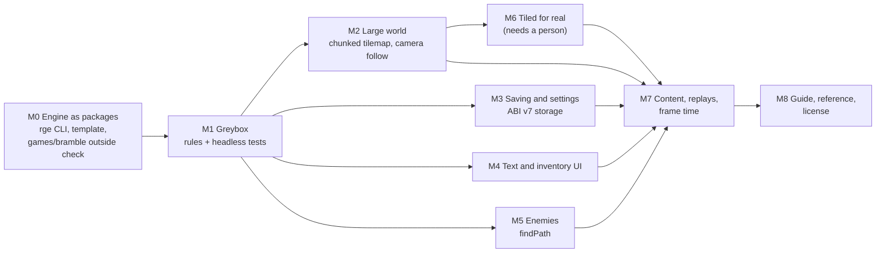

# A third game, made outside this repository: a small top-down adventure (plan)

Planned 2026-11-11; the implementation map (M0–M8) was added the same day. This is priority 8 in [NEXT_PRIORITIES.md](NEXT_PRIORITIES.md), merged with a third game: the work that makes
the engine usable outside this repository is tested by writing a game outside it, and the game is chosen to hit what Kite and
Hearth never touched.

## Why this game

Kite (`packages/kite`) and Hearth (`packages/hearth`) pull in different directions: one is about how a character moves, the other
about lists, menus and UI. But they are alike in what they leave out:

- **One screen, a few minutes, nothing kept.** Neither game scrolls a world bigger than the screen, loads or unloads anything as
  the player moves, or remembers anything between runs. Saves were excluded on purpose in both.
- **Written from the inside.** Both live in `packages/`, compile through a path into `packages/compiler/src/cli.ts`, and were
  written by people who know where each diagnostic comes from. Most of the friction found was the compiler subset.
- **Checked by tools.** Hearth has never been played in a window; Kite has been played once, and that once found an unplayable
  room that every test passed (Kite finding 12).

A small top-down adventure is the opposite shape on each of these: one world bigger than the screen, a save, NPCs that talk,
an inventory, enemies that find their way to the player, and a settings screen. Each row below is a gap the earlier games named
or left untouched.

| Gap | What exists today | Where this game hits it |
| --- | --- | --- |
| A large, scrolling world | `<Tilemap>` writes one record per filled cell with no culling; the camera has `bounds` and `slide` but no follow smoothing; a room change costs one ~25 ms step (Kite finding 10); room seams are not continuous (Kite finding 7) | One overworld map about 4 × 3 screens, scrolled continuously with the character, plus interiors entered by doors |
| Saving and loading | Nothing: no storage call in librge, the Node host or the Rust host | A save slot written at shrines and on quitting; the title offers "Continue"; settings kept apart from the save |
| Maps saved by Tiled itself | The importer reads CSV layers, finite maps and one embedded tileset; every map so far was written by a script (Kite finding 8) | The overworld is drawn in Tiled by a person: external tilesets (`.tsx`), more than one tileset, object layers for NPCs, doors, chests and spawns with custom properties |
| Deeper UI | Context not built (needs a tree three levels deep); children on list items flat only (`RGE1209`); `<Text>` does not wrap | A dialogue box with wrapped, revealed text; an inventory grid of slots that may be empty; a settings screen of nested panels, sliders and a key-capture row |
| Entities that think | `moveActorX`/`moveActorY` against tiles; colliders report overlaps but stop nothing; no pathfinding | Enemies that wander, notice the player and path to them around walls; NPCs and pushable blocks that the character cannot walk through |
| Settings and rebinding | `createControls` binds names to keys at build time; one volume per sound or music | Rebinding a control by pressing a key, music and effects volume, full screen; all kept across runs |
| Usable outside this repo | Every game is a workspace in `packages/*` | The game is made from a template, installs the engine as packed packages, and is built and played with one command line |

The rule from priorities 7 and 7b still holds: **write the game the way the guide says to, and build an engine feature only when
the game hits the gap.** When something turns out not to be needed, write that down as a finding and build nothing.

## The game

Working title **Bramble** (the name can change). Original art, sound and music, made by a `tools/make-assets.ts` the same way Kite
and Hearth make theirs. No character, place or story from an existing game.

**Premise.** A small walled valley has gone quiet. The character, a keeper's apprentice, finds three bells hidden around the
valley (in a cave, an old house and a hedge maze) and rings them at the gate to open the road out. Twenty to thirty minutes for
someone new to it. One ending.

**Screen.** 320 × 180, like Kite and Hearth; tiles of 16 px (20 × 11.25 tiles in view).

**World.**

- **The overworld:** one Tiled map, about 80 × 48 tiles (four screens across, about four down). The camera follows the character
  smoothly, with a small dead zone, and stops at the map's edge. No room-by-room slide.
- **Three interiors** (the cave, the house, the maze), each its own map of one to two screens, entered through a door object.
  Going through a door fades out and back in, and the character arrives at the door object named by the one they used.
- Grass and bushes the character walks behind (a layer drawn over the character), water and walls that block, and a few
  pushable blocks in the maze.

**The character** walks in eight directions at a fixed speed, faces where they last moved, and has one action: **talk / use /
swing**, depending on what is in front of them. They have five hearts. Losing them all returns the character to the last shrine
with full hearts; nothing else is lost.

**People.** Four NPCs, each with a few lines that change once with progress (before and after the bell nearest them). Dialogue
is data in a `.ts` file: a list of pages per NPC per state. No branching choices.

**Items.** Six: a lantern (lights the cave), a key (opens the house), shears (cut bushes that block the maze), a bell ×3 (counted).
The inventory is a grid of eight slots on the pause screen; a slot can be empty. Picking an item up shows a short card.

**Enemies.** Two kinds, both simple:

| Enemy | Does |
| --- | --- |
| Beetle | Wanders, turns at walls. One heart on contact. Two hits. |
| Wisp | Drifts until the character is within 6 tiles and in sight, then paths to them around walls; loses interest after 4 s out of sight. One heart on contact. Three hits. |

The swing knocks an enemy back. Enemies keep their place when they leave the screen, and come back when the character
returns to a map.

**Shrines.** Three, one in each part of the overworld. Touching one saves and refills the hearts.

**Screens.** Title (New game, Continue if a save exists, Settings, Quit), play, pause (inventory, Settings, Save and quit), settings
(music volume, effects volume, full screen, rebind each control by pressing a key, reset to defaults), and the end.

## How it is built

The shape both games settled on stays the same:

- **Rules are plain TypeScript** in `src/rules/`, with headless tests: moving against the map and solid actors, the camera's
  follow, doors, talking (which NPC, which page), picking items up, enemy behaviour and paths, damage and knockback, shrines
  and respawn, and what a save holds.
- **The game state holds the run** (`run: newRun()`): the map the character is on, their position and hearts, the inventory,
  each NPC's progress, which chests are open, which enemies are defeated. **What gets saved is a plain object picked from that
  state**, with a version number, so a test can save, load and compare.
- **Effect stores** answer the rules' events (sounds, particles, shake), as in both earlier games.
- **The router** has the screens; the play screen steps the world through one action.

## Implementation map

Eight milestones, each split into steps that fit one PR. Engine and game changes go in separate commits. Every engine addition
gets a design section (`DESIGN.md`, `NATIVE_PLAN.md` or `UI_PLAN.md`), tests, and an entry in the guide's reference
(`docs/reference.html`). Kite's and Hearth's parity runs stay byte-identical unless a step changes what they draw on purpose;
then that step re-baselines them in a commit of its own and says why. `npm run bench:check` stays within budget throughout.



M2 to M5 do not depend on each other and can go in any order after M1. The order below is the suggested one: the large world
first, because it is the biggest gap and changes the draw path that M6 builds on.

### M0. The engine as packages a game outside the repo can install (\~1.5 weeks)

**Two things found while planning, which set this milestone's shape:**

- Every `@rge/*` package's `exports` point at `.ts` source (`"./src/index.ts"`). That works in the workspace because the files
  are not under `node_modules`. **Node refuses to strip types from files under `node_modules`**
  (`ERR_UNSUPPORTED_NODE_MODULES_TYPE_STRIPPING`), so an installed package has to ship JavaScript and `.d.ts` files.
- `findNativeLibrary` (`packages/player-node/src/ffi.ts`) looks only in `native/build*` beside the repository root, and
  `tools/package.ts` builds librge with CMake and the Rust host with cargo from the repository. An outside game has neither.

**0.1 Packs that build.** *(Done 2026-11-11.)* `npm run pack` (`tools/pack.ts`) writes `dist/packs/rge-<name>-<version>.tgz` for `runtime`, `compiler`,
`player`, `player-node`, `native` and `cli`.

- For each package it makes a staging copy: JavaScript from esbuild (one file per source file, ESM, no bundling, so the
  module structure and `import.meta.url` stay as they are), `.d.ts` from `tsc --emitDeclarationOnly`, and a `package.json`
  whose `exports` name the built files (`{ "types": "./dist/index.d.ts", "default": "./dist/index.js" }`). Then it runs `npm pack`.
- The workspace keeps exporting source, so nothing changes for Kite, Hearth or the tests.
- `.ts` imports in the source (`./foo.ts`) are rewritten to `.js` by esbuild (`rewriteRelativeImportExtensions`, or a small
  plugin if needed).
- `@rge/compiler`'s `cli.ts` is shipped as `cli.js` with a `bin`. `dev.ts` finds the compiler through
  `import.meta.resolve("@rge/compiler")` plus `cli.ts`, which becomes "the package's `bin`".
- **Test:** `packages/cli/test/packs.test.ts` packs into a temporary folder, installs the tarballs into an empty project, and
  imports each entry point (`@rge/runtime/jsx`, `@rge/player`, `@rge/player-node`, `@rge/compiler`) under plain Node.

**0.2 `@rge/native`: librge and the host, prebuilt.** *(Done 2026-11-11: `packages/native`; `node tools/pack.ts --build` builds both flavors, desktop only if it can.)* A package with no code of its own beyond one `paths.js`:
`lib/linux-x64/{desktop,headless}/librge.so` and `bin/linux-x64/{desktop,headless}/rge-host`, built by `npm run pack` from
the CMake and cargo builds it already knows how to make. Only `linux-x64`: other platforms stay in "Not now".

- `findNativeLibrary` looks in this order: `RGE_NATIVE_LIB`, then `@rge/native` (through `import.meta.resolve`), then the
  repository's build folders. The repository order is unchanged, so `npm test` behaves as before.
- The same applies to `rge-host` (`RGE_HOST_BIN`, then `@rge/native`, then `host/target/release`).
- The ABI check at load already says clearly when the library and the player disagree.

**0.3 `@rge/cli`: one command line.** *(Done 2026-11-11: `packages/cli`; `tools/check-game.ts`, `package.ts` and `screenshot.ts` are gone, `tools/bundle.ts` is a shim over the CLI, and a packaged game now lands in the game's own `dist/<name>/`.)* A new package with bin `rge` that takes over `tools/check-game.ts`, `tools/package.ts`,
`tools/bundle.ts`, `tools/screenshot.ts` and `packages/player-node/src/play.ts`. It runs in a game's folder, or the folder
given as the first argument (`rge check packages/kite`).

- **A game's settings** live in its `package.json`'s `"rge"` field: `name`, `entry` (default `main.ts`), `src` (`src`),
  `generated` (`generated`), `scenes` and `assets` (used when the folders exist, as `check-game.ts` does now), and
  `checkAssets` (already used by the demo).
- **Commands:**

  | Command | Does | From |
  | --- | --- | --- |
  | `rge build` | Compile `src` to `generated` (with scenes and assets) | `rge-compile` |
  | `rge dev [--no-watch]` | Compile, open the window, hot reload | `play.ts`, `dev.ts` |
  | `rge check` | Compile, type-check the game's `tsconfig.json`, `node --test test/`, parity under Node twice and under `rge-host` | `check-game.ts` |
  | `rge package [--engine node\|quickjs] [--headless]` | The folder build, with librge and `rge-host` from `@rge/native` | `package.ts`, `bundle.ts` |
  | `rge screenshot <script> [--frames …]` | PNGs and a contact sheet of a scripted run | `screenshot.ts` |
  | `rge create <folder>` | A new game from the template (0.4) | new |

- `tsc`, `esbuild` and `postject` are the CLI's own dependencies, resolved from its own folder, not the repository's
  `node_modules/.bin`. The repository-wide `tsc -p tsconfig.json` that `check-game.ts` runs stays in the root's `check:*`
  scripts.
- **The root scripts become thin:** `"check:kite": "rge check packages/kite"`, `"play:kite": "rge dev packages/kite"`,
  `"package:kite": "rge package packages/kite"`. Kite and Hearth are the command line's first users, and their checks must
  print the same results as before.
- **Tests:** each command against a small fixture game in a temporary folder; `npm run check:kite` and `check:hearth` pass
  through it.

**0.4 The template and `rge create`.** *(Done 2026-11-11.)* `packages/cli/template/`:

- `package.json` (with `"rge"` and the `@rge/*` dependencies), `tsconfig.json`, `main.ts`, `game.ts` (bindings and screen),
  `src/Main.tsx` (a `<Game>`, a `<Screen>`, a `<Router>` with one route), `src/GameState.ts`, `src/rules/move.ts` with one
  test, `assets/` with one image, `parity.ts` and `.gitignore` (`generated/`, `node_modules/`, `dist/`).
- `rge create <folder> [--name] [--packs <dir>]` copies it and fills in the name. `--packs` writes `file:` dependencies on
  the tarballs, which is how everything is tested before anything is published.
- **Test:** create, install and `rge check` in a temporary folder pass; the template's own test passes.

**0.5 `games/bramble`, checked from outside.** *(Done 2026-11-11: `npm run check:outside` passes locally; the CI job `outside` is new and has not run yet.)*

- `games/bramble` is made with `rge create`. It is **not** one of the workspaces (`packages/*`), and the root's `generate`,
  `test` and `typecheck` do not include it. Its `node_modules` is ignored by git.
- `npm run bramble:install` repacks the engine and reinstalls the tarballs into `games/bramble`. This is the in-repo loop when
  the engine changes. It is slower than a workspace on purpose: it is the loop an outside author has.
- `npm run check:outside` (`tools/check-outside.ts`) packs the engine, copies `games/bramble` to a temporary folder outside the
  repository, points its dependencies at the tarballs, runs `npm install`, `rge check`, and `rge package --headless`, then runs
  the packaged build for 120 frames.
- A CI job, `outside`, runs it after the `native` job (it needs librge and `rge-host` built to pack `@rge/native`). A
  relative import into `packages/`, an export that is missing from a package, or a file left out of a pack fails there.

**Done when:** Kite and Hearth check through `rge`; `rge create` gives a game that passes `rge check` from a temporary folder;
`check:outside` passes locally and in CI on the empty Bramble.

### M1. Bramble's greybox (game; \~1 week)

*(Built 2026-11-11 in `games/bramble`: the rules, the screens, 17 tests including a replay through the game and a search that proves it can be finished, and six findings in its `DESIGN.md`. Not yet done from this list: `actor.ts`, `doors.ts`, `talk.ts`, `items.ts` and `shrines.ts` are all in `run.ts` for now; a person has not played it.)*

No engine work is planned here. Bramble is written from the guide, and every snag goes into `games/bramble/DESIGN.md`
under "Findings while writing", as Kite and Hearth did. The engine is fixed only when a finding is worth it.

- **The design note:** mechanics, the map list, the NPCs and their lines, the items, what "finished" means, and every number
  in `rules/constants.ts`, with untested guesses marked.
- **Rules** (`src/rules/`, plain TypeScript, headless tests for each):

  | File | What it holds |
  | --- | --- |
  | `world.ts` | Maps as solid grids; the overworld and interiors written as text by `tools/make-maps.ts` until M6 |
  | `actor.ts` | Eight-way movement through `moveActorX`/`moveActorY`, diagonals normalised, a sub-pixel remainder, facing |
  | `doors.ts` | Stepping on a door, and which map and door the character arrives at |
  | `talk.ts` | What is in front of the character, which NPC, which page of their lines for the current progress |
  | `items.ts` | Chests, pickups, the inventory, using an item on a tile (lantern, key, shears) |
  | `shrines.ts` | Touching a shrine: the save point and refilled hearts; dying sends the character back to it |
  | `run.ts` | `newRun()`, `step(run, input, dt)`, which returns the run and a list of `GameEvent`s, as Hearth's `stepBattle` does |

- **Components:**
  - `Main`: `<Game>`, `<Screen>`, and `<Router>` for title, play, pause and end.
  - `Play`: the world: `<Tilemap>`s, the character and NPCs as `<Shape>`s, and a camera following the character.
  - A one-line `<Text>` dialogue box as a placeholder until M4.
- **Tests:** the rules, plus one replay: the title, walking to an NPC, talking, and going through a door.
- A person plays it here if one is available.

**Done when:** the greybox can be walked, talked to and played through its doors; `rge check` passes from outside; the
findings are written down.

### M2. The large world (engine; \~1 week)

**2.1 `<Tilemap>` draws only what the view shows.** *(Done 2026-11-11, simpler than planned: the player writes only the cells of the view's rectangle, in the same order as before, and no chunk cache; a view holds a few hundred cells, so the 200 × 200 bench scene costs 0.12 ms a frame under Node and 1.8 ms under QuickJS. The walk meets a tilemap before it finds the camera, so cells are chosen with the previous frame's camera and the frame is built a second time when the camera turns out to be another one (first frame, screen change). `TileGrid.set` is not built: Bramble keeps cut bushes as the rules' data.)* Today `#tilemap` in `packages/player/src/draw.ts` writes one sprite-region
record for every filled cell ("culled to none (a map is a room, not a world)").

- **Which cells are drawn:** the player already knows the view transform and the screen size when it walks the tree. From
  them it works out the visible rectangle in the map's cells, and draws only the **chunks** (16 × 16 cells) that touch it.
- **Caching:** each chunk's records are cached as a `Float64Array`, keyed by map, layer and chunk. The records are in world
  space and the camera is a separate VIEW record, so moving the camera never invalidates a chunk; it only changes which
  chunks are written.
- **What invalidates a chunk:** a change to the tilemap's transform, opacity, map or image, and the new
  `TileGrid.set(x, y, gid, layer?)` (bushes cut by shears), which bumps a version on the chunk it touches.
- **A rotated or scaled tilemap** keeps today's path (every cell), so nothing that works now draws differently.
- **Kite's parity:** Kite's neighbouring rooms are mounted by conditions, so their off-screen cells disappear from the
  records. That is expected; the step re-baselines Kite's parity and says why.
- **Bench:** a new scene, a 200 × 200 map scrolled across, with a budget in `packages/player/bench/budget.json`.

**2.2 A camera that follows smoothly.** *(Done 2026-11-11: `deadzone` and `smoothing`, in `Camera.ts`, with tests.)* `<Camera>` already follows its children's centre.

- **New props:**
  - `deadzone={[w, h]}`: the followed point can move inside a box around the centre without moving the view.
  - `smoothing={seconds}`: the view eases towards the point, exponentially, as `slide` does.
- **How it works:** the camera keeps where its view is in `onUpdate` (stepped, so a replay repeats), and `viewTransform()`
  reads it instead of the target. The view is rounded to whole pixels at the end, as now.
- **On a door:** a `bounds` change with no `slide` snaps the view at once, so going through a door needs no new prop.
- **Tests:** runtime tests of the dead zone, smoothing and snapping; a recording test of a scroll.

**2.3 A door without a hitch.** *(Measured 2026-11-11: a door step costs 1.2 to 1.5 ms under Node on the cloud VM, so nothing to fix; see `games/bramble/DESIGN.md`.)*

- **Measure first.** Bramble's `tools/frame-time.ts` (copied from Kite's) times the step that changes map.
- **Then fix the cause:**
  - If it is the first draw of the new map's chunks, write them during the fade out (`<Tilemap>` mounted while the screen is
    dark, or a `preload` that warms the chunk cache).
  - If it is building the subtree, mount the next map one step early, as Kite finding 10 suggested.
- **Target:** no step over 16.7 ms under Node on the cloud VM, recorded in `NATIVE_PLAN.md`.

**2.4 Entities off screen, measured.** *(Not yet: there are no enemies until M5; the ones in the world now are 4 people.)* One overworld map holds about 40 enemies and NPCs. Measure the busiest view first. If
rendering the ones off screen costs too much:

- **First**, the game filters its lists by distance to the view, with a computed selector (no engine change).
- **Only if** both a filter and a second game need it, an engine way to skip a subtree outside the view.

**Done when:** the overworld scrolls continuously at full size, the bench scene is in budget, and the door's step time is
recorded.

### M3. Saving and settings (engine; one native batch, ABI v7; \~1 week)

**3.1 Storage in librge.** New in `native/include/rge.h`:

```c
/* Saved data: small named entries in the platform's user data folder, each written whole and atomically. Needs no window. */
int32_t rge_storage_open(const char *game_id);  /* 0 ok; makes the folder if missing. Before any other storage call. */
int32_t rge_storage_read(const char *name, uint8_t *out, int32_t capacity); /* bytes the entry holds, -1 if there is none; copies only when it fits */
int32_t rge_storage_write(const char *name, const uint8_t *data, int32_t length); /* 0 ok */
int32_t rge_storage_remove(const char *name);   /* 0 ok, also when it did not exist */
```

- **The folder:** `$RGE_DATA_DIR` if set (tests and CI), else `$XDG_DATA_HOME/<game_id>`, else
  `~/.local/share/<game_id>`. The macOS and Windows folders are written but unverified, like `host/build.rs`'s link lists.
- **Names:** `[A-Za-z0-9_-]{1,64}`, stored as `<name>.dat`. Anything else is refused, so a name can never become a path.
- **Writing:** to `<name>.tmp`, flushed and `fsync`ed, then `rename`d over the old file. A crash leaves the old save or
  the new one, never half of one.
- **Reading:** the two-call pattern `rge_read_pixels` already uses (ask for the size, then copy).
- **Tests:** a C test in `native/test` for write, read, overwrite, remove, a missing entry, a bad name, and `RGE_DATA_DIR`.

**Both hosts:**

- `protocol.ts` mirrors the header, and the header test checks it.
- `ffi.ts` (`Native`) and `player-node/src/backend.ts` add the calls; `host/src/ffi.rs` and `backend.rs` add the same four.
- `Backend` gains an optional `storage?: { read(name): string | null; write(name, text): boolean; remove(name): void }`
  (UTF-8 text), opened with the game's `id`.
- `RecordingBackend` gets an in-memory store, with an option to start from given entries, so a replay can start from a save.

**3.2 Runtime: `createSave` and `createSettings`,** effect-store style in `packages/runtime/src/storage.ts`, with a
`setStorage` sink installed by the player as `setSoundSink` is.

```ts
export const save = createSave({
  name: "save",
  version: 2,
  pick: (s: State) => ({ map: s.run.map, at: s.run.shrine, items: s.run.items, npcs: s.run.npcs, opened: s.run.opened }),
  apply: (data) => useGame.getState().continueFrom(data),
  migrate: { 1: (old) => ({ ...old, opened: [] }) },
});
save.write(); save.exists(); save.load(); save.remove();

export const settings = createSettings({ name: "settings", defaults: { music: 0.6, effects: 0.8, fullscreen: false, bindings: null } });
settings.get(); settings.set({ music: 0.4 });
```

- **What is stored:** JSON with `{ version, data }`.
- **Reading problems:**
  - A file that does not parse warns once and reads as no save.
  - A save from a newer version than the game is refused with a clear message.
  - `migrate` steps run in order up to the current version.
- **Calls are synchronous:** the entries are small and the native calls are blocking. They are made from game-state
  actions, like `sfx.play`.
- **Game id:** `<Game id="bramble">` names the folder (a new `<Game>` prop, a literal).
- **Applying settings:** they are read before the first frame. Full screen goes through `setFullscreen`; volumes and
  bindings are applied at once.
- **Tests:** runtime tests on the memory store (round trip, migrate, corrupt, too new); a player test through
  `RecordingBackend`; a Node host test against the real library with a temporary `RGE_DATA_DIR`; a parity line under the
  Rust host that writes and reads an entry.

**3.3 Rebinding.**

- **`Controls`:**
  - It gains `bind(action, keys)`, `reset()`, `toJSON()` and `load(data)`. Its `bindings` are read every time an action is
    asked about (`actionAware`), so a change applies at once.
  - `load` checks each key is a `KeyName` and ignores unknown actions, so an old settings file cannot break the controls.
  - The settings screen keeps its labels in the game state, so a rebind re-renders them.
- **`InputState`** gains `lastPressed(): KeyName | undefined`, the first key or button pressed this step, for "press a key
  for Jump". The player and `createInputState` both fill it.
- **Input scripts:** they keep working with rebinding, because the harness and the script map their names through the
  bindings.

**3.4 Volume groups.**

- `setVolume("music" | "effects", v)` in `packages/runtime/src/Sound.ts`, multiplied in on top of each sound's own volume.
- **Effects:** `SoundStore.play` and `Sound.play` multiply by the effects volume.
- **Music:** `<Music>` multiplies by the music volume in the same place it applies its fade, so a change is heard at once.
- **Tests:** the counts and volumes the mock sink records.

**Done when:** a save survives quitting under both hosts; the settings screen's choices persist; a rebinding is used by
`input.pressed`; ABI v7 is in `NATIVE_PLAN.md`.

### M4. Text and inventory UI (engine where hit; \~4–6 days)

**4.1 Wrapped text.**

- **New props:** `<Text maxWidth={n} lineGap={px}>`. The player breaks the text into lines:
  - It breaks at spaces, and inside a word only when the word alone is too wide.
  - `\n` always breaks.
  - Words are measured with the measure cache it already has (`measureText`, or the bitmap font's cell widths).
- **Drawing:** each line is its own TEXT record (or its own run of sprite regions for a bitmap font), so `rge.h` does not
  change.
- **Layout:** `<Flex>` measures the wrapped size (the widest line by the line count). `align` applies per line.
- **Caching:** line breaks are cached by text, size, font and `maxWidth`.
- **Tests:** recording tests for both kinds of font, a `<Flex>` column holding a wrapped text, and a word longer than
  `maxWidth`.

**4.2 Revealed text.** `<Text reveal={n}>` draws the first `n` characters but lays out the whole text, so the box neither grows
nor rewraps as the text appears. The game's rules count `n`; the engine has no timer for it.

**4.3 Tier 3, as hit.** Each is built only when Bramble hits it, one commit each, with compiler tests and a DESIGN.md
section; otherwise recorded as not needed:

- **The inventory grid:** slots that may be empty, `{item && <Icon/>}` inside a list item's children. Today that is `RGE1209`.
- **Context:** if the settings screen passes the same props three levels down.

**4.4 A slider.** A component in the game first (a focusable `<Flex>` whose left and right keys call an action). It becomes
a built-in only if it is awkward, and the outcome is recorded either way.

**Done when:** the dialogue box shows wrapped, revealed pages; the inventory and settings screens work with keyboard, gamepad
and mouse.

### M5. Enemies (engine and game; \~4 days)

**5.1 `findPath` and `lineOfSight`** in `packages/runtime/src/path.ts`, exported from `@rge/runtime`:

```ts
findPath(grid: TileGrid, from: Cell, to: Cell, options?: { diagonal?: boolean; maxNodes?: number; blocked?: (x: number, y: number) => boolean }): Cell[] | null
lineOfSight(grid: TileGrid, from: Point, to: Point): boolean
```

- **`findPath`:** A* with a binary heap. Ties break by a fixed order, so the same search always returns the same path, under
  V8 and QuickJS alike, and a parity run stays identical. Diagonals never cut a solid corner. `maxNodes` bounds a search that
  cannot finish.
- **Tests:** shortest paths, no path, corners, determinism, and a bench scene (100 searches on an 80 × 48 map) with a QuickJS
  budget.

**5.2 The game's enemies** (rules):

- **Beetle:** wanders and turns at walls.
- **Wisp:** notices the character within range and in sight (`lineOfSight`), paths to them, finds a new path every 0.5 s
  (not every step), and gives up 4 s after losing sight.
- **Combat:** the swing knocks an enemy back; contact damages the character, who then gets a moment of invulnerability.
- **Actors block each other:** the `blocked` function passed to `moveActorX`/`moveActorY` checks tiles, then other actors'
  boxes. It moves into `@rge/runtime` only if it turns out to be the same code twice.

**Done when:** both enemies work on the overworld, a replay shows a wisp chasing around a wall, and the bench is in budget.

### M6. Maps saved by Tiled (engine and a person; \~4 days plus the person's time)

**6.1 The importer** (`packages/compiler/src/scenes/tilemap.ts`):

- **Layer data:** base64 layers, uncompressed, zlib and gzip (`node:zlib`). zstd stays a diagnostic.
- **External tilesets:** `.tsj` (JSON), and `.tsx` (XML) through a small reader in `scenes/tsx.ts` that knows only Tiled's
  tileset elements: `tileset`, `image`, `tile`, `properties`, `property`.
- **More than one tileset:**
  - `TilemapData` gains `tilesets: { firstGid, image, columns, tileWidth, tileHeight, solid }[]`.
  - Each cell names its tileset.
  - `<Tilemap image>` becomes optional: without it the images come from the map, relative to the assets folder.
  - `#tilemap` picks the sheet per cell. With `image` given, Kite and Hearth draw as before.
- **Tests:** a fixture map for each case.

**6.2 Objects as data for the rules.**

- **Generated data:** `generated/tilemaps.ts` also exports each map's objects:
  `{ id, name, type, x, y, width, height, properties }`, with properties as `string | number | boolean`.
- **The game** reads its doors, NPCs, chests, spawns and shrines from them through one validating function, with a test
  that every map passes it. Its text maps and `make-maps.ts` markers go away.
- **The scene importer** (`importTiled`) stays as it is for prefab scenes.

**6.3 The person's step.**

1. Someone opens the overworld in Tiled (a recent 1.x), draws or re-saves it, and commits the file.
2. The importer is fixed for whatever that file holds.
3. The file becomes a test fixture.

This is the one step an agent cannot do. Until it happens, M7 can go ahead on the tool-written maps.

**Done when:** at least one map saved by Tiled imports without changes by hand, and Kite finding 8's row in "Not now" is
updated.

### M7. Content, replays and frame time (game; \~1 week)

- **Art, sound and music** from `tools/make-assets.ts`: tiles, the character's eight-way walk and swing, the NPCs, both
  enemies, the bells, the UI frame, a pixel font with lower case if the dialogue needs it, overworld and cave music, and
  sound effects.
- **Feel:** particles, shake and fades through the effect stores, as in Kite and Hearth.
- **Replays** (`test/replays.ts`):
  - One plays from the title to the end.
  - One saves at a shrine, quits, starts again from that save with `RecordingBackend` storage, continues and finishes.
  - One loses all hearts and returns to the shrine.
- **Frame time:** `tools/frame-time.ts` on the busiest view and on each door, under Node and QuickJS, recorded in
  `NATIVE_PLAN.md`.
- **Findings:** the "Findings from the third game" section of `NEXT_PRIORITIES.md`, including which of Kite's and Hearth's
  findings held a third time.

### M8. The guide, the reference and the license (\~4 days)

- **A getting-started page** (`docs/start.html`, linked first from `docs/index.html`), written by doing it: an empty folder,
  `rge create`, a moving square, a sprite, a sound, a second screen, a test, `rge check`, `rge package`. Then it is followed
  again from scratch by someone (or an agent) who did not write it.
- **A reference entry for every built-in and hook,** each with an example. A test lists the runtime manifest's built-ins and
  hooks and fails when `docs/reference.html` lacks one, so it cannot fall behind.
- **The license** is your choice. Then a pass over the repository for anything that should not be public: secrets, large
  files, private names.

### Risks

| Risk | What happens then |
| --- | --- |
| TypeScript 7.1 beta's declaration output is incomplete for some file | Hand-write that `.d.ts` or adjust the source; the packs test catches it |
| Packing slows the loop when the engine and the game change together | Engine changes land with their own tests in `packages/` first, then `bramble:install`; the slower loop is what an outside author has, so it is worth feeling |
| Culling and chunks change Kite's records | Expected; Kite's parity is re-baselined once, in its own commit |
| Nobody is available to save a map in Tiled | M6.3 waits; nothing else does |
| Synchronous storage hitches on a slow disk | The entries are a few KB; measure the write in the frame-time tool, and move it after the frame only if it shows |
| Storage on macOS and Windows | Written but unverified, as the rest of those platforms are |

## Done when

- [ ] `rge create`, `rge dev`, `rge check`, `rge build` and `rge package` work for a game in a folder outside this repository,
      installed from packed packages, and Kite and Hearth use the same command line
- [ ] Bramble is playable from the title to the end by keyboard or gamepad, under Node and as a packaged build, with music and
      sound; a scripted replay plays it through, and another saves, quits, continues and finishes
- [ ] A save survives quitting and is read by "Continue"; a save from an older version is migrated by a test; settings
      (volumes, full screen, bindings) are kept
- [ ] The overworld scrolls continuously; the frame time on its busiest view and on a door is recorded in `NATIVE_PLAN.md`,
      and a door causes no step over 16.7 ms under Node
- [ ] At least one map was saved by Tiled itself and is imported without changes by hand
- [ ] Each engine addition has its design notes, tests, and a guide entry; the parity test passes; `npm run bench:check` stays
      within budget
- [ ] The getting-started guide takes a new reader from an empty folder to a packaged game, checked by following it
- [ ] A license is chosen
- [ ] A "Findings from the third game" section is added to `NEXT_PRIORITIES.md`, including which of Kite's and Hearth's findings
      held a third time
- [ ] A person has played it in a window (priority 6), and what they found is filed or fixed

## Open decisions

1. ~~**Where storage lives.**~~ Decided 2026-11-11: **one implementation, in librge**, shared by both hosts, until a web build is
   decided on. The player's `Storage` interface is where a second one (`localStorage`) would go then.
2. ~~**Whether the game is in this repository.**~~ Decided 2026-11-11: **yes**, in `games/bramble` outside the workspaces, checked
   from a copy in a temporary folder.
3. **Combat at all.** Proposed: the one swing and two enemies above, because enemies are what tests pathfinding and actors
   blocking each other. Dropping it keeps the game smaller and leaves `findPath` unasked for.
4. **Package names and a scope** for the packed packages (`@rge/…` today). Only matters once anything is published; decide with
   the license.
