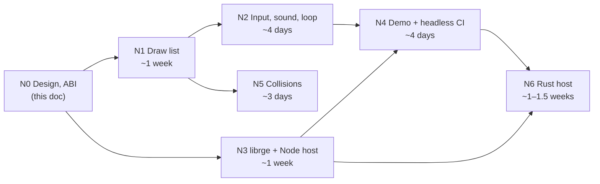

# Phase 3 plan: the native player

Snapshot of the plan as of 2026-11-09. Phase 2 built the compiler and a mock runtime: generated components run, render and handle input, but nothing draws. Phase 3 puts a compiled game in a native window: it draws, plays sound, reads the keyboard and mouse, and ships as a native executable without Node. This document is both the design note the Phase 2 ground rules ask for (it changes the "runtime stays a mock" rule, see [Ground rules](#ground-rules)) and the milestone plan. Progress is tracked in [Status](#status) and the [Handoff checklist](#handoff-checklist). Phase 3 is complete; the next priorities are in [NEXT_PRIORITIES.md](NEXT_PRIORITIES.md).

Read first: [DESIGN.md](DESIGN.md) sections "Transforms and refs", "Camera", "Pointer", "`<AnimatedSprite>`" and "useSound". They define what the player must draw and dispatch. This plan does not change any of them.

## Status

Last updated 2026-11-09. **Update this table and the milestone's checklist in the same PR as the work.** A milestone moves Not started → In review (PR open) → Done (PR merged); the PR number goes in the third column.

| Milestone | Status | Branch / PR | Notes |
| --- | --- | --- | --- |
| N0 Design and protocol | Done | #25 | This document |
| N1 Draw list (`@rge/player`, pure TS) | Done | #26 | `FrameBuilder` + `walkTree` in `draw.ts`; `native/include/rge.h` is committed here (complete, including the full key table); goldens are JSON files in `test/golden/` (`UPDATE_GOLDEN=1` rewrites them, numbers rounded to 1e-9) rather than `node:test` snapshots, which are still experimental |
| N2 Input, sound and the frame loop (pure TS) | Done | #27 | Also added: `PlayerConfig.warn` (where warnings go; tests use it), `getSoundSink()` (so a closing player removes only its own sink), `PlayerInput` (the `InputState` with `worldPoint`, `screenX/Y`, `dt`, `quit`), `RecordingBackend`'s `missingSounds`. The press is dispatched only for a *new* left press and only to pointers drawn in the previous frame |
| N3 `librge` (C + raylib) and the Node dev host | Done | #28 | First pixels. Built and tested in the cloud container on both raylib platforms: `Memory` (software renderer, no system libraries; the CI `native` job) and `Desktop` (GLFW + Mesa under Xvfb; the `native-desktop` job). Still needs a person at a real display: how the window feels, real keyboard and mouse input, and audio (a hidden window has no audio device, so sounds are loaded but silent) |
| N4 Demo game and headless CI | Done | #29 | The headless C smoke test and the Node-host tests already ran in CI from N3; N4 adds the demo and runs it in those jobs: scripted-input tests through `RecordingBackend` (movement, camera, clicks, sound, the missing frame) and a 60-frame pixel check through the real library. Replaces N3's hello stand-in. Not yet seen by a person in a real window |
| N5 Collisions (pure TS) | Done | #30 | `CollisionTracker` in `collide.ts`, called once per frame by the player. Added a rule the plan did not have: colliders with the same parent never collide with each other (a hitbox and a shield must not hit each other, and handler code cannot read `other` to filter it out). Measured cost is in the doc comment |
| N6 Rust host with QuickJS-ng | Done | #31 | The shipping executable. Built and tested in the cloud container: the demo runs under QuickJS-ng with output byte-identical to Node over 60 scripted frames; the packaged folder runs from another directory. Differences from the plan: `--root <dir>` instead of `--assets <dir>` (the game's relative paths resolve against it); with no arguments the host runs `game.js` next to the executable. Measuring found that all-pairs collisions were ~45x slower under QuickJS (465 ms a frame for 2,000 colliders), so N5's tracker now sweeps over x (38 ms). Not yet seen by a person in a real window |

## Goals

1. **A compiled game runs in a native window.** Every built-in that draws (`Sprite`, `AnimatedSprite`, `Shape`, `Text`) appears where `worldTransform()` says, seen through the active `Camera`. `useInput` gets real keys and the pointer, `<Pointer onPress>` receives clicks, and `useSound` plays audio.
2. **It ships without Node.** A small Rust executable embeds a JavaScript engine (QuickJS-ng) and runs the same generated code: a folder with `game.exe`, `game.js` and `assets/`.
3. **One body of game code, three places it runs.** The generated TypeScript runs unchanged in the Node tests (mock), the Node dev player and the shipped executable. Nothing in the compiler changes for this phase.
4. **Testable without a GPU.** Almost all player logic is pure TypeScript and is tested against a recording backend. Native drawing gets a headless smoke test in CI.
5. **Pieces that can be swapped.** Drawing code lives in exactly one place (`librge`, in C). The boundary between JavaScript and native is a handful of functions, so a host (Node, Rust, or later a browser) is a thin adapter.

### Non-goals for this phase

- Compiling the IR to C, Go or Rust. That was considered and deferred: it needs a ported runtime, JavaScript's handler semantics, and resolved types (see [Decisions](#decisions-settled)). Revisit only if profiling shows script time dominates a frame.
- Physics beyond "these two boxes started touching" (N5). No rigid bodies, no resolution.
- 3D, shaders, post-processing, custom fonts (the default font only), z-index, a screen-space HUD layer, gamepads, hot reload, mobile, consoles, web. All are listed under [Later](#later-not-scheduled), and each slots into the design without reworking it.

## Architecture

```
            game source (.tsx)  ──rge-compile──▶  generated .ts  (unchanged from Phase 2)
                                                      │ imports
                                                      ▼
  @rge/runtime   GameObject, World, built-ins (mock; no drawing). New in N2: a sound sink hook.
                                                      ▲ reads the tree
  @rge/player    pure TypeScript, no Node APIs, no native deps
                 • draw.ts     walk the tree → one Float64Array of draw commands
                 • input.ts    native input buffers → InputState; pointer presses → World.reportPress
                 • collide.ts  collider overlaps → World.reportCollision (N5)
                 • loop.ts     createPlayer / run: the frame loop
                 • Backend     the interface every host implements
                 • RecordingBackend   records frames for tests
                                                      │ Backend interface
                    ┌─────────────────────────────────┼──────────────────────────────┐
                    ▼                                 ▼                              ▼
  @rge/player-node (dev)               host/ (Rust, ships)                  (later) a canvas
  koffi → librge.so/.dylib/.dll        rquickjs + librge linked statically   backend for the web
                    └─────────────────────────────────┬──────────────────────────────┘
                                                      ▼
  native/librge  C, the only drawing code. Wraps raylib 6.0: window, textures, text, sounds, input.
                 ABI: native/include/rge.h (about ten functions)
```

**Why this split.** The tree walk, colour parsing, camera maths, pointer hit testing and collision detection are where the bugs will be, so they live in TypeScript, where the existing test setup runs them without a window. The native side is deliberately boring: it executes a list of draw records and reports input. Because the boundary is one call per frame with plain arrays, it costs the same in every host, and each host's adapter is about 100 lines.

### The frame

`createPlayer` in `loop.ts` owns the loop. Each iteration of `step()`:

1. **Presses.** If `MouseLeft` was pressed, turn the mouse position into a world point (through the inverse of the view drawn last frame, which is what the player clicked on), test the pointers collected last frame from topmost (last drawn) to bottommost, and call `world.reportPress` on the first hit only.
2. **Tick.** `world.tick(dt, input)`, with `dt` clamped to `[0, 0.1]` seconds so a stall (a breakpoint, a dragged window) does not teleport things. Renders and structure commit inside the tick, as today.
3. **Walk.** One depth-first walk from `world.root` composes world transforms top-down. It emits draw records, finds the active camera, and collects pointers and colliders.
4. **Collisions (N5).** Compare collider boxes, call `world.reportCollision` for pairs that started touching. Their setters render in the next tick, as `reportCollision` already documents.
5. **Present.** `backend.frame(...)` draws the records, swaps buffers (blocking on vsync), polls devices and writes the next frame's input into the shared buffers.

`run()` is `open`, then `step()` until the window asks to close, then `close`. It is a plain blocking `while` loop, which is fine in both QuickJS and Node: game code is synchronous (the compiler has no `await`), and timers and promises are not part of the authoring model.

## Decisions (settled)

| Decision | Choice | Why |
| --- | --- | --- |
| Graphics library | **raylib 6.0** (released 2026-04-23), pinned to the `6.0` tag | Each built-in maps to one or two raylib calls. It is one C library with no extra libraries for images, fonts or audio. 6.0 adds a CPU-only software renderer, which makes headless CI possible. raylib can itself run on SDL as its platform layer, so moving to SDL later does not change our code |
| Not SDL3 (3.4) | Rejected for now | Better platform reach (consoles, gamepads, the GPU API), but we would add SDL_image, SDL_ttf and SDL_mixer and write our own batching for the same feature set. Revisit if consoles or custom shaders become goals |
| Where drawing code lives | **C, in `native/librge`**, once | raylib's documentation and examples are in C. Both hosts link the same library: Node loads it as a shared library, the Rust host links it statically |
| Native boundary | **One call per frame**: a `Float64Array` of fixed-size records, plus strings | Per-call FFI cost does not grow with the number of sprites, and a new host is a small adapter. `Float64Array`, not `Float32Array`: a packed `0xRRGGBBAA` colour and every handle fit exactly, and JavaScript numbers go in unchanged |
| Dev host | **Node + koffi** (`@rge/player-node`) | The repo targets Node ≥ 22.18, and koffi works there with prebuilt binaries. `node:ffi` is still experimental (added in 26.1 behind a flag, and its signature syntax changed between minor versions). The koffi calls stay in one file, so moving to `node:ffi` later is a small change |
| Shipping host | **Rust + rquickjs (QuickJS-ng)** in `host/` | A small binary with Cargo's cross-platform build. QuickJS-ng is an interpreter: no JIT, so it can go where JIT is banned (iOS, consoles), and it supports the ES2022 features the generated code uses (classes, `#private` fields, `??`, `?.`). Rust only hosts the engine; it does not draw |
| Bundling for the Rust host | **esbuild** to one ESM file (`--bundle --format=esm --platform=neutral --target=es2022`) | It resolves workspace packages and `.ts` imports. The Rust host loads one file, so it needs no module resolver |
| Draw order | **Tree order, depth first**: parent before children, children in `children` order (source order, by `(slot, order)`). Later draws are on top | It matches how JSX reads, and keyed lists already keep their order. A `z` prop is "Later" |
| Origin of a drawn element | **Top-left**, as `Sprite`, `Shape` and `Pointer` already document. Rotation and scale are about the origin. `Collider` follows the same rule (N5 writes this into its doc comment) | Consistency with the existing docs |
| Active camera | **The first `Camera` in draw order.** More than one: warn once, use the first. None: identity view, world origin at the window's **top-left** | With a camera, the followed point is centred, as `Camera` documents. Without one, top-left is what people expect from a 2D API |
| `input.pointerX/Y` | **World space**, through the active camera | Components only know world space and cannot reach a camera to convert. A screen-space reading can come later as `input.screenX/Y` |
| Coordinates | Logical pixels. raylib's high-DPI flag is off in v1 | Simplest. High DPI is "Later" |
| Key names | Keep the current style: `"A"`–`"Z"`, `"0"`–`"9"`, `"Space"`, `"Enter"`, `"Escape"`, `"Tab"`, `"Backspace"`, `"Shift"`, `"Control"`, `"Alt"`, `"ArrowUp"`, `"ArrowDown"`, `"ArrowLeft"`, `"ArrowRight"`, `"F1"`–`"F12"`, and mouse buttons as keys: `"MouseLeft"`, `"MouseRight"`, `"MouseMiddle"` | The examples already use `"Space"` and `"A"`. Mouse buttons as keys mean `input.pressed("MouseLeft")` works with no new API. The table is in `rge.h` (see [The ABI](#the-abi-nativeincludergeh)) |
| Asset paths | Relative to the player's `assets` option (default `"assets"`), joined with `/` in TypeScript (no `node:path`) | `@rge/player` must also run in QuickJS |
| Missing asset or bad colour | Never throw. Warn once per value, draw a 16×16 magenta rect for a missing texture, use magenta for an unparsable colour | A typo should not stop a game during development, and magenta is easy to spot |
| Sound playback | The runtime gets a sound sink (N2). `Sound` calls `sink.load(path)` when constructed (so sounds preload as components mount) and `sink.play(path)` from `play()`, after counting the play | `Sound` instances are fields on components and not reachable from the tree, so the player cannot find them. One module-level hook is the smallest change |

## Ground rules

The compiler's rules ([DESIGN.md](DESIGN.md#ground-rules-and-settled-decisions)) still apply. Two change, and three are added:

- **Changed: "Runtime stays a mock" → "Runtime stays backend-free."** `@rge/runtime` never draws, plays or polls anything. It gains only hooks a backend plugs into (the sound sink). Drawing, input and audio live in `@rge/player` and the hosts. The mock tests keep passing unchanged.
- **Changed: TypeScript-only.** `native/` (C) and `host/` (Rust) are new languages in the repo. Keep them small; logic goes in TypeScript unless it needs the GPU, the OS or audio.
- **New: `@rge/player` and `@rge/runtime` import no `node:` modules and no native packages.** They run in QuickJS. A test enforces this (N1).
- **New: `rge.h` is the single source of truth for the protocol.** `packages/player/src/protocol.ts` mirrors it, and a test parses `rge.h` and fails if any constant or key name differs (N1). Change the header first.
- **New: the C side does no maths beyond applying the transform it is given and drawing the shape a record describes.** Anything else a record needs (a world position, a view, a colour) is computed in TypeScript.

## The ABI: `native/include/rge.h`

This is the contract every milestone builds on. It is written out here in full so N1 (TypeScript) and N3 (C) can be built in parallel against it. Changing it is fine, but change it here and in the header together, and bump `RGE_ABI_VERSION`.

```c
#ifndef RGE_H
#define RGE_H
#include <stdint.h>

#define RGE_ABI_VERSION 1

/* ---------- Draw records ----------
 * A frame is a flat array of doubles: records back to back, each starting with its op.
 * Every drawable record then has a common header: x, y, rotation (radians), scaleX, scaleY
 * (the element's resolved world transform), followed by its payload.
 * The C side draws each drawable at the local origin under translate(x, y), rotate, scale(sx, sy).
 * Colours are packed 0xRRGGBBAA stored in a double (exact).
 */
#define RGE_OP_VIEW     1  /* op, a, b, c, d, e, f: world → screen affine, already including
                              the viewport-centre offset. Always the first record of a frame.   len 7 */
#define RGE_OP_SPRITE   2  /* op, x, y, rot, sx, sy, texture                                    len 7 */
#define RGE_OP_RECT     3  /* op, x, y, rot, sx, sy, width, height, color                       len 9 */
#define RGE_OP_ELLIPSE  4  /* op, x, y, rot, sx, sy, width, height, color (fills the w×h box)   len 9 */
#define RGE_OP_TEXT     5  /* op, x, y, rot, sx, sy, textIndex, size, color                     len 9 */

#define RGE_OP_VIEW_LEN    7
#define RGE_OP_SPRITE_LEN  7
#define RGE_OP_RECT_LEN    9
#define RGE_OP_ELLIPSE_LEN 9
#define RGE_OP_TEXT_LEN    9

/* ---------- Input, written by rge_frame ---------- */
#define RGE_IN_DT       0  /* seconds since the previous frame */
#define RGE_IN_WIDTH    1  /* window size in logical pixels */
#define RGE_IN_HEIGHT   2
#define RGE_IN_MOUSE_X  3  /* window coordinates, origin top-left */
#define RGE_IN_MOUSE_Y  4
#define RGE_IN_WHEEL    5
#define RGE_IN_QUIT     6  /* 1 when the window was asked to close */
#define RGE_IN_LEN      7

/* Per-key flags in the keys buffer (one byte per entry of RGE_KEYS, in order). */
#define RGE_KEY_DOWN     1
#define RGE_KEY_PRESSED  2
#define RGE_KEY_RELEASED 4

/* The key table: X(kind, raylib code, name). kind K = keyboard, M = mouse button.
 * The order here is the order of the keys buffer. Append only. */
#define RGE_KEYS(X) \
  X(K, KEY_SPACE, "Space") X(K, KEY_ENTER, "Enter") X(K, KEY_ESCAPE, "Escape") \
  X(K, KEY_TAB, "Tab") X(K, KEY_BACKSPACE, "Backspace") \
  X(K, KEY_LEFT_SHIFT, "Shift") X(K, KEY_LEFT_CONTROL, "Control") X(K, KEY_LEFT_ALT, "Alt") \
  X(K, KEY_UP, "ArrowUp") X(K, KEY_DOWN, "ArrowDown") X(K, KEY_LEFT, "ArrowLeft") X(K, KEY_RIGHT, "ArrowRight") \
  X(K, KEY_A, "A") /* … through KEY_Z, "Z" */ \
  X(K, KEY_ZERO, "0") /* … through KEY_NINE, "9" */ \
  X(K, KEY_F1, "F1") /* … through KEY_F12, "F12" */ \
  X(M, MOUSE_BUTTON_LEFT, "MouseLeft") X(M, MOUSE_BUTTON_RIGHT, "MouseRight") X(M, MOUSE_BUTTON_MIDDLE, "MouseMiddle")
/* N3 writes the table out in full; no "…" in the real header. Shift/Control/Alt read left OR right. */

/* ---------- Window options for rge_open ---------- */
#define RGE_OPEN_RESIZABLE 1
#define RGE_OPEN_VSYNC     2
#define RGE_OPEN_HIDDEN    4  /* no visible window: tests and CI */
#define RGE_OPEN_SMOOTH    8  /* bilinear texture filtering; default is nearest (pixel art) */

/* ---------- Functions ---------- */
int32_t rge_abi_version(void);
int32_t rge_key_count(void);
int32_t rge_open(int32_t width, int32_t height, const char *title, uint32_t options); /* 0 ok, nonzero error */
void    rge_close(void);

int32_t rge_load_texture(const char *path); /* handle >= 0, or -1 if it could not be loaded */
int32_t rge_load_sound(const char *path);   /* handle >= 0, or -1 */
void    rge_play_sound(int32_t handle);     /* ignores -1 */

/* Draw one frame and present it, then poll devices and fill `input` (RGE_IN_LEN doubles) and
 * `keys` (rge_key_count() bytes). `text` holds `textCount` NUL-terminated UTF-8 strings back to back;
 * `textOffsets[i]` is the byte offset of string i, which RGE_OP_TEXT's textIndex refers to. */
void rge_frame(uint32_t clearColor,
               const double *records, int32_t recordsLength,
               const char *text, const int32_t *textOffsets, int32_t textCount,
               double *input, uint8_t *keys);

/* Tests only: copy the last presented frame as RGBA8, top row first. Returns the bytes needed;
 * copies only when capacity is enough. */
int32_t rge_read_pixels(uint8_t *rgba, int32_t capacity);

#endif
```

Notes for the C implementer (N3):

- **Transforms.** For each drawable: `rlPushMatrix(); rlTranslatef(x, y, 0); rlRotatef(rot * RAD2DEG, 0, 0, 1); rlScalef(sx, sy, 1);`, draw at the origin, then `rlPopMatrix()`. rlgl applies the matrix to vertices on the CPU while batching, so this does not break batching. For `RGE_OP_VIEW`, push once and multiply by the affine as a column-major 4×4: `{ a, b, 0, 0,  c, d, 0, 0,  0, 0, 1, 0,  e, f, 0, 1 }`. Pop it at the end of the frame. Check the layout with a test: a view with `e = 10` must move a rect 10 pixels right.
- **Disable backface culling** (`rlDisableBackfaceCulling()`) after opening. A negative scale (a flipped sprite) reverses the triangles' winding, and raylib culls back faces by default, so flipped sprites would vanish. N3 has a test for a flipped sprite.
- **Per op:** `SPRITE` → `DrawTexture(tex, 0, 0, WHITE)`. `RECT` → `DrawRectangle(0, 0, w, h, c)` (use the float variant). `ELLIPSE` → `DrawEllipse(w/2, h/2, w/2, h/2, c)` (the record describes the box; filling it is the C side's job). `TEXT` → `DrawTextEx(GetFontDefault(), str, (Vector2){0, 0}, size, size / 10.0f, c)`, the spacing `DrawText` uses.
- **Opening:** `SetConfigFlags` from the options, `InitWindow`, `InitAudioDevice`, `SetExitKey(KEY_NULL)` (Escape must reach the game, not close the window), `SetTraceLogLevel(LOG_WARNING)`. When `RGE_OPEN_VSYNC` is off, `SetTargetFPS(60)`.
- **In `rge_frame`:** `BeginDrawing`, `ClearBackground`, the records, `EndDrawing` (raylib swaps and polls input here), then fill `input` from `GetFrameTime`, `GetScreenWidth/Height`, `GetMousePosition`, `GetMouseWheelMove` and `WindowShouldClose`, and fill `keys` from `IsKeyDown/Pressed/Released` and `IsMouseButtonDown/Pressed/Released`. `"Shift"` is down when either shift is (the same for Control and Alt).
- **Handles** index into growable arrays of `Texture2D` and `Sound`. Unload everything in `rge_close`. TypeScript caches by path, so C never sees a path twice.
- **An unknown op or a short buffer**: log once at `LOG_ERROR` and stop drawing that frame. Never read past `recordsLength`.
- **Hidden windows** (`RGE_OPEN_HIDDEN`) have no audio device (so no ALSA noise on machines without a sound card; sounds still load and are silent) and keep each frame for `rge_read_pixels`.
- **raylib 6.0's software renderer reads the framebuffer back top row first and as BGRA**, whatever format is requested, and `LoadImageFromScreen` flips it again. `capture_frame` reads it raw and swaps red and blue under `GRAPHICS_API_OPENGL_SOFTWARE`, and uses `LoadImageFromScreen` on OpenGL. The smoke test checks both orientations and channels.

## Pieces and interfaces

### `packages/player` (`@rge/player`, TypeScript)

```
packages/player/
  src/protocol.ts    constants mirroring rge.h: ops, record lengths, input indices, key flags, KEYS (names, in order)
  src/backend.ts     Backend interface, WindowConfig
  src/color.ts       CSS colour string → packed 0xRRGGBBAA (cached)
  src/draw.ts        DrawList (a growable Float64Array plus a text array) and the tree walk
  src/input.ts       buffers → InputState; screen ↔ world; press dispatch
  src/collide.ts     (N5)
  src/loop.ts        createPlayer, run
  src/recording.ts   RecordingBackend
  src/host.ts        hostBackend(): the backend a host installed on globalThis
  src/index.ts
  test/
```

**Backend.** Every host implements this; `RecordingBackend` is the test one.

```ts
export interface WindowConfig {
  readonly width: number;
  readonly height: number;
  readonly title: string;
  readonly resizable?: boolean;   // default true
  readonly vsync?: boolean;       // default true
  readonly hidden?: boolean;      // default false
  readonly smooth?: boolean;      // default false (pixel art)
}

export interface Backend {
  open(config: WindowConfig): void;
  close(): void;
  loadTexture(path: string): number; // -1 on failure
  loadSound(path: string): number;   // -1 on failure
  playSound(handle: number): void;
  /** Draw and present `records[0, length)`, then write the next input into `input` and `keys`. */
  frame(clearColor: number, records: Float64Array, length: number, texts: readonly string[], input: Float64Array, keys: Uint8Array): void;
}
```

Backends receive `texts` as a JavaScript array: each host packs it the way that is cheapest for it (the Node host with `TextEncoder` into one buffer plus offsets; the Rust host natively). Records refer to text by index, so the records are identical for every host.

**Player API.**

```ts
export interface PlayerConfig extends WindowConfig {
  /** Builds the root object. Called after the sound sink is installed, so sounds preload. */
  readonly root: () => GameObject;
  readonly background?: string;  // CSS colour, default "black"
  readonly assets?: string;      // default "assets"
}

export interface Player {
  readonly world: World;
  /** Run one frame. Returns false once the window has asked to close. */
  step(): boolean;
  close(): void;
}

export function createPlayer(backend: Backend, config: PlayerConfig): Player; // opens the window
export function run(backend: Backend, config: PlayerConfig): void;            // createPlayer, step until false, close
```

A scene-driven game passes `root: () => { const root = new Entity(); /* loadScene into a world */ … }`. If that turns out awkward, add `scene` and `prefabs` options in N4 rather than changing `root`.

**The tree walk (`draw.ts`).** This is the heart of N1. It must give the same world transform that `GameObject.worldTransform()` gives, without recomputing from the root for every object:

```ts
function visit(object: GameObject, parentSpace: WorldTransform, out: Walk): void {
  const world = composeTransforms(composeTransforms(parentSpace, object.placement), object.transform);
  emit(object, world, out); // Sprite / AnimatedSprite → SPRITE; Shape → RECT | ELLIPSE; Text → TEXT;
                            // Camera → first one becomes out.camera; Pointer, Collider → collected with `world`
  // Mirror GameObject.childSpace(): a Camera is transparent to its children.
  const childSpace = object instanceof Camera ? parentSpace : world;
  for (const child of object.children) visit(child, childSpace, out);
}
visit(world.root, IDENTITY_TRANSFORM, walk);
```

- Use the runtime's exported `composeTransforms`; never re-derive the maths. It already handles `global`.
- **Parity test (required):** for every object in the example `Level` tree after a few ticks, the walk's transform equals `object.worldTransform()` to within 1e-9. If a built-in ever overrides `childSpace()` again, this test is what catches the walk drifting from it.
- Emit `RGE_OP_VIEW` first with placeholder numbers and fill it in after the walk, once the active camera is known: `camera.viewTransform()` plus `e += width / 2`, `f += height / 2`. No camera: identity. `viewTransform()` throws a `RangeError` on a zero zoom or scale; catch it, warn once, use identity.
- `Sprite` and `AnimatedSprite` both draw `image` (the current frame). An empty `image` draws nothing. A texture is loaded through the backend the first time its path is seen (`assets + "/" + image`), with the handle cached in a `Map`. A handle of -1 emits a magenta 16×16 `RECT` instead, with one warning per path.
- `Shape`: `kind === "rect"` → `RECT`, `"circle"` → `ELLIPSE`, each with `width`, `height` and the parsed colour.
- `Text`: push `text` onto the frame's text array and emit its index, `size` and colour.
- `Entity`, `Camera`, `Pointer` and `Collider` draw nothing.
- Reuse one `Float64Array` across frames, doubling it when full. Clear the text array each frame.

**Colours (`color.ts`).** Accept `#rgb`, `#rgba`, `#rrggbb`, `#rrggbbaa`, `rgb()`/`rgba()` (comma or space separated, alpha 0–1 or a percentage), and the 148 CSS named colours plus `transparent`. `hsl()` is "Later". Cache results in a `Map<string, number>`. Pack as `((r << 24) | (g << 16) | (b << 8) | a) >>> 0`. The examples use `"white"`, `"gray"`, `"gold"`, `"red"` and `"rgba(255, 0, 0, 0.3)"`; test all of them.

**Input (`input.ts`).**

- `KEYS` (from `protocol.ts`) maps each name to its index in the keys buffer. `InputState.pressed(name)` reads `keys[index] & RGE_KEY_PRESSED`, and likewise for `down` and `released`. An unknown name returns false and warns once, listing the valid names.
- `pointerX/Y`: the mouse position taken back through the inverse of the view drawn last frame (the same maths as `Camera.viewToWorld`, applied to the full view including the centre offset).
- Presses as described in [The frame](#the-frame): topmost pointer first, one hit per press.

**Sound (runtime change, N2).** In `packages/runtime/src/Sound.ts`:

```ts
export interface SoundSink { load(path: string): void; play(path: string): void }
export function setSoundSink(sink: SoundSink | null): void; // exported from @rge/runtime
// constructor: this.path = path; sink?.load(path)
// play():      this.plays++;     sink?.play(path)
```

The player installs a sink that loads through the backend (cached by path) and plays the handle. Runtime tests reset the sink to `null`. With no sink installed, behaviour is exactly as today.

**Host-agnostic entry (`host.ts`).** A game's entry file is `run(hostBackend(), { … })`. `hostBackend()` returns `globalThis.__rgeBackend` and throws a clear error if no host installed one. The Node launcher installs it and then imports the entry; the Rust host installs it before evaluating the bundle. So one entry file runs under both hosts, and the bundle never contains koffi.

**`RecordingBackend`.** It keeps every frame's records (copied), texts and clear colour, plus every texture and sound load and every play. Tests script input frame by frame (`backend.queueInput({ pressed: ["Space"], down: ["A"], released: ["MouseLeft"], mouse: { x, y }, dt })`; `pressed` also sets down). It decodes records into readable objects for assertions (`{ op: "rect", x, y, …, color: "#ff0000ff" }`).

### `packages/player-node` (`@rge/player-node`, Node dev host)

- `src/ffi.ts`: the only file that imports koffi. It loads the library from `RGE_NATIVE_LIB` or the default `native/build/` path, declares the functions from `rge.h`, and checks `rge_abi_version()` and `rge_key_count()` against `protocol.ts` at load time.
- `src/backend.ts`: `createNodeBackend(): Backend`. `frame` encodes `texts` into a reused `Uint8Array` plus an `Int32Array` of offsets and passes typed arrays straight through as pointers. Check the koffi version's documentation for typed-array arguments before relying on it.
- `src/play.ts`: the CLI, `node packages/player-node/src/play.ts <entry.ts>`. It installs `globalThis.__rgeBackend = createNodeBackend()` and then dynamically imports the entry.

### `native/` (C)

```
native/
  CMakeLists.txt   FetchContent raylib (GIT_TAG 6.0); builds librge as SHARED (Node) and STATIC (Rust)
  include/rge.h
  src/rge.c        open/close/frame/read_pixels and record execution
  src/assets.c     texture and sound handle tables
  src/keys.c       the RGE_KEYS table expanded into code and name arrays
  test/smoke.c     opens hidden, draws a red rect, checks the pixel; a flipped sprite; a translated view
```

Build: `npm run native:build` (a real window; `native/build`) or `npm run native:build:headless` (raylib's software renderer, `-DRGE_PLATFORM=Memory`; `native/build-headless`: no window, no GPU, no system libraries, no keyboard or mouse, so it is what tests and CI use). `npm run native:test` builds and runs the C smoke test on the headless build. On Linux, raylib's desktop build needs the X11 and GL development packages (`libx11-dev libxrandr-dev libxinerama-dev libxcursor-dev libxi-dev libgl1-mesa-dev`). Confirm the list against raylib's Linux build instructions for 6.0.

### `host/` (Rust)

```
host/
  Cargo.toml       rquickjs (with the ESM loader feature), cmake (build dependency)
  build.rs         builds ../native with the cmake crate and links librge and raylib statically, plus system libs
  src/main.rs      CLI: rge-host <game.js> [--assets <dir>]
  src/backend.rs   a JS object implementing Backend (open, close, loadTexture, loadSound, playSound, frame)
  src/console.rs   console.log / warn / error → stderr (QuickJS provides no console)
```

- `frame` reads the `Float64Array`, `Uint8Array` and string array through rquickjs's typed-array and array types, packs the strings, and calls `rge_frame` with pointers into the typed arrays' memory.
- The bundle: `npm run bundle -- <entry.ts> host/dist/game.js` runs esbuild with the options in [Decisions](#decisions-settled). The host evaluates it as a module after setting `globalThis.__rgeBackend`.
- An uncaught exception prints the message and stack and exits with status 1, so a crash shows up in the terminal.
- Packaging in v1 is a folder: the executable, `game.js` and `assets/`. Embedding both in the executable is "Later".

## Milestones

Sizes are rough estimates for one engineer.



N1 and N3 can run in parallel because the ABI is fixed above. The cloud environment has a C toolchain, CMake, Rust, Xvfb and (after `apt-get update`) the X11 and Mesa packages, so every milestone can be built and pixel-tested there, on raylib's software renderer or on the real OpenGL path against a virtual display. What it cannot show is a real display: window feel, real keyboard and mouse input, and audio need a person at a desktop.

### N0: design and protocol (this document)

The ABI, the interfaces, the decisions, and the ground-rule change. Also points `PHASE2_PLAN.md` and the README here.

### N1: draw list (`@rge/player`, pure TS, ~1 week)

| Work item | Where | Done when |
| --- | --- | --- |
| Package scaffold: `@rge/player` workspace package, added to the root `tsconfig.json` includes and `npm test` | `packages/player`, root config | `npm test` runs its tests; `npm run typecheck` covers it |
| `protocol.ts` and the header-parity test (reads `native/include/rge.h` with a regex over `#define RGE_*` and the `RGE_KEYS` X-macro) | `src/protocol.ts`, `test/protocol.test.ts` | Changing a constant in either file alone fails the test |
| "No `node:` imports" test over `packages/player/src` and `packages/runtime/src` | `test/portability.test.ts` | Adding `import "node:fs"` to either package fails |
| `color.ts` | `src/color.ts` | Every format above is tested, including every example colour and an invalid one (magenta, one warning) |
| `Backend`, `RecordingBackend` with decoding | `src/backend.ts`, `src/recording.ts` | Tests can assert decoded records |
| Tree walk and `DrawList` | `src/draw.ts` | The parity test passes over the example `Level` tree. Golden decoded draw lists for the `Level` and `Hero` examples are snapshot-tested. A sprite with a missing texture draws magenta, warning once |
| Camera view | `src/draw.ts` | With a camera, the followed object's position maps to the window centre. Without one, the world origin maps to (0, 0). A zero zoom falls back to identity with one warning |

### N2: input, sound and the frame loop (pure TS, ~4 days)

| Work item | Where | Done when |
| --- | --- | --- |
| `InputState` from the buffers | `src/input.ts` | `pressed`/`down`/`released` for keys and mouse buttons; an unknown name warns once |
| `pointerX/Y` in world space | `src/input.ts` | Correct with no camera, a panned camera, and a zoomed and rotated camera (round-trip test against `Camera.worldToView`) |
| Press dispatch | `src/input.ts` | Of two overlapping pointers, only the topmost receives `onPress`; a press outside both calls neither; a press through a zoomed camera hits what is drawn |
| Sound sink | `runtime/src/Sound.ts`, `runtime/src/index.ts` | Runtime tests: with no sink, nothing changes; with a sink, construction loads and `play()` plays. Player test: the `Hero` example's `hurt.wav` is loaded at construction and played on collision |
| `createPlayer` / `run` | `src/loop.ts` | With `RecordingBackend`: frame order (press → tick → walk → present), `dt` clamping, `step()` returns false on quit, `close()` closes the backend |
| `hostBackend()` | `src/host.ts` | Throws a clear error with no host; returns the installed backend otherwise |
| `DESIGN.md` gains a "Player" section | `docs/DESIGN.md` | Covers draw order, origin, camera, `pointerX/Y`, sounds |

### N3: `librge` and the Node dev host (~1 week)

| Work item | Where | Done when |
| --- | --- | --- |
| CMake build with pinned raylib 6.0 | `native/CMakeLists.txt` | `npm run native:build` produces the shared and static libraries on Linux and macOS (Windows best-effort) |
| `rge.c`, `assets.c`, `keys.c` per the ABI | `native/src` | `smoke.c` passes: a red rect lands on the expected pixel, a flipped sprite is visible, a view with `e = 10` moves a rect 10 pixels right |
| koffi binding and `createNodeBackend` | `packages/player-node` | ABI version and key count are checked at load; a mismatch throws, naming both versions |
| `play.ts` CLI | `packages/player-node/src/play.ts` | `node packages/player-node/src/play.ts packages/demo/src/main.ts` opens a window (a stand-in demo until N4, which replaced it) |

### N4: demo game and headless CI (~4 days)

| Work item | Where | Done when |
| --- | --- | --- |
| `packages/demo`: a small game that needs no art. A square moved with the arrow keys inside a `<Camera>`, a `Shape` button with a `Pointer` that adds to a score, `<Text>` showing the score, an `AnimatedSprite` with one missing frame (shows magenta, on purpose), a sound on click | `packages/demo/src`, `assets/` with one short `.wav` | `npm run play:demo` plays it under Node. It has its own compile step like `example`, and CI checks its generated output too |
| Headless smoke in CI: a separate `native` job that installs the X11/GL dev packages, builds `native/`, runs `smoke.c`, then runs the demo for 60 frames with `hidden: true` and compares a few pixels from `rge_read_pixels` with expected colours | `.github/workflows/ci.yml` | The job passes. Try raylib 6.0's software renderer first (check its exact CMake option in the 6.0 release notes); if it is not usable, run under `xvfb-run` with Mesa's llvmpipe |

### N5: collisions (pure TS, ~3 days)

| Work item | Where | Done when |
| --- | --- | --- |
| Box per collider: top-left origin, `width × scaleX` by `height × scaleY`, rotated by the world rotation. Use the axis-aligned bounds of the four corners (an approximation for rotated colliders, documented) | `src/collide.ts` | Unit tests for moved, scaled and rotated colliders |
| Enter events: a pair that overlaps this frame and did not last frame calls `world.reportCollision(a, b)` once. A pair is forgotten when it stops overlapping or either side leaves the world. Colliders with the same parent never collide with each other | `src/collide.ts`, `src/loop.ts` | Two `Hero`s walking into each other report exactly once; separating and touching again reports again |
| O(n²) over colliders is fine to start. Note the count at which it shows up in a profile | | Comment in `collide.ts`: about 2.7 ms a frame for 1,000 colliders, 12 ms for 2,000, 59 ms for 4,000 (Node). N6 replaced the every-pair loop with a sweep over x after measuring 465 ms for 2,000 under QuickJS; see "Performance baseline (N6)" |
| `Collider` doc comment states the top-left origin | `runtime/src/components/Collider.ts` | |

### N6: Rust host with QuickJS-ng (~1–1.5 weeks)

| Work item | Where | Done when |
| --- | --- | --- |
| esbuild bundle script | root `package.json` (`npm run bundle`) | `host/dist/game.js` is one ESM file with no `node:` or koffi imports |
| `host/` crate: build script, console, backend, CLI | `host/` | `rge-host game.js --root packages/demo` plays the demo identically to the Node host (`--root` is the folder the game's relative `assets/` is resolved against) |
| Parity check | `host/tests` or a script | The same 60 scripted frames under Node and under the Rust host produce identical decoded draw lists. Record them from each host with a debug flag that dumps records |
| Performance baseline | `docs/NATIVE_PLAN.md` | Measure frame time for 500, 2,000 and 5,000 sprites under QuickJS and Node, and record the numbers here. A target to aim for, not a promise: 2,000 objects at 60 fps on a mid-range laptop under QuickJS. If it misses, the first fixes are caching world transforms for subtrees that did not change, and dependency-scoped `render()` (Phase 2 "Later"). **Recorded below, under "Performance baseline (N6)"** |
| Release folder | `npm run package` | Produces `dist/<game>/` with the executable, `game.js` and `assets/` for the current platform |

### Performance baseline (N6)

Script time per frame, from `packages/player/bench/frame.ts`: `createPlayer(...).step()` with `n` entities that move every frame (an `onUpdate` each) and are drawn as rectangles, against a backend that draws nothing. So it measures the engine (hooks, renders, tree walk, draw list, collisions) and not the GPU. Run on a 4-core 2.1 GHz Xeon cloud VM, which is slower than a typical laptop; Node 22 (V8 with JIT) against the Rust host (QuickJS-ng, an interpreter, no JIT).

| Scene | Node | QuickJS-ng |
| --- | --- | --- |
| 500 moving rects | 0.15 ms | 2.8 ms |
| 2,000 moving rects | 0.38 ms | 10.2 ms |
| 5,000 moving rects | 1.5 ms | 34 ms |
| 500 moving rects, each with a collider | 0.47 ms | 6.4 ms |
| 2,000 moving rects, each with a collider | 1.5 ms | 38 ms |
| *2,000 with colliders, before the sweep (every pair tested)* | *10.5 ms* | *465 ms* |

What it says:

- **The target is met on script time for 2,000 objects**: 10 ms of a 16.7 ms frame on this slow VM, leaving the rest for drawing. 5,000 is not (34 ms, about 30 fps). QuickJS is 20 to 70 times slower than V8 here, as expected without a JIT.
- **This is the worst case**: every object runs an update and changes its transform every frame. A scene where most things stand still pays much less, because only objects that override a hook are visited.
- **Collisions were the one real cliff**, and it showed only in the interpreter: testing every pair cost 465 ms a frame for 2,000 colliders. The tracker now sorts by left edge and sweeps (12x faster there). A scene where most colliders share the same columns degrades back towards every pair.
- **If more is needed**, the first fixes are the ones the plan named: cache world transforms for subtrees that did not change, and dependency-scoped `render()`.

### Review after N6 (2026-11-09)

A review of the whole phase found three costs that the baseline did not show, and fixed them. Same VM, same bench (which now also has a state-driven scene, the way compiled components move, and a pile of 300 colliders that all touch); each number is the middle of a few runs, and the VM is noisy to about ±15%.

| Scene | QuickJS-ng before | QuickJS-ng after | Node after |
| --- | --- | --- | --- |
| 500 moving rects | 2.2 ms | 1.5 ms | 0.1 ms |
| 2,000 moving rects | 8.7 ms | 5.0 ms | 0.2 ms |
| 5,000 moving rects | 24 ms | 14 ms | 0.8 ms |
| 2,000 rects moved by state | 12 ms | 8.0 ms | 0.6 ms |
| 500 moving rects, each with a collider | 6.1 ms | 3.7 ms | 0.2 ms |
| 2,000 moving rects, each with a collider | 32 ms | 16 ms | 0.9 ms |
| 300 colliders in one pile (44,850 touching pairs) | 37 ms | 24 ms | 4.4 ms (13 ms before) |
| Mounting 5,000 children under one parent (not in the bench) | 1,000 ms | 45 ms | 18 ms |

- **Mounting was quadratic.** `addChild` scanned the siblings for every child to find its slot, even when it belonged at the end. It now appends without a scan when the child sorts last (building a tree, spawning into a list). 20,000 children took 1.6 s in Node and would have taken most of a minute under QuickJS.
- **The tree walk** composed two transforms per object with a fresh object and `Math.cos`/`Math.sin` each time, and asked up to seven `instanceof` questions per object. `composeTransforms` now returns the parent for an identity `placement` (most of them) and skips the trigonometry under an upright parent; `FrameBuilder` looks up each class's kind once and walks with indexed loops (QuickJS allocates an iterator for every `for…of`).
- **Collisions** built a string key per touching pair and a new `Set` every frame. Keys are now small integers, scrambled, because QuickJS-ng hashes an integer by one multiply and keeps the low bits, which in `low * 2^15 + high` come from one id alone (a plain integer key was *slower* than a string there, and a key above int32 ten times slower). Ids are renumbered when they grow past 2^15, so the keys stay small in a game that keeps creating colliders; past that many colliders in one frame they fall back to strings. Boxes go into a reused `Float64Array`.
- **Still open**: the sweep over x degrades when colliders line up in columns (a grid of platforms; the bench's own grid is such a scene), so a uniform grid is the next step if collisions show up again. The state-driven tick (setters, closures, a full `render()` per moving object) is now the biggest cost after the walk; dependency-scoped `render()` and cached world transforms for still subtrees are the fixes the plan already names.

The review also fixed: `console.log` in the Rust host panicking (and ending the game) when stdout is closed, as with `rge-host game.js | head`; the Rust host accepting a keys buffer longer than librge's table (rge.h and protocol.ts drifting apart, which the Node host already refused); librge casting draw-record doubles straight to integers (undefined behaviour in C for NaN or out-of-range values; a bad op now stops the frame, a bad index draws nothing, a bad colour is magenta); frame capture on the OpenGL path copying a screen image whose size need not match the buffer on a high-DPI display; and Shift, Control and Alt reporting a second press when the other side went down while one was held, and a release while still held.

## Later (not scheduled)

| Idea | Notes |
| --- | --- |
| Hot reload | The IR's stable element ids and the scene ids were designed for it. Swap classes in the Node host, keep state by id |
| `z` prop for draw order | A sort key on the record, applied in TypeScript before emitting. Stays within the ABI |
| Screen-space layer (HUD) | A `<Screen>` built-in or `global`-like flag whose subtree is drawn after a second `RGE_OP_VIEW` with an identity view |
| Fonts | `<Text font="…">`, an `RGE_OP_TEXT` payload field with a font handle, and `rge_load_font` |
| Overlapping plays of one sound | raylib's `LoadSoundAlias` pool in `assets.c`. Today a second `play()` restarts the sound |
| Gamepads | More pseudo-keys in `RGE_KEYS`, plus axes in `RGE_IN_*` |
| Compile-time key checks | The manifest lists `KEYS`; the compiler reports an unknown literal in `input.pressed("Spcae")` with a did-you-mean, as `RGE1210` does for shape kinds |
| Fixed timestep | `useFixedUpdate`, if physics needs it |
| High DPI | `FLAG_WINDOW_HIGHDPI`, scaling the view by the DPI factor |
| Web | A canvas backend implementing `Backend` (records map directly to `setTransform` and `fillRect`/`drawImage`/`fillText`). No raylib needed in the browser |
| Embedded assets | Pack `game.js` and `assets/` into the executable (`include_bytes!` or an appended archive) |
| Prebuilt `librge` | Publish binaries per platform so `@rge/player-node` users skip CMake |
| SDL3 platform layer | raylib's SDL backend, if consoles or better gamepad support become goals. Our code does not change |
| Native code generation | Go first if ever, since its garbage collector fits the object graph. Needs resolved types from the TypeScript checker first |

## Risks

| Risk | Affects | Mitigation |
| --- | --- | --- |
| `rge.h` and `protocol.ts` drift | N1–N6 | The header-parity test (N1), plus the ABI version and key-count checks at load (N3) |
| The tree walk drifts from `worldTransform()` / `childSpace()` | N1 | The parity test over the example tree |
| The column-major matrix layout or backface culling is wrong, so things are invisible or mirrored | N3 | `smoke.c` covers a translated view and a flipped sprite |
| QuickJS is too slow for larger scenes | N6 | Measure in N6; see the fixes listed there. Node stays available as a host |
| koffi typed-array passing differs from what is assumed | N3 | Verify against the installed koffi version's documentation; the binding is one file |
| raylib 6.0's headless options differ from what this plan assumes | N4 | Fall back to `xvfb-run` with llvmpipe, a known-good setup |
| The default font looks poor at large sizes | N4 | Accept for v1; fonts are "Later" |
| raylib's software renderer reads pixels back flipped and BGRA (found in N3) | N3, N4 | `capture_frame` corrects it; pixel tests cover colour and orientation on both platforms |
| A JavaScript exception mid-frame leaves the window frozen | N3, N6 | Both hosts print the stack and exit with status 1. In-window error display is "Later" |

## Handoff checklist

A milestone is done when every box under it is ticked. Tick boxes in the same PR as the work, and note any caveat beside its box.

Orientation for the implementer: read this document, then `DESIGN.md`'s "Transforms and refs", "Camera" and "Pointer" sections, then `packages/runtime/src/GameObject.ts` (`worldTransform`, `childSpace`) and `World.ts` (`tick`, `reportPress`, `reportCollision`). Each milestone fits one PR.

### N0 Design and protocol

- [x] This document: goals, architecture, decisions, ABI, interfaces, milestones
- [x] `PHASE2_PLAN.md` ground rule updated and pointing here; README links here
- [x] Reviewed and merged

### N1 Draw list

- [x] `@rge/player` package scaffolded and covered by `npm test` and `npm run typecheck`
- [x] `protocol.ts` with the header-parity test (and `native/include/rge.h` committed as above, if N3 has not landed yet)
- [x] Portability test: no `node:` imports in `@rge/player` or `@rge/runtime`
- [x] `color.ts` with tests
- [x] `Backend` and `RecordingBackend`
- [x] Tree walk with the parity test, camera view, missing-texture fallback, and golden draw lists for `Level` and `Hero`
- [x] `npm test` and `npm run typecheck` pass on Node 22.18+

### N2 Input, sound and the frame loop

- [x] `InputState` from buffers, with unknown-key warnings
- [x] World-space `pointerX/Y`, tested through cameras
- [x] Press dispatch, topmost first
- [x] Runtime `setSoundSink`, tested with and without a sink
- [x] `createPlayer` / `run` frame order and `dt` clamp, tested with `RecordingBackend`
- [x] `hostBackend()`
- [x] `docs/DESIGN.md` "Player" section
- [x] `npm test` and `npm run typecheck` pass

### N3 `librge` and the Node dev host

- [x] CMake build with raylib pinned to 6.0; `npm run native:build` (built and tested on Linux only: macOS and Windows are unverified)
- [x] `rge.c`, `assets.c`, `keys.c` implementing every function in `rge.h`
- [x] `smoke.c`: pixel check, flipped sprite, translated view
- [x] koffi binding with ABI version and key-count checks
- [x] `play.ts` opens a window (run under Xvfb; a person should check it on a real display)

### N4 Demo game and headless CI

- [x] `packages/demo` uses every drawing built-in, `Pointer`, `useInput`, `useSound` and a `Camera`
- [x] `npm run play:demo` (runs under Xvfb; a person should play it on a real display)
- [x] CI `native` and `native-desktop` jobs: build, smoke test, 60 headless demo frames with pixel checks (extends the jobs N3 added)
- [x] Demo's generated output checked in CI like `example`

### N5 Collisions

- [x] Collider boxes, including scaled and rotated colliders
- [x] Enter events reported once per contact; forgotten on separation or detach
- [x] `Collider` documents its top-left origin
- [x] Tests pass

### N6 Rust host

- [x] `npm run bundle` produces one ESM file with no `node:` or koffi imports
- [x] `host/` builds and links `librge` statically on Linux (macOS and Windows link lists are written from raylib's own and unverified)
- [x] The demo plays identically under the Rust host (decoded draw-list parity over 60 scripted frames)
- [x] Performance baseline recorded in this document
- [x] `npm run package` produces a runnable folder
