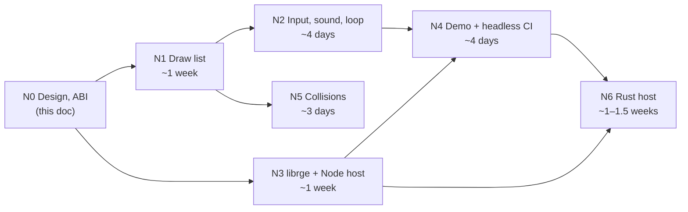

# Phase 3 plan: the native player

Snapshot of the plan as of 2026-11-09. Phase 2 built the compiler and a mock runtime: generated components run, render and handle input, but nothing draws. Phase 3 puts a compiled game in a native window: it draws, plays sound, reads the keyboard and mouse, and ships as a native executable without Node. This document is both the design note the Phase 2 ground rules ask for (it changes the "runtime stays a mock" rule, see [Ground rules](#ground-rules)) and the milestone plan. Progress is tracked in [Status](#status) and the [Handoff checklist](#handoff-checklist). Phase 3 is complete; the next priorities are in [NEXT_PRIORITIES.md](NEXT_PRIORITIES.md).

Read first: [DESIGN.md](DESIGN.md) sections "Transforms and refs", "Camera", "Pointer", "`<AnimatedSprite>`" and "useSound". They define what the player must draw and dispatch. This plan does not change any of them.

## Status

Last updated 2026-11-09. **Update this table and the milestone's checklist in the same PR as the work.** A milestone moves Not started → In review (PR open) → Done (PR merged); the PR number goes in the third column.

| Milestone | Status | Branch / PR | Notes |
| --- | --- | --- | --- |
| N0 Design and protocol | Done | #25 | This document |
| N1 Draw list (`@rge/player`, pure TS) | Done | #26 | `FrameBuilder` + `walkTree` in `draw.ts`; `native/include/rge.h` is committed here (complete, including the full key table); goldens are JSON files in `test/golden/` (`UPDATE_GOLDEN=1` rewrites them, numbers rounded to 1e-9) rather than `node:test` snapshots, which are still experimental |
| N2 Input, sound and the frame loop (pure TS) | Done | #27 | Also added: `PlayerConfig.warn` (where warnings go; tests use it), `getSoundSink()` (so a closing player removes only its own sink), `PlayerInput` (the `InputState` with `worldPoint`, `screenX/Y`, `dt`, `quit`), `RecordingBackend`'s `missingSounds`. The press is dispatched only for a *new* left press and only to pointers drawn in the previous frame |
| N3 `librge` (C + raylib) and the Node dev host | Done | #28 | First pixels. Built and tested in the cloud container on both raylib platforms: `Memory` (software renderer, no system libraries; the CI `native` job) and `Desktop` (GLFW + Mesa under Xvfb; the `native-desktop` job). Still needs a person at a real display: how the window feels, real keyboard and mouse input, and audio (a hidden window has no audio device, so sounds are loaded but silent) |
| N4 Demo game and headless CI | Done | #29 | The headless C smoke test and the Node-host tests already ran in CI from N3; N4 adds the demo and runs it in those jobs: scripted-input tests through `RecordingBackend` (movement, camera, clicks, sound, the missing frame) and a 60-frame pixel check through the real library. Replaces N3's hello stand-in. Not yet seen by a person in a real window |
| N5 Collisions (pure TS) | Done | #30 | `CollisionTracker` in `collide.ts`, called by the player once per frame (since 2026-11-12: after every step, see DESIGN.md, "Why collisions are per step"). Added a rule the plan did not have: colliders with the same parent never collide with each other (a hitbox and a shield must not hit each other, and handler code cannot read `other` to filter it out). Measured cost is in the doc comment |
| N6 Rust host with QuickJS-ng | Done | #31 | The shipping executable. Built and tested in the cloud container: the demo runs under QuickJS-ng with output byte-identical to Node over 60 scripted frames; the packaged folder runs from another directory. Differences from the plan: `--root <dir>` instead of `--assets <dir>` (the game's relative paths resolve against it); with no arguments the host runs `game.js` next to the executable. Measuring found that all-pairs collisions were ~45x slower under QuickJS (465 ms a frame for 2,000 colliders), so N5's tracker now sweeps over x (38 ms). Not yet seen by a person in a real window |

## Goals

1. **A compiled game runs in a native window.** Every built-in that draws (`Sprite`, `AnimatedSprite`, `Shape`, `Text`) appears where `worldTransform()` says, seen through the active `Camera`. `useInput` gets real keys and the pointer, `<Pointer onPress>` receives clicks, and `useSound` plays audio.
2. **It ships without Node.** A small Rust executable embeds a JavaScript engine (QuickJS-ng) and runs the same generated code: a folder with `game.exe`, `game.js` and `assets/`.
3. **One body of game code, three places it runs.** The generated TypeScript runs unchanged in the Node tests (mock), the Node dev player and the shipped executable. Nothing in the compiler changes for this phase.
4. **Testable without a GPU.** Almost all player logic is pure TypeScript and is tested against a recording backend. Native drawing gets a headless smoke test in CI.
5. **Pieces that can be swapped.** Drawing code lives in exactly one place (`librge`, in C). The boundary between JavaScript and native is a handful of functions, so a host (Node, Rust, or later a browser) is a thin adapter.

### Non-goals for this phase

- Compiling the IR to C, Go or Rust. That was considered and deferred: it needs a ported runtime, JavaScript's handler semantics, and resolved types (see [Decisions](#decisions-settled)). Revisit only if profiling shows script time dominates a frame.
- Physics beyond "these two boxes started touching" (N5). No rigid bodies, no resolution.
- 3D, shaders, post-processing, custom fonts (the default font only), z-index, a screen-space HUD layer, gamepads, hot reload, mobile, consoles, web. All are listed under [Later](#later-not-scheduled), and each slots into the design without reworking it.

## Architecture

```
            game source (.tsx)  ──rge-compile──▶  generated .ts  (unchanged from Phase 2)
                                                      │ imports
                                                      ▼
  @rge/runtime   GameObject, World, built-ins (mock; no drawing). New in N2: a sound sink hook.
                                                      ▲ reads the tree
  @rge/player    pure TypeScript, no Node APIs, no native deps
                 • draw.ts     walk the tree → one Float64Array of draw commands
                 • input.ts    native input buffers → InputState; pointer presses → World.reportPress
                 • collide.ts  collider overlaps → World.reportCollision (N5)
                 • loop.ts     createPlayer / run: the frame loop
                 • Backend     the interface every host implements
                 • RecordingBackend   records frames for tests
                                                      │ Backend interface
                    ┌─────────────────────────────────┼──────────────────────────────┐
                    ▼                                 ▼                              ▼
  @rge/player-node (dev)               host/ (Rust, ships)                  (later) a canvas
  koffi → librge.so/.dylib/.dll        rquickjs + librge linked statically   backend for the web
                    └─────────────────────────────────┬──────────────────────────────┘
                                                      ▼
  native/librge  C, the only drawing code. Wraps raylib 6.0: window, textures, text, sounds, input.
                 ABI: native/include/rge.h (about ten functions)
```

**Why this split.** The tree walk, colour parsing, camera maths, pointer hit testing and collision detection are where the bugs will be, so they live in TypeScript, where the existing test setup runs them without a window. The native side is deliberately boring: it executes a list of draw records and reports input. Because the boundary is one call per frame with plain arrays, it costs the same in every host, and each host's adapter is about 100 lines.

### The frame

`createPlayer` in `loop.ts` owns the loop. Each iteration of `step()`:

1. **Presses.** If `MouseLeft` was pressed, turn the mouse position into a world point (through the inverse of the view drawn last frame, which is what the player clicked on), test the pointers collected last frame from topmost (last drawn) to bottommost, and call `world.reportPress` on the first hit only.
2. **Tick.** `world.tick(dt, input)`, with `dt` clamped to `[0, 0.1]` seconds so a stall (a breakpoint, a dragged window) does not teleport things. Renders and structure commit inside the tick, as today.
3. **Walk.** One depth-first walk from `world.root` composes world transforms top-down. It emits draw records, finds the active camera, and collects pointers and colliders.
4. **Collisions (N5).** Compare collider boxes, call `world.reportCollision` for pairs that started touching. Their setters render in the next tick, as `reportCollision` already documents.
5. **Present.** `backend.frame(...)` draws the records, swaps buffers (blocking on vsync), polls devices and writes the next frame's input into the shared buffers.

`run()` is `open`, then `step()` until the window asks to close, then `close`. It is a plain blocking `while` loop, which is fine in both QuickJS and Node: game code is synchronous (the compiler has no `await`), and timers and promises are not part of the authoring model.

## Decisions (settled)

| Decision | Choice | Why |
| --- | --- | --- |
| Graphics library | **raylib 6.0** (released 2026-04-23), pinned to the `6.0` tag | Each built-in maps to one or two raylib calls. It is one C library with no extra libraries for images, fonts or audio. 6.0 adds a CPU-only software renderer, which makes headless CI possible. raylib can itself run on SDL as its platform layer, so moving to SDL later does not change our code |
| Not SDL3 (3.4) | Rejected for now | Better platform reach (consoles, gamepads, the GPU API), but we would add SDL_image, SDL_ttf and SDL_mixer and write our own batching for the same feature set. Revisit if consoles or custom shaders become goals |
| Where drawing code lives | **C, in `native/librge`**, once | raylib's documentation and examples are in C. Both hosts link the same library: Node loads it as a shared library, the Rust host links it statically |
| Native boundary | **One call per frame**: a `Float64Array` of fixed-size records, plus strings | Per-call FFI cost does not grow with the number of sprites, and a new host is a small adapter. `Float64Array`, not `Float32Array`: a packed `0xRRGGBBAA` colour and every handle fit exactly, and JavaScript numbers go in unchanged |
| Dev host | **Node + koffi** (`@rge/player-node`) | The repo targets Node ≥ 22.18, and koffi works there with prebuilt binaries. `node:ffi` is still experimental (added in 26.1 behind a flag, and its signature syntax changed between minor versions). The koffi calls stay in one file, so moving to `node:ffi` later is a small change |
| Shipping host | **Rust + rquickjs (QuickJS-ng)** in `host/` | A small binary with Cargo's cross-platform build. QuickJS-ng is an interpreter: no JIT, so it can go where JIT is banned (iOS, consoles), and it supports the ES2022 features the generated code uses (classes, `#private` fields, `??`, `?.`). Rust only hosts the engine; it does not draw |
| Bundling for the Rust host | **esbuild** to one ESM file (`--bundle --format=esm --platform=neutral --target=es2022`) | It resolves workspace packages and `.ts` imports. The Rust host loads one file, so it needs no module resolver |
| Draw order | **Tree order, depth first**: parent before children, children in `children` order (source order, by `(slot, order)`). Later draws are on top | It matches how JSX reads, and keyed lists already keep their order. `transform.z` now overrides it (see DESIGN.md, "What is drawn") |
| Origin of a drawn element | **Top-left**, as `Sprite`, `Shape` and `Pointer` already document. Rotation and scale are about the origin. `Collider` follows the same rule (N5 writes this into its doc comment) | Consistency with the existing docs |
| Active camera | **The first `Camera` in draw order.** More than one: warn once, use the first. None: identity view, world origin at the window's **top-left** | With a camera, the followed point is centred, as `Camera` documents. Without one, top-left is what people expect from a 2D API |
| `input.pointerX/Y` | **World space**, through the active camera | Components only know world space and cannot reach a camera to convert. A screen-space reading can come later as `input.screenX/Y` |
| Coordinates | Logical pixels. raylib's high-DPI flag is off in v1 | Simplest. High DPI is "Later" |
| Key names | Keep the current style: `"A"`–`"Z"`, `"0"`–`"9"`, `"Space"`, `"Enter"`, `"Escape"`, `"Tab"`, `"Backspace"`, `"Shift"`, `"Control"`, `"Alt"`, `"ArrowUp"`, `"ArrowDown"`, `"ArrowLeft"`, `"ArrowRight"`, `"F1"`–`"F12"`, and mouse buttons as keys: `"MouseLeft"`, `"MouseRight"`, `"MouseMiddle"` | The examples already use `"Space"` and `"A"`. Mouse buttons as keys mean `input.pressed("MouseLeft")` works with no new API. The table is in `rge.h` (see [The ABI](#the-abi-nativeincludergeh)) |
| Asset paths | Relative to the player's `assets` option (default `"assets"`), joined with `/` in TypeScript (no `node:path`) | `@rge/player` must also run in QuickJS |
| Missing asset or bad colour | Never throw. Warn once per value, draw a 16×16 magenta rect for a missing texture, use magenta for an unparsable colour | A typo should not stop a game during development, and magenta is easy to spot |
| Sound playback | The runtime gets a sound sink (N2). `Sound` calls `sink.load(path)` when constructed (so sounds preload as components mount) and `sink.play(path)` from `play()`, after counting the play | `Sound` instances are fields on components and not reachable from the tree, so the player cannot find them. One module-level hook is the smallest change |

## Ground rules

The compiler's rules ([DESIGN.md](DESIGN.md#ground-rules-and-settled-decisions)) still apply. Two change, and three are added:

- **Changed: "Runtime stays a mock" → "Runtime stays backend-free."** `@rge/runtime` never draws, plays or polls anything. It gains only hooks a backend plugs into (the sound sink). Drawing, input and audio live in `@rge/player` and the hosts. The mock tests keep passing unchanged.
- **Changed: TypeScript-only.** `native/` (C) and `host/` (Rust) are new languages in the repo. Keep them small; logic goes in TypeScript unless it needs the GPU, the OS or audio. *(One exception since ABI v4: `rge_overlaps`, the search for the boxes that overlap. It needs none of those; it is there because the interpreter spent more of a busy frame on it than on anything else. See "Performance pass three, the broad phase in librge".)*
- **New: `@rge/player` and `@rge/runtime` import no `node:` modules and no native packages.** They run in QuickJS. A test enforces this (N1).
- **New: `rge.h` is the single source of truth for the protocol.** `packages/player/src/protocol.ts` mirrors it, and a test parses `rge.h` and fails if any constant or key name differs (N1). Change the header first.
- **New: the C side does no maths beyond applying the transform it is given and drawing the shape a record describes.** Anything else a record needs (a world position, a view, a colour) is computed in TypeScript. *(`rge_overlaps`, ABI v4, is the exception: it compares boxes the script worked out, and decides nothing about the game. Which pairs collide, by parent and layer, and what starts and ends, stays in script.)*

## The ABI: `native/include/rge.h`

This is the contract every milestone builds on. It is written out here in full so N1 (TypeScript) and N3 (C) can be built in parallel against it. Changing it is fine, but change it here and in the header together, and bump `RGE_ABI_VERSION`.

```c
#ifndef RGE_H
#define RGE_H
#include <stdint.h>

#define RGE_ABI_VERSION 1

/* ---------- Draw records ----------
 * A frame is a flat array of doubles: records back to back, each starting with its op.
 * Every drawable record then has a common header: x, y, rotation (radians), scaleX, scaleY
 * (the element's resolved world transform), followed by its payload.
 * The C side draws each drawable at the local origin under translate(x, y), rotate, scale(sx, sy).
 * Colours are packed 0xRRGGBBAA stored in a double (exact).
 */
#define RGE_OP_VIEW     1  /* op, a, b, c, d, e, f: world → screen affine, already including
                              the viewport-centre offset. A later VIEW replaces it (ABI v2).    len 7 */
#define RGE_OP_SPRITE   2  /* op, x, y, rot, sx, sy, texture                                    len 7 */
#define RGE_OP_RECT     3  /* op, x, y, rot, sx, sy, width, height, color                       len 9 */
#define RGE_OP_ELLIPSE  4  /* op, x, y, rot, sx, sy, width, height, color (fills the w×h box)   len 9 */
#define RGE_OP_TEXT     5  /* op, x, y, rot, sx, sy, textIndex, size, color                     len 9 */

#define RGE_OP_VIEW_LEN    7
#define RGE_OP_SPRITE_LEN  7
#define RGE_OP_RECT_LEN    9
#define RGE_OP_ELLIPSE_LEN 9
#define RGE_OP_TEXT_LEN    9

/* ---------- Input, written by rge_frame ---------- */
#define RGE_IN_DT       0  /* seconds since the previous frame */
#define RGE_IN_WIDTH    1  /* window size in logical pixels */
#define RGE_IN_HEIGHT   2
#define RGE_IN_MOUSE_X  3  /* window coordinates, origin top-left */
#define RGE_IN_MOUSE_Y  4
#define RGE_IN_WHEEL    5
#define RGE_IN_QUIT     6  /* 1 when the window was asked to close */
#define RGE_IN_LEN      7

/* Per-key flags in the keys buffer (one byte per entry of RGE_KEYS, in order). */
#define RGE_KEY_DOWN     1
#define RGE_KEY_PRESSED  2
#define RGE_KEY_RELEASED 4

/* The key table: X(kind, raylib code, name). kind K = keyboard, M = mouse button.
 * The order here is the order of the keys buffer. Append only. */
#define RGE_KEYS(X) \
  X(K, KEY_SPACE, "Space") X(K, KEY_ENTER, "Enter") X(K, KEY_ESCAPE, "Escape") \
  X(K, KEY_TAB, "Tab") X(K, KEY_BACKSPACE, "Backspace") \
  X(K, KEY_LEFT_SHIFT, "Shift") X(K, KEY_LEFT_CONTROL, "Control") X(K, KEY_LEFT_ALT, "Alt") \
  X(K, KEY_UP, "ArrowUp") X(K, KEY_DOWN, "ArrowDown") X(K, KEY_LEFT, "ArrowLeft") X(K, KEY_RIGHT, "ArrowRight") \
  X(K, KEY_A, "A") /* … through KEY_Z, "Z" */ \
  X(K, KEY_ZERO, "0") /* … through KEY_NINE, "9" */ \
  X(K, KEY_F1, "F1") /* … through KEY_F12, "F12" */ \
  X(M, MOUSE_BUTTON_LEFT, "MouseLeft") X(M, MOUSE_BUTTON_RIGHT, "MouseRight") X(M, MOUSE_BUTTON_MIDDLE, "MouseMiddle")
/* N3 writes the table out in full; no "…" in the real header. Shift/Control/Alt read left OR right. */

/* ---------- Window options for rge_open ---------- */
#define RGE_OPEN_RESIZABLE 1
#define RGE_OPEN_VSYNC     2
#define RGE_OPEN_HIDDEN    4  /* no visible window: tests and CI */
#define RGE_OPEN_SMOOTH    8  /* bilinear texture filtering; default is nearest (pixel art) */

/* ---------- Functions ---------- */
int32_t rge_abi_version(void);
int32_t rge_key_count(void);
int32_t rge_open(int32_t width, int32_t height, const char *title, uint32_t options); /* 0 ok, nonzero error */
void    rge_close(void);

int32_t rge_load_texture(const char *path); /* handle >= 0, or -1 if it could not be loaded */
int32_t rge_load_sound(const char *path);   /* handle >= 0, or -1 */
void    rge_play_sound(int32_t handle);     /* ignores -1 */

/* Draw one frame and present it, then poll devices and fill `input` (RGE_IN_LEN doubles) and
 * `keys` (rge_key_count() bytes). `text` holds `textCount` NUL-terminated UTF-8 strings back to back;
 * `textOffsets[i]` is the byte offset of string i, which RGE_OP_TEXT's textIndex refers to. */
void rge_frame(uint32_t clearColor,
               const double *records, int32_t recordsLength,
               const char *text, const int32_t *textOffsets, int32_t textCount,
               double *input, uint8_t *keys);

/* Tests only: copy the last presented frame as RGBA8, top row first. Returns the bytes needed;
 * copies only when capacity is enough. */
int32_t rge_read_pixels(uint8_t *rgba, int32_t capacity);

#endif
```

**ABI v4** adds one function, for collisions (the header has the full contract):

```c
/* The pairs of the `count` boxes (minX, minY, maxX, maxY each) that overlap, two box indices a pair, up to `capacity`
 * of them; returns how many there are. `order` is the caller's to keep: it comes back as the boxes by minX. */
int32_t rge_overlaps(const double *boxes, int32_t count, int32_t *order, int32_t *pairs, int32_t capacity);
```

Notes for the C implementer (N3):

- **Transforms.** For each drawable: `rlPushMatrix(); rlTranslatef(x, y, 0); rlRotatef(rot * RAD2DEG, 0, 0, 1); rlScalef(sx, sy, 1);`, draw at the origin, then `rlPopMatrix()`. rlgl applies the matrix to vertices on the CPU while batching, so this does not break batching. For `RGE_OP_VIEW`, push once and multiply by the affine as a column-major 4×4: `{ a, b, 0, 0,  c, d, 0, 0,  0, 0, 1, 0,  e, f, 0, 1 }`. Pop it at the end of the frame. Check the layout with a test: a view with `e = 10` must move a rect 10 pixels right.
- **Disable backface culling** (`rlDisableBackfaceCulling()`) after opening. A negative scale (a flipped sprite) reverses the triangles' winding, and raylib culls back faces by default, so flipped sprites would vanish. N3 has a test for a flipped sprite.
- **Per op:** `SPRITE` → `DrawTexture(tex, 0, 0, WHITE)`. `RECT` → `DrawRectangle(0, 0, w, h, c)` (use the float variant). `ELLIPSE` → `DrawEllipse(w/2, h/2, w/2, h/2, c)` (the record describes the box; filling it is the C side's job). `TEXT` → `DrawTextEx(GetFontDefault(), str, (Vector2){0, 0}, size, size / 10.0f, c)`, the spacing `DrawText` uses.
- **Opening:** `SetConfigFlags` from the options, `InitWindow`, `InitAudioDevice`, `SetExitKey(KEY_NULL)` (Escape must reach the game, not close the window), `SetTraceLogLevel(LOG_WARNING)`. When `RGE_OPEN_VSYNC` is off, `SetTargetFPS(60)`.
- **In `rge_frame`:** `BeginDrawing`, `ClearBackground`, the records, `EndDrawing` (raylib swaps and polls input here), then fill `input` from `GetFrameTime`, `GetScreenWidth/Height`, `GetMousePosition`, `GetMouseWheelMove` and `WindowShouldClose`, and fill `keys` from `IsKeyDown/Pressed/Released` and `IsMouseButtonDown/Pressed/Released`. `"Shift"` is down when either shift is (the same for Control and Alt).
- **Handles** index into growable arrays of `Texture2D` and `Sound`. Unload everything in `rge_close`. TypeScript caches by path, so C never sees a path twice.
- **An unknown op or a short buffer**: log once at `LOG_ERROR` and stop drawing that frame. Never read past `recordsLength`.
- **Hidden windows** (`RGE_OPEN_HIDDEN`) have no audio device (so no ALSA noise on machines without a sound card; sounds still load and are silent) and keep each frame for `rge_read_pixels`.
- **raylib 6.0's software renderer reads the framebuffer back top row first and as BGRA**, whatever format is requested, and `LoadImageFromScreen` flips it again. `capture_frame` reads it raw and swaps red and blue under `GRAPHICS_API_OPENGL_SOFTWARE`, and uses `LoadImageFromScreen` on OpenGL. The smoke test checks both orientations and channels.

## Pieces and interfaces

### `packages/player` (`@rge/player`, TypeScript)

```
packages/player/
  src/protocol.ts    constants mirroring rge.h: ops, record lengths, input indices, key flags, KEYS (names, in order)
  src/backend.ts     Backend interface, WindowConfig
  src/color.ts       CSS colour string → packed 0xRRGGBBAA (cached)
  src/draw.ts        DrawList (a growable Float64Array plus a text array) and the tree walk
  src/input.ts       buffers → InputState; screen ↔ world; press dispatch
  src/collide.ts     (N5)
  src/loop.ts        createPlayer, run
  src/recording.ts   RecordingBackend
  src/host.ts        hostBackend(): the backend a host installed on globalThis
  src/index.ts
  test/
```

**Backend.** Every host implements this; `RecordingBackend` is the test one.

```ts
export interface WindowConfig {
  readonly width: number;
  readonly height: number;
  readonly title: string;
  readonly resizable?: boolean;   // default true
  readonly vsync?: boolean;       // default true
  readonly hidden?: boolean;      // default false
  readonly smooth?: boolean;      // default false (pixel art)
}

export interface Backend {
  open(config: WindowConfig): void;
  close(): void;
  loadTexture(path: string): number; // -1 on failure
  loadSound(path: string): number;   // -1 on failure
  playSound(handle: number): void;
  /** Draw and present `records[0, length)`, then write the next input into `input` and `keys`. */
  frame(clearColor: number, records: Float64Array, length: number, texts: readonly string[], input: Float64Array, keys: Uint8Array): void;
}
```

Backends receive `texts` as a JavaScript array: each host packs it the way that is cheapest for it (the Node host with `TextEncoder` into one buffer plus offsets; the Rust host natively). Records refer to text by index, so the records are identical for every host.

**Player API.**

```ts
export interface PlayerConfig extends Partial<WindowConfig> {
  /** Builds the root object, before the window opens (a `<Game>` root says what window to open); its sounds preload once it is open. */
  readonly root: () => GameObject;
  readonly background?: string;  // CSS colour, default "black"
  readonly assets?: string;      // default "assets"
}

export interface Player {
  readonly world: World;
  /** Run one frame. Returns false once the window has asked to close. */
  step(): boolean;
  close(): void;
}

export function createPlayer(backend: Backend, config: PlayerConfig): Player; // opens the window
export function run(backend: Backend, config: PlayerConfig): void;            // createPlayer, step until false, close
```

A scene-driven game passes `root: () => { const root = new Entity(); /* loadScene into a world */ … }`. If that turns out awkward, add `scene` and `prefabs` options in N4 rather than changing `root`.

**The tree walk (`draw.ts`).** This is the heart of N1. It must give the same world transform that `GameObject.worldTransform()` gives, without recomputing from the root for every object:

```ts
function visit(object: GameObject, parentSpace: WorldTransform, out: Walk): void {
  const world = composeTransforms(composeTransforms(parentSpace, object.placement), object.transform);
  emit(object, world, out); // Sprite / AnimatedSprite → SPRITE; Shape → RECT | ELLIPSE; Text → TEXT;
                            // Camera → first one becomes out.camera; Pointer, Collider → collected with `world`
  // Mirror GameObject.childSpace(): a Camera is transparent to its children.
  const childSpace = object instanceof Camera ? parentSpace : world;
  for (const child of object.children) visit(child, childSpace, out);
}
visit(world.root, IDENTITY_TRANSFORM, walk);
```

- Use the runtime's exported `composeTransforms`; never re-derive the maths. It already handles `global`.
- **Parity test (required):** for every object in the example `Level` tree after a few ticks, the walk's transform equals `object.worldTransform()` to within 1e-9. If a built-in ever overrides `childSpace()` again, this test is what catches the walk drifting from it.
- Emit `RGE_OP_VIEW` first with placeholder numbers and fill it in after the walk, once the active camera is known: `camera.viewTransform()` plus `e += width / 2`, `f += height / 2`. No camera: identity. `viewTransform()` throws a `RangeError` on a zero zoom or scale; catch it, warn once, use identity.
- `Sprite` and `AnimatedSprite` both draw `image` (the current frame). An empty `image` draws nothing. A texture is loaded through the backend the first time its path is seen (`assets + "/" + image`), with the handle cached in a `Map`. A handle of -1 emits a magenta 16×16 `RECT` instead, with one warning per path.
- `Shape`: `kind === "rect"` → `RECT`, `"circle"` → `ELLIPSE`, each with `width`, `height` and the parsed colour.
- `Text`: push `text` onto the frame's text array and emit its index, `size` and colour.
- `Entity`, `Camera`, `Pointer` and `Collider` draw nothing.
- Reuse one `Float64Array` across frames, doubling it when full. Clear the text array each frame.

**Colours (`color.ts`).** Accept `#rgb`, `#rgba`, `#rrggbb`, `#rrggbbaa`, `rgb()`/`rgba()` (comma or space separated, alpha 0–1 or a percentage), and the 148 CSS named colours plus `transparent`. `hsl()` is "Later". Cache results in a `Map<string, number>`. Pack as `((r << 24) | (g << 16) | (b << 8) | a) >>> 0`. The examples use `"white"`, `"gray"`, `"gold"`, `"red"` and `"rgba(255, 0, 0, 0.3)"`; test all of them.

**Input (`input.ts`).**

- `KEYS` (from `protocol.ts`) maps each name to its index in the keys buffer. `InputState.pressed(name)` reads `keys[index] & RGE_KEY_PRESSED`, and likewise for `down` and `released`. An unknown name returns false and warns once, listing the valid names.
- `pointerX/Y`: the mouse position taken back through the inverse of the view drawn last frame (the same maths as `Camera.viewToWorld`, applied to the full view including the centre offset).
- Presses as described in [The frame](#the-frame): topmost pointer first, one hit per press.

**Sound (runtime change, N2).** In `packages/runtime/src/Sound.ts`:

```ts
export interface SoundSink { load(path: string): void; play(path: string): void }
export function setSoundSink(sink: SoundSink | null): void; // exported from @rge/runtime
// constructor: this.path = path; sink?.load(path)
// play():      this.plays++;     sink?.play(path)
```

The player installs a sink that loads through the backend (cached by path) and plays the handle. Runtime tests reset the sink to `null`. With no sink installed, behaviour is exactly as today.

**Host-agnostic entry (`host.ts`).** A game's entry file is `run(hostBackend(), { … })`. `hostBackend()` returns `globalThis.__rgeBackend` and throws a clear error if no host installed one. The Node launcher installs it and then imports the entry; the Rust host installs it before evaluating the bundle. So one entry file runs under both hosts, and the bundle never contains koffi.

**`RecordingBackend`.** It keeps every frame's records (copied), texts and clear colour, plus every texture and sound load and every play. Tests script input frame by frame (`backend.queueInput({ pressed: ["Space"], down: ["A"], released: ["MouseLeft"], mouse: { x, y }, dt })`; `pressed` also sets down). It decodes records into readable objects for assertions (`{ op: "rect", x, y, …, color: "#ff0000ff" }`).

### `packages/player-node` (`@rge/player-node`, Node dev host)

- `src/ffi.ts`: the only file that imports koffi. It loads the library from `RGE_NATIVE_LIB` or the default `native/build/` path, declares the functions from `rge.h`, and checks `rge_abi_version()` and `rge_key_count()` against `protocol.ts` at load time.
- `src/backend.ts`: `createNodeBackend(): Backend`. `frame` encodes `texts` into a reused `Uint8Array` plus an `Int32Array` of offsets and passes typed arrays straight through as pointers. Check the koffi version's documentation for typed-array arguments before relying on it.
- `src/play.ts`: the CLI, `node packages/player-node/src/play.ts <entry.ts> [--no-watch]`. It installs `globalThis.__rgeBackend = createNodeBackend()`. When the game's folder has a `src/`, it plays the game with hot reload (`dev.ts`); with `--no-watch` it dynamically imports the entry, which runs as under the packaged build.
- `src/dev.ts`: `playWithReload(backend, { entry })` (priority 5, 2026-11-11). It installs a function at `globalThis.__rgeRun` (`HOST_RUN_KEY`), so the entry's `run(hostBackend(), config)` hands over its config instead of looping, and drives the frame loop itself, one `player.step()` per turn of Node's event loop, so it can hear file events while the game runs. It compiles the game first (as `check:<game>` does: `rge-compile src generated`, with `--scenes` and `--assets` where the folders exist), then watches `src/` and `scenes/`. A save (debounced, 80 ms) compiles in a child process while the game keeps running; a compile error goes to the window (`player.showError`) with the note "Save a file to reload. Close the window to quit." A good build is imported again: a `module.registerHooks` resolve hook (in-thread, Node 22.15+) gives every file inside the game's folder, but not its `node_modules`, the load's version in its URL (`?v=3`), so the game's components, rules and game state are evaluated afresh while the engine's packages and the window stay as they are. The game states the new build exports are matched to the old ones by file and export name and `carryFrom` them, then `player.reload` swaps the root (see DESIGN.md, "Hot reload"). On the cloud VM compiling Kite with its type-check takes about 0.65 s, which is most of a reload. Images and sounds are loaded once per path, so a changed asset file still needs a restart, and each build stays in memory (ES modules cannot be unloaded). The Rust host does not reload: it runs a packaged game.

### `native/` (C)

```
native/
  CMakeLists.txt   FetchContent raylib (GIT_TAG 6.0); builds librge as SHARED (Node) and STATIC (Rust)
  include/rge.h
  src/rge.c        open/close/frame/read_pixels and record execution
  src/assets.c     texture and sound handle tables
  src/keys.c       the RGE_KEYS table expanded into code and name arrays
  test/smoke.c     opens hidden, draws a red rect, checks the pixel; a flipped sprite; a translated view
```

Build: `npm run native:build` (a real window; `native/build`) or `npm run native:build:headless` (raylib's software renderer, `-DRGE_PLATFORM=Memory`; `native/build-headless`: no window, no GPU, no system libraries, no keyboard or mouse, so it is what tests and CI use). `npm run native:test` builds and runs the C smoke test on the headless build. On Linux, raylib's desktop build needs the X11 and GL development packages (`libx11-dev libxrandr-dev libxinerama-dev libxcursor-dev libxi-dev libgl1-mesa-dev`). Confirm the list against raylib's Linux build instructions for 6.0.

### `host/` (Rust)

```
host/
  Cargo.toml       rquickjs (with the ESM loader feature), cmake (build dependency)
  build.rs         builds ../native with the cmake crate and links librge and raylib statically, plus system libs
  src/main.rs      CLI: rge-host <game.js> [--assets <dir>]
  src/backend.rs   a JS object implementing Backend (open, close, loadTexture, loadSound, playSound, frame)
  src/console.rs   console.log / warn / error → stderr (QuickJS provides no console)
```

- `frame` reads the `Float64Array`, `Uint8Array` and string array through rquickjs's typed-array and array types, packs the strings, and calls `rge_frame` with pointers into the typed arrays' memory.
- The bundle: `npm run bundle -- <entry.ts> host/dist/game.js` runs esbuild with the options in [Decisions](#decisions-settled). The host evaluates it as a module after setting `globalThis.__rgeBackend`.
- An uncaught exception prints the message and stack and exits with status 1, so a crash shows up in the terminal.
- Packaging in v1 is a folder: the executable, `game.js` and `assets/`. Embedding both in the executable is "Later".

## Milestones

Sizes are rough estimates for one engineer.



N1 and N3 can run in parallel because the ABI is fixed above. The cloud environment has a C toolchain, CMake, Rust, Xvfb and (after `apt-get update`) the X11 and Mesa packages, so every milestone can be built and pixel-tested there, on raylib's software renderer or on the real OpenGL path against a virtual display. What it cannot show is a real display: window feel, real keyboard and mouse input, and audio need a person at a desktop.

### N0: design and protocol (this document)

The ABI, the interfaces, the decisions, and the ground-rule change. Also points `PHASE2_PLAN.md` and the README here.

### N1: draw list (`@rge/player`, pure TS, ~1 week)

| Work item | Where | Done when |
| --- | --- | --- |
| Package scaffold: `@rge/player` workspace package, added to the root `tsconfig.json` includes and `npm test` | `packages/player`, root config | `npm test` runs its tests; `npm run typecheck` covers it |
| `protocol.ts` and the header-parity test (reads `native/include/rge.h` with a regex over `#define RGE_*` and the `RGE_KEYS` X-macro) | `src/protocol.ts`, `test/protocol.test.ts` | Changing a constant in either file alone fails the test |
| "No `node:` imports" test over `packages/player/src` and `packages/runtime/src` | `test/portability.test.ts` | Adding `import "node:fs"` to either package fails |
| `color.ts` | `src/color.ts` | Every format above is tested, including every example colour and an invalid one (magenta, one warning) |
| `Backend`, `RecordingBackend` with decoding | `src/backend.ts`, `src/recording.ts` | Tests can assert decoded records |
| Tree walk and `DrawList` | `src/draw.ts` | The parity test passes over the example `Level` tree. Golden decoded draw lists for the `Level` and `Hero` examples are snapshot-tested. A sprite with a missing texture draws magenta, warning once |
| Camera view | `src/draw.ts` | With a camera, the followed object's position maps to the window centre. Without one, the world origin maps to (0, 0). A zero zoom falls back to identity with one warning |

### N2: input, sound and the frame loop (pure TS, ~4 days)

| Work item | Where | Done when |
| --- | --- | --- |
| `InputState` from the buffers | `src/input.ts` | `pressed`/`down`/`released` for keys and mouse buttons; an unknown name warns once |
| `pointerX/Y` in world space | `src/input.ts` | Correct with no camera, a panned camera, and a zoomed and rotated camera (round-trip test against `Camera.worldToView`) |
| Press dispatch | `src/input.ts` | Of two overlapping pointers, only the topmost receives `onPress`; a press outside both calls neither; a press through a zoomed camera hits what is drawn |
| Sound sink | `runtime/src/Sound.ts`, `runtime/src/index.ts` | Runtime tests: with no sink, nothing changes; with a sink, construction loads and `play()` plays. Player test: the `Hero` example's `hurt.wav` is loaded at construction and played on collision |
| `createPlayer` / `run` | `src/loop.ts` | With `RecordingBackend`: frame order (press → tick → walk → present), `dt` clamping, `step()` returns false on quit, `close()` closes the backend |
| `hostBackend()` | `src/host.ts` | Throws a clear error with no host; returns the installed backend otherwise |
| `DESIGN.md` gains a "Player" section | `docs/DESIGN.md` | Covers draw order, origin, camera, `pointerX/Y`, sounds |

### N3: `librge` and the Node dev host (~1 week)

| Work item | Where | Done when |
| --- | --- | --- |
| CMake build with pinned raylib 6.0 | `native/CMakeLists.txt` | `npm run native:build` produces the shared and static libraries on Linux and macOS (Windows best-effort) |
| `rge.c`, `assets.c`, `keys.c` per the ABI | `native/src` | `smoke.c` passes: a red rect lands on the expected pixel, a flipped sprite is visible, a view with `e = 10` moves a rect 10 pixels right |
| koffi binding and `createNodeBackend` | `packages/player-node` | ABI version and key count are checked at load; a mismatch throws, naming both versions |
| `play.ts` CLI | `packages/player-node/src/play.ts` | `node packages/player-node/src/play.ts packages/demo/src/main.ts` opens a window (a stand-in demo until N4, which replaced it) |

### N4: demo game and headless CI (~4 days)

| Work item | Where | Done when |
| --- | --- | --- |
| `packages/demo`: a small game that needs no art. A square moved with the arrow keys inside a `<Camera>`, a `Shape` button with a `Pointer` that adds to a score, `<Text>` showing the score, an `AnimatedSprite` with one missing frame (shows magenta, on purpose), a sound on click | `packages/demo/src`, `assets/` with one short `.wav` | `npm run play:demo` plays it under Node. It has its own compile step like `example`, and CI checks its generated output too |
| Headless smoke in CI: a separate `native` job that installs the X11/GL dev packages, builds `native/`, runs `smoke.c`, then runs the demo for 60 frames with `hidden: true` and compares a few pixels from `rge_read_pixels` with expected colours | `.github/workflows/ci.yml` | The job passes. Try raylib 6.0's software renderer first (check its exact CMake option in the 6.0 release notes); if it is not usable, run under `xvfb-run` with Mesa's llvmpipe |

### N5: collisions (pure TS, ~3 days)

| Work item | Where | Done when |
| --- | --- | --- |
| Box per collider: top-left origin, `width × scaleX` by `height × scaleY`, rotated by the world rotation. Use the axis-aligned bounds of the four corners (an approximation for rotated colliders, documented) | `src/collide.ts` | Unit tests for moved, scaled and rotated colliders |
| Enter events: a pair that overlaps this frame and did not last frame calls `world.reportCollision(a, b)` once. A pair is forgotten when it stops overlapping or either side leaves the world. Colliders with the same parent never collide with each other | `src/collide.ts`, `src/loop.ts` | Two `Hero`s walking into each other report exactly once; separating and touching again reports again |
| O(n²) over colliders is fine to start. Note the count at which it shows up in a profile | | Comment in `collide.ts`: about 2.7 ms a frame for 1,000 colliders, 12 ms for 2,000, 59 ms for 4,000 (Node). N6 replaced the every-pair loop with a sweep over x after measuring 465 ms for 2,000 under QuickJS; see "Performance baseline (N6)" |
| `Collider` doc comment states the top-left origin | `runtime/src/components/Collider.ts` | |

### N6: Rust host with QuickJS-ng (~1–1.5 weeks)

| Work item | Where | Done when |
| --- | --- | --- |
| esbuild bundle script | root `package.json` (`npm run bundle`) | `host/dist/game.js` is one ESM file with no `node:` or koffi imports |
| `host/` crate: build script, console, backend, CLI | `host/` | `rge-host game.js --root packages/demo` plays the demo identically to the Node host (`--root` is the folder the game's relative `assets/` is resolved against) |
| Parity check | `host/tests` or a script | The same 60 scripted frames under Node and under the Rust host produce identical decoded draw lists. Record them from each host with a debug flag that dumps records |
| Performance baseline | `docs/NATIVE_PLAN.md` | Measure frame time for 500, 2,000 and 5,000 sprites under QuickJS and Node, and record the numbers here. A target to aim for, not a promise: 2,000 objects at 60 fps on a mid-range laptop under QuickJS. If it misses, the first fixes are caching world transforms for subtrees that did not change, and dependency-scoped `render()` (Phase 2 "Later"). **Recorded below, under "Performance baseline (N6)"** |
| Release folder | `npm run package` | Produces `dist/<game>/` with the executable, `game.js` and `assets/` for the current platform |

### Performance baseline (N6)

Script time per frame, from `packages/player/bench/frame.ts`: `createPlayer(...).step()` with `n` entities that move every frame (an `onUpdate` each) and are drawn as rectangles, against a backend that draws nothing. So it measures the engine (hooks, renders, tree walk, draw list, collisions) and not the GPU. Run on a 4-core 2.1 GHz Xeon cloud VM, which is slower than a typical laptop; Node 22 (V8 with JIT) against the Rust host (QuickJS-ng, an interpreter, no JIT).

| Scene | Node | QuickJS-ng |
| --- | --- | --- |
| 500 moving rects | 0.15 ms | 2.8 ms |
| 2,000 moving rects | 0.38 ms | 10.2 ms |
| 5,000 moving rects | 1.5 ms | 34 ms |
| 500 moving rects, each with a collider | 0.47 ms | 6.4 ms |
| 2,000 moving rects, each with a collider | 1.5 ms | 38 ms |
| *2,000 with colliders, before the sweep (every pair tested)* | *10.5 ms* | *465 ms* |

What it says:

- **The target is met on script time for 2,000 objects**: 10 ms of a 16.7 ms frame on this slow VM, leaving the rest for drawing. 5,000 is not (34 ms, about 30 fps). QuickJS is 20 to 70 times slower than V8 here, as expected without a JIT.
- **This is the worst case**: every object runs an update and changes its transform every frame. A scene where most things stand still pays much less, because only objects that override a hook are visited.
- **Collisions were the one real cliff**, and it showed only in the interpreter: testing every pair cost 465 ms a frame for 2,000 colliders. The tracker now sorts by left edge and sweeps (12x faster there). A scene where most colliders share the same columns degrades back towards every pair.
- **If more is needed**, the first fixes are the ones the plan named: cache world transforms for subtrees that did not change, and dependency-scoped `render()`.

### Review after N6 (2026-11-09)

A review of the whole phase found three costs that the baseline did not show, and fixed them. Same VM, same bench (which now also has a state-driven scene, the way compiled components move, and a pile of 300 colliders that all touch); each number is the middle of a few runs, and the VM is noisy to about ±15%.

| Scene | QuickJS-ng before | QuickJS-ng after | Node after |
| --- | --- | --- | --- |
| 500 moving rects | 2.2 ms | 1.5 ms | 0.1 ms |
| 2,000 moving rects | 8.7 ms | 5.0 ms | 0.2 ms |
| 5,000 moving rects | 24 ms | 14 ms | 0.8 ms |
| 2,000 rects moved by state | 12 ms | 8.0 ms | 0.6 ms |
| 500 moving rects, each with a collider | 6.1 ms | 3.7 ms | 0.2 ms |
| 2,000 moving rects, each with a collider | 32 ms | 16 ms | 0.9 ms |
| 300 colliders in one pile (44,850 touching pairs) | 37 ms | 24 ms | 4.4 ms (13 ms before) |
| Mounting 5,000 children under one parent (not in the bench) | 1,000 ms | 45 ms | 18 ms |

- **Mounting was quadratic.** `addChild` scanned the siblings for every child to find its slot, even when it belonged at the end. It now appends without a scan when the child sorts last (building a tree, spawning into a list). 20,000 children took 1.6 s in Node and would have taken most of a minute under QuickJS.
- **The tree walk** composed two transforms per object with a fresh object and `Math.cos`/`Math.sin` each time, and asked up to seven `instanceof` questions per object. `composeTransforms` now returns the parent for an identity `placement` (most of them) and skips the trigonometry under an upright parent; `FrameBuilder` looks up each class's kind once and walks with indexed loops (QuickJS allocates an iterator for every `for…of`).
- **Collisions** built a string key per touching pair and a new `Set` every frame. Keys are now small integers, scrambled, because QuickJS-ng hashes an integer by one multiply and keeps the low bits, which in `low * 2^15 + high` come from one id alone (a plain integer key was *slower* than a string there, and a key above int32 ten times slower). Ids are renumbered when they grow past 2^15, so the keys stay small in a game that keeps creating colliders; past that many colliders in one frame they fall back to strings. Boxes go into a reused `Float64Array`.
- **Still open**: the sweep over x degrades when colliders line up in columns (a grid of platforms; the bench's own grid is such a scene), so a uniform grid is the next step if collisions show up again. The state-driven tick (setters, closures, a full `render()` per moving object) is now the biggest cost after the walk; dependency-scoped `render()` and cached world transforms for still subtrees are the fixes the plan already names.

### Performance pass two: what was measured (2026-11-10)

Same bench, now with a by-phase breakdown (`tick` / `walk` / `collisions`) and scenes with still objects; the bench now prints the phases for four scenes. Rust host (QuickJS-ng), a 4-core cloud VM, noisy to about ±15%. Two designs were built, measured and **rejected**, so the numbers are what is left to beat.

| Scene | Total | Tick | Walk and draw list | Collisions |
| --- | --- | --- | --- | --- |
| 2,000 rects moved by state | 9.2 ms | 2.9 | 6.1 | — |
| 2,000 rects moved by state, each with a collider | 20.6 ms | 3.2 | 8.7 | 8.3 |
| 2,000 still rects | 6.1 ms | — | 6.1 | — |
| 2,000 still rects, each with a collider | 16.4 ms | — | 9.4 | 9.4 |
| 2,000 rects with colliders, 20 moving | 16.3 ms | — | 9.1 | 8.9 |

- **A uniform grid for collisions did not pay under QuickJS.** Inside `CollisionTracker.update`, the bounds loop is 2.3 ms for 2,000 colliders, the sort 1.4 ms and the sweep 4.9 ms. A hashed grid (a cell twice the mean collider, cells chained in typed arrays, large boxes tested against everything) cost 2.5 ms to build and 2.9 ms to query: 8.0 ms against the sweep's 8.1 ms, and the pile of 300 overlapping colliders went from 23 ms to 98 ms. The interpreter pays for every operation, so a broad phase that does more bookkeeping per box than the sweep does per comparison loses until the scene is far larger than 2,000.
- **Version-counter setters on `Transform`, with each object's world transform kept while its inputs are unchanged, was a net loss.** Still scenes gained about 1.2 ms (2,000 still rects 6.1 to 4.7 ms) because the walk's cost is mostly writing the draw list and calling the visitor, not composing transforms; the accessors made every moving scene about 4 ms slower (2,000 moving rects 6.6 to 11.1 ms, by state 9.1 to 12.9 ms), since QuickJS calls a getter for every read and a setter for every write. Plain fields stay.
- **What is left is per-node cost**: about 1.2 µs a node in the walk and about 1.5 µs a collider in `update`, mostly the interpreter's price for each statement. The ways to a large saving are structural: retained draw-list segments for subtrees that did not change (copy a cached range of records instead of rebuilding it), an incremental broad phase that tests only colliders that moved against the rest, and dependency-scoped `render()`; each needs a cheap "did this move" signal that does not slow the moving case, which plain-field comparison did not provide either.

### Performance pass two, cheap fixes (2026-11-10)

Measured on a VM about 1.4x slower than the one above, so read the changes, not the milliseconds. 2,000 rects with colliders, by phase, before and after:

| Phase | Before | After | What changed |
| --- | --- | --- | --- |
| Tree walk and draw list | 12.6-13.3 ms | 9.9-10.8 ms | `walkTree` has no default parameters (QuickJS pays for each on every recursive call); it finds an object's kind once and hands it to the visitor, which used to look it up again; and it skips the `composeTransforms` call for an identity `placement` |
| Collisions | 11.7-12.6 ms | 9.5-10.2 ms | The x-order is an insertion sort over last frame's order (boxes barely move; after too many shifts it falls back to `sort`), and a collider at the same index as last frame keeps its id without a `WeakMap` lookup |

### Performance pass two, reusing draw records (2026-11-10)

The structural fix the previous section named: copy last frame's records for a subtree that did not change (see "Reusing draw
records" in DESIGN.md for the contract). It needed a cheap "did this change" signal, and found one that costs a moving scene almost
nothing: the renders, structural changes and animation frames the world already runs stamp the object and its ancestors, instead of
watching `Transform`'s fields. Same VM, same bench file, old and new code run alternately; the middle of three runs.

| Scene (2,000 objects) | Walk, before | Walk, after | Whole frame, before | Whole frame, after |
| --- | --- | --- | --- | --- |
| still rects | 7.1 ms | about 0.1 ms | 7.1 ms | 0.03 ms |
| still rects, each with a collider | 10.1 ms | 0.3 ms | 20.8 ms | 10.9 ms |
| with colliders, 20 moving (hooks) | 10.3 ms | 1.7 ms | 21.0 ms | 11.7 ms |
| with colliders, 20 moving by state (compiled-style) | 10.8 ms | 1.7 ms | 19.1 ms | 11.3 ms |
| moved by state | 7.7 ms | 8.4 ms | 12.3 ms | 13.1 ms |
| moved by state, each with a collider | 10.1 ms | 12.3 ms | 25.6 ms | 27.7 ms |

- **What it costs where nothing can be reused**: about 0.5 to 2 ms on 2,000 objects that all move every frame (a walk that
  does a little more per node, and a stamp per render in the tick). Writing a subtree down is skipped for anything that changed this
  frame, which is what keeps that small; an earlier version that wrote everything down cost more.
- **With reuse, collisions are now the larger half of a mostly-still frame** (10 ms of 11): the tracker still rebuilds and sorts
  every collider each frame. An incremental broad phase is the next step, and a retained collider entry is the "did it move" signal it needs.
- **Not reused yet**: anything with a `z` (its records would need their z runs replayed), `<Pointer>`s, and everything under a
  `<Flex>` or the `<Hud>`. Each is rebuilt every frame, as before.
- **How it was checked.** The tests rebuild every frame from scratch beside the reused one and compare record for record (and colliders,
  texts, pointers) over random renders, adds, removes, reorders, z changes and text changes. Breaking the implementation in four ways (ignoring a
  descendant's change, ignoring an ancestor's, not moving a copied child's offsets, not patching text indices) each fails them.

### Performance pass two, an incremental collision check (2026-11-10)

With draw records reused, a mostly-still frame was half collisions (about 10 ms of 11), because the tracker rebuilt, sorted and swept every collider each frame. The reused records also gave it the signal it lacked: a collider in a reused subtree comes with the *same entry object* as last frame, and any other collider gets a new one. So `CollisionTracker` now compares entries with last frame's, by identity, and when the list is the same colliders in the same order and at most an eighth of the entries are new, it tests only those: their old contacts are found from their old boxes (before anything is updated), their new ones from their new boxes against a list kept sorted by left edge from frame to frame, and the difference is the exits and enters. Pairs between colliders that did not change cannot have changed. Any other frame (a collider added, removed or with no area, a different collider in a place, more than an eighth moved, or ids being renumbered) takes the full sweep, which is the same code as before and gives the same reports in the same order.

Same VM and bench file, old and new code run alternately; the middle of three runs.

| Scene (2,000 objects) | Collisions, before | Collisions, after | Whole frame, before | Whole frame, after |
| --- | --- | --- | --- | --- |
| still, each with a collider | 10.4 ms | 0.1 ms | 9.9 ms | 0.3 ms |
| with colliders, 20 moving | 9.9 ms | 1.2 ms | 12.0 ms | 2.6 ms |
| with colliders, 20 moving by state | 10.2 ms | 1.1 ms | 11.4 ms | 2.8 ms |
| moved by state, each with a collider (all move) | 10.1 ms | 10.1 ms | 27.2 ms | 27.4 ms |
| 300 colliders in one pile (all move) | | | 31.2 ms | 31.0 ms |

- **What the cost is where it cannot help.** When every collider moves the frame is the full sweep as before, plus a scan that gives up after an eighth of the entries differ, and a copy of the list: no change within noise.
- **The 10 ms target.** "2,000 state-driven objects with colliders under 10 ms" is about objects that all move every frame, which neither this nor reusing draw records can help. Where most things stand still (tiles, platforms, a few actors) a frame is now about 3 ms of script for 2,000 objects with colliders.
- **The contract.** An entry must not be changed after it is handed over; make a new one. The frame builder does. Tests that built a list once and edited its entries in place now make new entries.
- **How it was checked.** A randomized test runs an incremental tracker beside a full-sweep one over the same lists (jumps, drifts, additions, removals, colliders losing and regaining their area, layer changes, two shared parents, a collider far wider than any before) and requires identical reports in identical order, and the same enters and exits as testing every pair by the rules. Another feeds both from the real frame builder over random changes. Seven deliberate bugs (no old contacts, no dedupe of two moved colliders on either side, layers not refreshed, order not re-sorted, a search window that never widens, a contact never forgotten) each fail them.

The review also fixed: `console.log` in the Rust host panicking (and ending the game) when stdout is closed, as with `rge-host game.js | head`; the Rust host accepting a keys buffer longer than librge's table (rge.h and protocol.ts drifting apart, which the Node host already refused); librge casting draw-record doubles straight to integers (undefined behaviour in C for NaN or out-of-range values; a bad op now stops the frame, a bad index draws nothing, a bad colour is magenta); frame capture on the OpenGL path copying a screen image whose size need not match the buffer on a high-DPI display; and Shift, Control and Alt reporting a second press when the other side went down while one was held, and a release while still held.

### Performance pass three: the frame where everything moves (2026-11-10)

**Why the two changes before this did nothing for "moved by state, each with a collider".** Both skip work for what stood still. In that scene every component renders every frame, so every draw record is made again, every collider gets a new entry, and the tracker gives up looking only at what moved after an eighth of the entries are new. The frame was the same code as before them, and its 24 ms was the price of each object. Where that went, measured under QuickJS on the same VM (2,000 components, each an `Entity` with a `Shape` and a `Collider`: 6,001 objects):

| Phase | Time | What it was spent on |
| --- | --- | --- |
| Collisions | 8.1 ms | **5.0 ms in the sweep, testing 43,450 pairs of boxes that never touch.** The sweep over x compares each box with every box that overlaps it in x, wherever it is in y, and a square of n boxes puts about √n / 2 of them in each box's column: 22 here. It is not only the bench's exact columns: the same boxes scattered at random test 63,000 pairs. About another 2 ms went on each collider's box and id (`writeBounds` with four `Math.min`/`max` and four `Number.isFinite` calls, and a method call to file the collider under its id; 2.3 ms when pass two measured it, 1.7 ms now) |
| Tree walk | 10.2 ms | 6,001 calls of `walk`, 4,000 of them for a leaf (the shape and the collider) that only inherits its parent's transform. Each leaf paid for a 7-argument call, `composeTransforms`, a `Map` lookup of its class, and for a shape five more nested calls to write nine numbers |
| Tick | 4.7 ms | Between 0.6 and 1 ms of it on the `Set` of objects to render: one `add` per object, and a copy of the whole set each frame. The rest is the component's own code: two setters with an updater arrow each, `commitState` and `render` |

**What changed.**

- **The sweep runs in horizontal bands when that pays.** The plain sweep counts the pairs it tests; when that is more than 8 for each box, the following sweeps deal the boxes into bands twice the mean box height (a counting sort over the x order, so each band is already sorted), sweep each band alone, and take a pair that shares several bands in the first of them only. This is the cheap half of the grid that did not pay in pass two: two more passes over the boxes instead of a hash per cell, about 1 ms for 2,000, after which the sweep takes about 1 ms instead of 5. Every 64 banded frames the tracker estimates what the plain sweep would have tested and goes back to it when bands save little (a row, a pile, one far-away box that stretches the bands), waiting longer each time before it tries again. Reports are the same in the same order either way.
- **A box and an id cost less.** The upright case of `writeBounds` is written out in the loop, and while the list is last frame's colliders box for box (a steady scene, moving or not), ids and the colliders-by-id table are left as they are. A box's parent, layer and `hits` are read when the first other box overlaps it.
- **The walk deals with plain leaves in place.** Under an object that changed this frame, a `<Shape>`, `<Sprite>` or `<Collider>` with no children, no z, no layout offset and no placement is written by its parent's loop instead of by a call to `walk`, and a shape's or sprite's record is written straight into the buffer. An object's class kind is kept on the object (`GameObject.drawKind`) once asked. Texture handles are looked up by image name instead of by a path put together for every sprite of every frame.
- **The tick keeps a list, not a `Set`, of objects to render.** An object can be in it twice (it asks when it turns dirty, and again if it joins the world while dirty), so each pass of `flush` is numbered and looks at an object once, which is exactly what the `Set` did.

Old and new code run alternately on one VM; the middle of three runs each.

| Scene (2,000 objects) | Tick | Walk | Collisions | Whole frame, before | Whole frame, after |
| --- | --- | --- | --- | --- | --- |
| moved by state, each with a collider | 4.7 → 4.1 ms | 10.2 → 7.1 ms | 8.1 → 3.8 ms | 23.5 ms | 15.0 ms |
| the same, scattered at random (2,000 pairs touching) | 5.1 → 4.0 ms | 10.8 → 7.8 ms | 11.5 → 5.8 ms | 27.6 ms | 16.5 ms |
| the same, with sprites for shapes | 4.8 → 4.0 ms | 10.6 → 6.8 ms | 8.3 → 3.8 ms | 24.2 ms | 15.3 ms |
| moved by a hook, each with a collider | 0.9 → 0.9 ms | 11.2 → 8.1 ms | 8.6 → 4.2 ms | 20.6 ms | 12.3 ms |
| moved by state, no colliders | 4.4 → 3.9 ms | 7.7 → 5.4 ms | — | 11.2 ms | 9.1 ms |
| with colliders, 20 moving by state | | 1.5 → 1.4 ms | 1.1 → 1.1 ms | 2.6 ms | 2.4 ms |
| still, each with a collider | | | | 0.28 ms | 0.28 ms |
| 300 colliders in one pile | | | 25.8 → 25.7 ms | 28.3 ms | 28.3 ms |

- **The 10 ms target is still not met on this VM**: 15 ms, from 23.5. What is left is close to what an interpreter charges for the statements each object needs, so the next savings come from doing less in script, not from doing it more cleverly:
  - **Updater arrows written out by the compiler**, about 0.9 ms (measured by editing the bench's stand-in by hand: tick 3.8 to 2.9 ms). `setX((x) => x + dt * 30)` makes a closure and two calls per setter per frame; `{ const x = this.#xNext; const next = x + dt * 30; if (next !== x) { this.#xNext = next; this.markDirty(); } }` is the same thing. Priority 4 already lists it.
  - **The broad phase in `librge`**, about 2 ms of the 3.8 (the sort, the bands and the sweep; the box per collider stays in script). The player would hand the boxes over in a `Float64Array` and get back the pairs that overlap. An ABI change for both hosts, with the script sweep kept for a backend without it.
  - **A component that only moved**, perhaps 3 ms of the walk (an estimate; nothing was built). A render stamps the component, and the builder then makes every record under it again, though usually only the component's own transform changed. If the compiler stamped each owned element whose props a render really changed, the builder could copy a moved component's records with the offset added, and make only its collider entries again.
- **The pile is untouched** (26 ms): its time is the `Set` of touching pairs, 44,850 of them added and looked up each frame, not the sweep.
- **Found on the way**: `DrawList.sprite` read `records` before the call that could grow it, so a sprite whose record was the one that grew the buffer was drawn with texture 0 for that one frame. Fixed, with a test.
- **How it was checked.** Trackers that always, never and sometimes sweep in bands, and one that looks only at what moved, are run over the same lists and must report the same in the same order, and the same enters and exits as testing every pair: boxes of mixed sizes, some reaching through every band, tiles whose edges land on band edges, a world taller than the most bands, a far-away box, a row and a pile. Leaves written in place are compared, record for record, with the same tree under a z, which the general walk draws. 26 deliberate bugs in the new code each fail a test; a 27th (not clamping a box's last band) changes nothing, because a write past the end of a typed array is dropped.

### Performance pass three, updaters written in place (2026-11-10)

The first of the three things pass three left. In a hook, `setX((x) => x + dt * 30)` made an arrow, called the setter and had the setter call the arrow back: a closure and two calls per setter per frame, for every object that moves. The compiler now writes an updater of one expression out where it stands, as what the setter would do with it (see "Generated code" under handlers in DESIGN.md); the block's only name is the updater's own parameter. A plain value, an updater with statements and any setter in an element's callback still call the setter.

The bench's stand-in component moves the way the compiler now writes it. Before and after alternately, the middle of three runs (this VM was about a tenth slower than for the table above):

| Scene (2,000 objects) | Tick, before | Tick, after | Whole frame, before | Whole frame, after |
| --- | --- | --- | --- | --- |
| moved by state | 4.1 ms | 2.7 ms | 10.0 ms | 8.2 ms |
| moved by state, each with a collider | 4.5 ms | 3.0 ms | 17.3 ms | 16.1 ms |

- **What is left of the tick** is `markDirty`, the render list, `runRender`, `commitState` and `render`: five calls for an object that moved, about 1.4 µs.
- **How it was checked.** A component with every case (two updaters chained, a parameter named like a state, like a local and like the hook's own parameter, an updater that changes nothing, one that makes a new array, one with statements, one in a callback) is compiled, type-checked and run; the example and demo are generated again, and their golden draw lists and the Node/QuickJS parity test are unchanged.

### Performance pass three, the broad phase in librge (2026-11-10)

The second of the three things pass three left, and the first logic that is not drawing to move out of script. After the banded sweep, collisions for 2,000 moving colliders were 4.3 ms: 1.7 ms working out each collider's box, and 2.3 ms finding which boxes overlap (the sort by left edge, the bands and the sweep), which is a few thousand comparisons that compiled code does in microseconds.

- **`rge_overlaps` (ABI v4)** takes the boxes in the `Float64Array` the tracker already fills and writes back the pairs that overlap, as box indices. It is the script's sweep in C: an insertion sort over the order the caller keeps from last frame, then horizontal bands, each swept on its own. It needs no window and keeps no state but its working memory.
- **What stays in script** is everything about the game: the box of each collider, the rules for a pair (same parent, layers and `hits`), which contacts started and ended, and the reports. The tracker's frames that look only at what moved do not ask the host at all; they use the order the last full sweep left, which the host now writes.
- **A backend without it** (the test recorder, any host that does not implement `Backend.overlaps`) gets the script's sweep, unchanged. Both find the same pairs, so reports are the same in the same order, and the Node/QuickJS parity test passes with the Node host on koffi and the Rust host linked statically.
- **It trusts nothing.** The order may hold anything (it is checked to be a permutation, or started again), a count larger than the arrays is cut down by each host, and boxes that are not finite still return valid indices. Its tests run under the address and undefined-behaviour sanitizers.

The bench under the Rust host now uses the host's broad phase, as a player there does, and prints two scenes with the script's sweep to compare; under plain `node` it measures the script's sweep. The middle of three runs, 2,000 objects:

| Scene | Collisions, script sweep | Collisions, host | Whole frame, script sweep | Whole frame, host |
| --- | --- | --- | --- | --- |
| moved by state, each with a collider | 4.3 ms | 2.2 ms | 16.0 ms | 15.0 ms |
| 300 colliders in one pile | | | 36.1 ms | 33.0 ms |

- **What is left of collisions** when everything moves is the box and id of each collider (about 1 µs each), in script. Writing the boxes during the tree walk, which already has each collider's world transform in hand, would take most of that.
- **The pile hardly changes**, as expected: its time is the `Set` of touching pairs, in script.
- **How it was checked.** `smoke.c` compares `rge_overlaps` with testing every pair over seven layouts (mixed sizes with boxes that reach through every band, tiles on band edges, a world deeper than the most bands, a far-away box, a row, a pile, a column) and twelve frames each, with the order carried over, a shorter and a longer list, too little room, and rubbish for boxes and order. Seven deliberate bugs in the C each fail it. The Node host's tests do the same through koffi, and run a tracker on the host's broad phase beside one on the script's sweep over 120 frames of moves, adds and removals: the same reports in the same order. The player's tests do that again with a stand-in broad phase that returns its pairs in another order and too many for the first buffer.

### Performance pass three, a component that only moved (2026-11-10)

The last of the three things pass three left. A render stamped the component and every element it owns as changed, so the
builder made every record under a moving component again, though usually only the component's own transform had changed.

- **A generated `render()` now says what it changed.** It works out each value, and only when one differs from what is there
  writes them and tells that object: `markMoved()` for a transform or placement, `markChanged()` for anything else. A render
  that changes nothing that is drawn reports nothing, so the player keeps everything it drew. Generated classes declare
  `reportsChanges = true`; for any other class a render still counts as a change of everything it owns, as before.
- **`markMoved` is a new, narrower stamp.** It stamps the object's own transform, and the content of its ancestors (something
  under them moved), but not the object's own content (`GameObject.contentChangedAt`). A hand-written object moved from
  outside a render may call it instead of `markChanged`.
- **The builder moves a block of records.** When everything an object and its subtree wrote is at the object's own world
  transform (a component with plain shapes, sprites and colliders, a `DrawInfo` it marks `flat`), and only that transform
  changed, last frame's records are copied with the new transform written into each, and its colliders become new entries at
  that transform, so the collision tracker still tests them. Anything else (a text, which may be shifted inside its width, a
  child placed off the component's origin, a z, something the walk must see) is drawn the long way, as before.

Main against this, alternately, the middle of three (2,000 objects, QuickJS):

| Scene | Walk, before | Walk, after | Whole frame, before | Whole frame, after |
| --- | --- | --- | --- | --- |
| moved by state | 4.9 ms | 3.9 ms | 7.7 ms | 6.0 ms |
| moved by state, each with a collider | 7.7 ms | 5.3 ms | 11.9 ms | 10.0 ms |
| still, each with a collider; 20 moving | within noise | | | |

- **The 10 ms target** for 2,000 state-driven objects with colliders is now at the line on this VM (about 10 ms, from 27 ms at the start of pass three).
- **How it was checked.** The runtime's stamps are tested for each kind of report. Generated components are compiled, type-checked
  and run, and their stamps checked for a move, a render that changes nothing, a change of an element, of a root prop and of one
  value of several. The builder is run with `retain: "check"` (every frame built again from nothing and compared) over turned,
  flipped, recoloured, offset, z-raised, nested and relabelled components, components that are themselves a sprite or a text,
  and 160 random frames of moves, changes, adds and removes, with the collision tracker beside a full sweep. The demo plays a
  scripted minute under the same check. Of 27 deliberate bugs, 26 fail a test; the 27th (marking a subtree with something the
  walk must see as movable) cannot change what is drawn, because the copy checks for a z again when it copies.

### Performance pass four, a pile that stays a pile (2026-11-10)

The pile of 300 colliders, every pair touching, was the slowest scene left (about 26 ms under QuickJS, 5 ms under Node), and the broad phase in `librge` did not help it: its time was the `Set` of touching pairs. Each of the 44,850 pairs paid for a key, a `now.add` and a `touching.has` every frame; timed alone under QuickJS that is about 20 ms, and a plain loop over the same pairs about 4.

- **When the pairs are last sweep's, the `Set`s are left alone.** The full sweep (the host's broad phase or the script's) writes the pairs the rules accept into an `Int32Array`, as box indices in the order found, and compares them on the way with the last full sweep's. When the colliders are last frame's box for box (so a box index means the same collider) and the pairs are the same in the same order, the contacts are exactly what `#touching` holds: nothing started or ended, and no key is made. At the first difference it clears `now` and files the rest of the pairs as before, and files the ones before the difference after the loop, so a frame whose contacts change does the same work as before plus two stores a pair.
- **When it is not used.** A frame that looked only at what moved and changed a contact, or a renumbering, leaves `#touching` different from what the last full sweep found, so the next sweep files every pair.

Old and new code alternately, the middle of three, Rust host:

| Scene | Before | After |
| --- | --- | --- |
| 300 colliders in one pile (host's broad phase) | 28.2 ms | 11.3 ms |
| 300 in one pile, script sweep | 28.1 ms | 15.5 ms |
| 300 in one pile, under Node | 5.3 ms | 0.4 ms |
| a pile where 30 colliders leave and rejoin every frame | 48-59 ms | 50-63 ms (noise) |
| 2,000 moving by state, each with a collider | 11.3 ms | 10.2 ms (noise) |

- **How it was checked.** The randomized trackers-against-every-pair tests run it on every frame they make. A new test covers a frame that looks only at what moved ending a contact, then a full sweep that finds last full sweep's pairs again (it must report the contact again). Eight deliberate bugs (ignoring whether the list is box for box the same, not clearing the flag after such a frame, ignoring a shorter list, comparing one index of a pair, not clearing `now` at the first difference on either path, not filing the pairs before it, not clearing it when the frame cannot match from the start) each fail a test. The flag cleared by a renumbering is a safeguard only: a renumbering empties the tracker's list, so the next sweep cannot match anyway, and breaking it fails nothing.

### A guard in CI (2026-11-10)

`npm run bench:check` runs the bench under Node, and with `--host <rge-host>` under the Rust host too, and fails when a scene is over its budget in `packages/player/bench/budget.json` or a scene with four times the objects takes more than about twice four times as long (`ratios`: a mount, collisions and the walk, which catch quadratic growth on any machine). The bench now also times mounting 5,000 and 20,000 objects, which is how the quadratic mount went unnoticed. Budgets are about 2.5 to 3 times this VM's numbers. The CI `host` job runs it in place of the step that only printed the numbers. Run against the code before pass four, it fails on the pile under Node (5.6 ms against 2.5).

### A V8 build for desktops (2026-11-10)

After pass four, what is left in a busy frame is mostly the price QuickJS-ng charges for each statement: the same bench under Node is 10 to 30 times faster. QuickJS was the default when this was written, because it is small and goes where a JIT is not allowed (iOS, consoles). *Since 2026-11-10 (NEXT_PRIORITIES.md, "V8 is the main engine") V8 is the default and QuickJS the fallback: `rge package` builds on V8 unless given `--engine quickjs`.* For desktops there is now a second way to package a game, on V8:

    npm run package -- --engine node [--headless]

`dist/<name>/` then holds a Node single executable application (Node's own binary with the game bundled inside it), `lib/librge.so` (the shared library the Node dev host already uses), `node_modules/koffi` (with this platform's addon; koffi finds it by paths relative to its own files, so it cannot be bundled and is loaded from beside the executable) and `assets/`. Like the Rust host run with no arguments, it runs from its own folder. It is about 125 MB, nearly all of it Node, against a few MB for the Rust host. It is built from the Node that runs `npm run package`, with `postject` (a dev dependency) per the Node documentation; the macOS and Windows steps follow that documentation and are unverified, like the link lists in `host/build.rs`.

The frame bench packaged this way, against the Rust host, same VM:

| Scene | QuickJS-ng (Rust host) | V8 (packaged Node) |
| --- | --- | --- |
| 2,000 moved by state, each with a collider | 9.5 ms | 0.65 ms |
| 5,000 moving rects | 12.6 ms | 0.73 ms |
| 300 colliders in one pile | 11.3 ms | 0.39 ms |
| mount 20,000 objects | 310 ms | 41 ms |

- **How it was checked.** The demo's parity script, packaged this way, prints byte for byte what it prints under Node and under the Rust host; CI's `native` job does the same and then runs the packaged demo from another folder, and the `native-desktop` job packages it with a window and runs it under a virtual display. The windowed package was not built in the container this was written in (it lacks the X11 development packages), only in CI.
- **Found on the way:** the bench took the host backend's `overlaps` without binding it, which worked for the Rust host's plain function and threw for the Node backend's method. It is bound now.

## Priority 7 additions (2026-11)

Engine features the first level of the platformer needed (see [NEXT_PRIORITIES.md](NEXT_PRIORITIES.md), priority 7). Each section says what was built, what was decided and why. Native changes are batched, so the ABI moves once.

### Headless tooling

Built first, because the level is written without a window. `npm run check:<game>` (`tools/check-game.ts`) compiles a game package, type-checks it, runs its tests and runs its parity script under Node (and under the Rust host when it is built), printing one line per step.

- **`parseInputScript(script, { bindings, dt })`** turns `right*30, jump, right*20+dash` into input frames. Items run one after another, `+` joins terms that start together, `name*N` holds N frames, a bare name is a one-frame tap, `_` waits. Presses and releases are derived from what is held, so a key held across two items is one hold. The same format is the replay format of the level.
- **`runScript(config, frames, observe)`** (`@rge/player`) builds a game on a `RecordingBackend`, does one warm-up step, then steps once per frame and returns what `observe` gives after each: the game state, not draw records. `ScriptedInputBackend` wraps any backend and takes input from a script, which is how a scripted run is drawn natively.
- **GPU screenshots** (2026-11-15). `rge screenshot --gpu` runs `renderRun` against the desktop librge (`findNativeLibraryOf("desktop")`,
  never falling back to the software build), in a hidden window captured with `LoadImageFromScreen`, and runs itself under
  `xvfb-run -a -s "-screen 0 1920x1080x24"` when there is no display. `--compare <dir>` checks each frame against a stored PNG with a
  per-channel `--tolerance`; `npm run check:gpu` checks two frames of the demo and two of Kite, and the `native-desktop` CI job runs it.
  On this scene set, Mesa's llvmpipe and raylib's software renderer agree on every pixel of the demo and on all but 360 of Kite's
  518,400 (within 64 per channel). Building it found the next item.
- **Render targets on Mesa 25.x** (fixed 2026-11-15). raylib 6.0's `LoadRenderTexture` uploads its colour texture with no pixels, which
  Mesa 25.2's llvmpipe and softpipe refuse (`GL_INVALID_ENUM` from `glTexImage2D`), and gives its depth renderbuffer the unsized
  `GL_DEPTH_COMPONENT`. The framebuffer was incomplete, so the canvas (`RGE_OP_CANVAS`) and the sharp upscale were never drawn: 15 of
  the C smoke test's 644 checks failed under Xvfb, and a player on such a driver would have seen the canvas missing. librge now makes its
  own targets (`load_target` in `rge.c`): a colour texture uploaded from zeroed pixels and no depth, which nothing it draws tests. The
  software build still uses `LoadRenderTexture`.
- **`renderRun` and `npm run screenshot`** (`@rge/player-node`, `tools/screenshot.ts`) render chosen steps of a scripted run through the software-rendered hidden window to PNG, and a contact sheet of them with step numbers (`--sheet`). Needs `npm run native:build:headless`.

### Fixed timestep

`<Game fixedStep={60}>` (or `PlayerConfig.fixedStep`) runs `world.tick` at a fixed rate from an accumulator. Per frame: add the frame's `dt` (clamped to `MAX_DT`), run as many whole steps as it holds, each a full tick (`useInput`, `useUpdate`, renders) with `dt = 1 / rate`, then build and draw once. Decisions:

- A frame can run no step (a fast monitor), one, or several. At most `MAX_STEPS_PER_FRAME` (8) run; after that the leftover time is dropped, so a stall is not followed by a catch-up burst. The accumulator compares with a 1e-9 epsilon: sixty sums of 1/60 s must give sixty steps.
- **No input is lost.** Key edges (pressed, released) accumulate from every frame's poll and go to the next step only; a step after the first in a frame sees the key held but no edge. A tap that began and ended between two steps is shown to the next step as down, pressed and released at once. Handlers read a per-step copy of the key flags (`PlayerInput.handlerKeys`); the player's own reads (mouse press, full screen) use the raw flags once per frame.
- Collisions are still reported once per frame after the steps, and nothing is interpolated: the frame draws the latest step. A frame that ran no step settles pending renders (`world.flush()`) so state set by the last step still shows.
- Off by default, so existing games and the parity test are untouched.

### ABI v5: one batch (priority 7)

`RGE_ABI_VERSION` moved from 4 to 5 once, for everything the platformer needed from librge:

- **`RGE_OP_SPRITE_REGION`** (op 9, 15 doubles): a source rectangle of a texture, an origin, mirror flags and a packed tint (its alpha is opacity). `DrawTexturePro` under the record's transform; a mirror swings the picture about the origin, so a character flipped to face left stays on its feet. The old `RGE_OP_SPRITE` is unchanged, so a game that uses no sprite option writes the same bytes as before (the parity test stays byte-identical).
- **`rge_play_sound_ex(handle, volume)`**: volume 0 to 1 (clamped, NaN is 0), and a sound that is still playing is played again on an alias (`LoadSoundAlias`), up to `RGE_SOUND_VOICES` (4) at once; with all busy the oldest is cut off.
- **`rge_load_music` / `rge_music_play(handle, volume, loop)` / `rge_music_set_volume` / `rge_music_stop`**: streams (`LoadMusicStream`) that `rge_frame` feeds each frame. Fading is the player's job (`<Music>` moves the volume each step), which keeps librge free of time.
- **Gamepad keys**: `PadA PadB PadX PadY PadLB PadRB PadBack PadStart` and `PadLeft PadRight PadUp PadDown` are appended to `RGE_KEYS` (kinds `G` and `S`), read from the first gamepad; a direction is down for the d-pad or the left stick beyond the dead zone, which `rge_set_gamepad_deadzone` sets (default 0.35). Edges are worked out in librge from last frame's state. No pad connected reads as nothing held, so the hidden-window smoke test checks that every key is idle.

Both hosts, the recording backend (`playVolumes`, `musicEvents`, `spriteRegion` records) and `smoke.c` follow.

### Sprite sheets and sprite options

`<Sprite image frameWidth frameHeight frame flipX flipY originX originY tint opacity>` draws one frame of a sheet (read left to right, then down; the columns come from the texture's width). `<AnimatedSprite sheet frameWidth frameHeight animations animation loop …>` plays named animations: `animations` is text, `"idle:0-1@4, run:2-7@12, die:8-12@10~"` (name, frames as `3`, `2-7` or `1+2+3+2`, `@fps`, a trailing `~` to play once and hold the last frame), and `loop={false}` plays all once. Setting a different `animation` restarts it, setting the same one does not; `finished` is true on the last frame of a played-once animation. The list of image files (`frames`) still works and is no longer required. A malformed list throws when the sprite is made, naming the entry. Since 2026-11-11 `animations` also takes a table, which reads and type-checks better: `animations={{ idle: { frames: "0-1", fps: 3 }, die: { frames: "12-15", fps: 16, once: true } }}` (frames as a number, a list, or the same text; `fps` defaults to 10). Setting an equal table again (a render writing the same literal) changes nothing; a different one restarts.

A sprite that uses none of this draws as it always did, through the fast in-place path in the frame builder; a styled one is written by the general walk, which also keeps it out of the "moved as a block" copy (that copy only knows plain sprites and shapes).

### Tilemap

`<Tilemap map="room1" image="tiles.png" layer="Tiles" />` draws a registered map: one region record for each filled cell of each visible layer, no game object per tile. The data is `TilemapData` (`runtime/src/tilemap.ts`): cells as global tile ids with the flip bits split off, a `flips` array only when a cell has one, per-layer `visible`, the first tileset's `firstGid`, and the global ids that are `solid`. `registerTilemaps(tilemaps)` makes them known by name, and **the same data is the solid grid movement code reads**: `getTilemap("room1")` is a `TileGrid` (`tileAt`, `solidAt(col, row)`, `solidAtPixel`, `find(layer, gid)`), so what is drawn and what blocks cannot disagree. Horizontal and vertical flips are mirrors about the tile's middle; the diagonal flip, which Tiled applies first, is a quarter turn plus at most one mirror (the table is in `#tilemap` and tested through the software renderer). A tilemap is reused like any other leaf: a still one is copied from the last frame.

Limits, each said by the importer: one tileset (the first is used; a second is a warning), embedded tilesets only (an external one draws but nothing is solid), CSV layers (base64 and compressed ones are an error that says what to change), finite maps.

### Camera: bounds, slide, shake

`<Camera bounds={[x, y, w, h]} slide={0.4} shake={n} shakeStrength shakeDuration>`. The view never shows outside `bounds` (an area smaller than the view is centred on); the player tells the camera the size of the screen before it asks for the view. When `bounds` change and `slide` is above 0, the view starts where it was last shown and eases to where the new bounds put it (an exponential ease with a time constant of `slide / 7` steps, snapping the last half pixel), in `onUpdate`, so it follows the fixed timestep. `shake` is a counter: when its value changes (not when the camera is made) the view is thrown by `shakeStrength` pixels, dying over `shakeDuration`, in whole pixels from a fixed sine-hash sequence, so a replay shakes the same every time.

### Particles, fades, fonts, freeze frames

- **`<Particles>`** keeps its particles in one flat `Float64Array` (six numbers each) and simulates in `onUpdate`: `rate`, `burst` (when it starts emitting, which includes being mounted), `lifetime`, `speed`, `angle` ± `spread`, `gravity`, `color` to `endColor`, `shrink`, `fade`, `max`, `space="world"` for a trail, and a seeded generator (mulberry32) so a run repeats exactly. It draws a rect record per live particle, in whole pixels. It stamps itself changed only on ticks where it has particles, so an idle emitter costs a copied record.
- **`<Particles width height prewarm>`** (2026-11-11): particles start anywhere in a `width` × `height` area from the emitter (a room's dust, snow across the screen), and `prewarm` starts it as if it had been emitting for a lifetime, each particle partway through its life and its path. An emitter with no area uses no randomness for its place, so existing ones repeat exactly. Kite's rooms have drifting dust behind the rock, which stops with the world in a freeze.
- **`<Fade color on duration from>`** in a `<Hud>`: a full-screen rect whose alpha is how far along the fade is; `from={1}` fades in as a screen begins. A fade in the world warns once and draws nothing.
- **`<Text font="font.png" size>`**: a bitmap font is a sheet of the characters 32 to 127 in 16 × 6 cells; the player writes a region record per character (spaces advance without drawing, anything outside is a `?`), tinted with the text's colour, and layout measures by the cell. `size` is the cell's height, so a whole multiple keeps pixels square.
- **`freeze(steps)`** (also callable as a statement in a handler): the next `steps` ticks skip every `onUpdate`; `onInput` and renders still run. The request is taken when the tick ends, so the tick that asked still updates. During a freeze the player keeps the key edges for the first step after it, so a press in the middle of a dash's freeze is not lost. Anything animated by `onUpdate` pauses with the world, which is the point.

### Effect stores: bursts, sounds and shakes from anywhere (2026-11-11)

`createParticles` and `createSounds` (runtime `effects.ts`) are stores made once in a module and called from anywhere, as a toast library's are; `<ParticleLayer particles={fx}>` draws a particle store (an `Entity`-like leaf holding one `<Particles>` per preset, emitting with `emitAt(n, x, y, angle)`). A camera shake is state (`useShake`) the camera reads as a value. Squash and stretch is state (`useSquash`) written to the sprite's transform scale, which the native side already applies about the origin. Nothing new reaches the frame builder or the ABI: the layer's emitters draw as every `<Particles>` does. See DESIGN.md, "Effects that happen at a moment".

### Sound with a volume, and music

`useSound`'s function takes a volume (`play(0.5)`); `SoundSink.play(path, volume)`. `<Music src playing volume loop fade>` opens its stream when it is made, starts silent and fades up over `fade`, fades out and stops when `playing` turns off, and restarts from the beginning when it turns on; it belongs to whatever holds it, so a `<Music>` in the root keeps playing across rooms and screens. A backend without music (`loadMusic` absent) warns once and stays silent.

### ABI v6: sharp scaling

`RGE_OPEN_SHARP` (open option 16; `<Game upscale="sharp">`). A pixel-perfect `<Screen>` shown at a scale that is not a whole number (`fit="contain"`, or any window size) used to be copied to the window with nearest filtering, so at 2.3x some game pixels were two window pixels wide and some three, which shimmers as things move slowly. With the option, a canvas shown between two whole scales is first copied into a second render texture at the next whole number above (3x for 2.3x) with nearest filtering, and that is taken down to the exact size with bilinear filtering: edges stay crisp and every game pixel looks the same size. Whole-number scales and scales below 1 are untouched, and the default stays nearest, so no parity output changes. The second texture is made when needed and resized with the window. **Fixed 2026-11-11:** the copy into the second texture did not flip the canvas, so at a fractional scale (full screen, say) the picture was upside down; every draw of a render texture flips it, so both draws do. The first check only ran at whole scales, which skip this path; `player-node/test/screenshot.test.ts` now renders a 320 × 180 game at 3.125 times through librge and checks the top left is the top left.

### ABI v7: saved data

Four calls in `rge.h`, no window needed: `rge_storage_open(game_id)`, `rge_storage_read(name, out, capacity)` (the two-call size-then-copy pattern of `rge_read_pixels`; -1 when there is no entry), `rge_storage_write(name, data, length)` and `rge_storage_remove(name)`. Entries are small named files in one folder per game: `$RGE_DATA_DIR` when set (tests and CI), else `$XDG_DATA_HOME/<game_id>`, else `~/.local/share/<game_id>`, `~/Library/Application Support/<game_id>` on macOS and `%APPDATA%\<game_id>` on Windows (the last two are written but unverified, like `host/build.rs`'s link lists). The game id and every name are 1 to 64 of `A-Z a-z 0-9 _ -`, so neither can become a path, and an entry is `<name>.dat`. A write goes to `<name>.tmp`, is flushed and `fsync`ed, then `rename`d over the old file: a crash leaves the old entry or the new one. One implementation, in librge, serves both hosts (decided 2026-11-11); `Backend.storage` (UTF-8 text: `open`, `read`, `write`, `remove`) is where a web build's `localStorage` would go.

Above it, `@rge/runtime` has `createSave` (`write`, `exists`, `load`, `remove`; a `{ version, data }` JSON entry; `migrate` steps from older versions; a file that does not parse, or one from a newer version of the game, is said once and read as no save) and `createSettings` (`get`, `set`, `reset`; `music` and `effects` set the volume groups, `fullscreen` goes through the window, `bindings` through `Controls.load`; applied when the player installs its `StorageSink`, which is before the tree is mounted, and on each `set`). The `<Game id="…">` prop (a literal) names the folder; without it nothing is kept. `Controls` can be rebound (`bind`, `reset`, `toJSON`, `load`), `InputState.lastPressed()` names the first key pressed this step, and `setVolume("music" | "effects", v)` multiplies every `<Music>` and every sound. `RecordingBackend` keeps entries in memory (`options.storage` to start from a save, `stored` to read what was written). Tests: the C smoke test (write, read, overwrite, remove, missing, bad names, both folder variables), `player-node`'s `native.test.ts` against the real library, `demo/test/parity.test.ts` under the Rust host, the runtime's `storage.test.ts` and `rebinding.test.ts`, and the player's `storage.test.ts`.

### ABI v8: boxes with borders and rounded corners

`RGE_OP_BOX` (op 10, 12 doubles): `op, x, y, rot, sx, sy, width, height, fill, borderColor, borderWidth, radius`. The fill covers the whole box, then the border is drawn inside its edge, as CSS paints a background under its border. A fill or border colour with alpha 0, or a width of 0 or less, draws nothing for that part; a radius of 0 or less is square, and a radius or width over half the shorter side is clamped to it. `<Flex>` writes it only when it has a border or a radius (`borderWidth`, `borderColor`, `borderRadius`); a box with just a `background` is still a `RECT`, so a game that uses neither writes the same bytes as before.

The border is built from exact pieces rather than raylib's rounded outline (in raylib 6.0 `DrawRectangleRoundedLinesEx` draws outside the rectangle): four edge rectangles between the corners, and in each corner block (c × c, where c is the larger of the radius and the border width) a `DrawRing` quarter when the radius covers the border, else a quarter disc of the outer corner and the rest of the block. No pixel is painted twice, so a translucent border is one even colour. **Corner segments.** A rounded corner is drawn with an explicit segment count, about one per pixel of radius from 4 to 24 (`corner_segments`), because raylib's own count for a radius of a few pixels is one segment, which draws a 10 pixel circle as a diamond (a slider's thumb or a toggle's knob). The smoke test checks the top row and left column of a 12 × 12 circle, which the diamond leaves clear. No ABI change: only how the same records look. The pixel tests in `native/test/smoke.c` cover square and rounded boxes, a radius smaller than the border, a translucent border, and the clamps.

### ABI v9: typed text

`int32_t rge_typed(uint32_t *out, int32_t capacity)` gives the characters typed during the last `rge_frame`: raylib's `GetCharPressed` queue (Unicode code points, as the keyboard layout and the system's key repeat make them), and `RGE_TYPED_BACKSPACE` (8) for each press or repeat of Backspace (`IsKeyPressedRepeat`), after them. At most `RGE_TYPED_MAX` (64) a frame. It is a function of its own, not part of `rge_frame`'s input buffer, so that buffer keeps its fixed size. Both hosts expose it as `Backend.typed()`, a string with `"\b"` for Backspace; the player hands a frame's typing to the next frame's first step as `InputState.typed`, and a focused `<TextInput>` takes it.

### ABI v10: layers and blend modes

Two records, built for lighting and for the shaders that come next (NEXT_PRIORITIES.md, "Now", steps 5 to 7):

- `RGE_OP_LAYER_BEGIN` (op 11, 3 doubles): `op, clearColor, childBlend`. What follows is drawn into an off-screen target the size of
  the current one (the canvas, the window, or the layer it is in), cleared to `clearColor`, each drawable blended with `childBlend`.
- `RGE_OP_LAYER_END` (op 12, 3 doubles): `op, blend, tint`. The innermost layer is laid over the target it is in, covering it
  exactly, blended with `blend`, its colours multiplied by `tint` (whose alpha is the layer's opacity).

Blend modes `RGE_BLEND_NORMAL` (0), `ADD` (1), `MULTIPLY` (2) and `SCREEN` (3) are raylib's alpha, additive and multiplied modes and a
custom `(ONE, ONE_MINUS_SRC_COLOR)` for screen. Layers nest `RGE_LAYER_MAX` (4) deep; one more, or an end with none open, stops the frame
as a malformed record does, and a layer left open is closed at the end of the frame. Each depth keeps one target between frames
(`state.layers`), remade when the size changes. **librge keeps the view and the scissor itself** (`target` in `rge.c`), because raylib's
`BeginTextureMode` and `EndTextureMode` reset its matrices and its scissor: they are put back after every change of target, and a layer is
composited in target pixels with no view. **Making or unloading a texture binds the window's framebuffer**, which once sent what was
still batched for a canvas to the window: a layer's target is made only after the current target is left.

**The software renderer** (`RGE_PLATFORM=Memory`, rlsw) needed two things raylib does not do there. `rlSetBlendMode` does nothing on
it, so librge sets rlsw's `swBlendFunc` itself. And rlsw switches blending off for a primitive whose colour is opaque and whose texture
has no alpha when the blend function reads alpha, which is right only for normal blending: an opaque light added with
`(SRC_ALPHA, ONE)` replaced what was under it. With nothing translucent drawn, add and multiply use `(ONE, ONE)` and
`(DST_COLOR, ZERO)` there, which give the same result without reading alpha; a layer laid over at an opacity below 1 keeps the
alpha-aware factors. A translucent sprite drawn in an add layer is therefore added at full strength by the software renderer, not on
the GPU. The software capture also sets every alpha to 255, as `LoadImageFromScreen` does on the GPU: a window has none, and two of
Hearth's and seven of Bramble's stored story screenshots changed in alpha only.

On the TypeScript side `<Layer blend childBlend clear opacity>` is a built-in container (DESIGN.md, "Layers"); the frame builder
writes a begin before its children and an end after them, and `DrawList.setZ` does nothing while a layer is open, so a layer's records
stay one run at its own `z` when the frame is sorted. The pixel tests in `native/test/smoke.c` check each blend mode, a half-opaque
layer, a view and a nest carried through, a layer in a canvas, an opaque texture added into a layer, and the malformed cases, on both
renderers.

### ABI v11: shaders

`int32_t rge_load_shader(const char *path)` loads a file holding one GLSL function, `vec4 effect(vec2 uv)`, and `RGE_OP_LAYER_END` grows to 13
doubles: `op, blend, tint, shader, time, p0..p7`. librge wraps the function (`SHADER_HEAD` and `SHADER_TAIL` in `assets.c`) in GLSL 3.30
with the inputs it is given: `image` (the layer's texture), `pixel` (from the top left of the target, worked out from `gl_FragCoord`, whose
origin is the bottom left), `resolution`, `time` and `params[8]`, and a `main` that multiplies its result by raylib's tint and vertex
colour. `#line 1` before the author's text makes the compiler's messages count lines in their file. Only the function is the author's,
so a WebGL build can wrap the same file in GLSL ES 3.00 (a different version line and a precision qualifier). The shader runs while the
layer is laid over its target (`end_layer`), with its uniforms set each time; the locations are looked up once, at load.

It returns -1 for a missing file or GLSL that does not compile (raylib then falls back to its default shader, which counts as a
failure; its compiler message is in the log), and `RGE_SHADER_UNSUPPORTED` (-2) in the software build, which has no shaders: a layer
with that handle is laid over without one. The player asks once per name and warns once for -1 and once for -2 (the warning step 4
deferred). The `time` is the player's animation clock, so a replay draws the same frames, and the records stay byte-identical between
Node and the Rust host. `<Layer shader params>` is checked against the assets folder by `rge build` like an image. The smoke test runs a
shader on the GPU (a pixel-position split, `params` and `time`, in the window and in a canvas, a bad handle, a shader that does not
compile) and checks the software build's -2 and fallback.

### Router and Route

`<Router route={screen} transition={fadeThrough} duration={0.5} coverColor="#12151f"><Route name="title">…</Route>…</Router>`. A `Route` is a container that is **in the world only while the router shows it**: the router keeps the routes by name, attaches the one `route` names, and swaps them with `queueAddChild` / `queueRemoveChild`, so only the shown screen updates, draws, collides and is pressed, and `useMount` / `useUnmount` inside a screen mean "the screen came" and "the screen went". **A route's components are made when it comes and dropped once it has gone** (decided 2026-11-11, as React Router does): the compiler shows a `<Route>`'s children only while the route is `active` (a conditional child on `this.<route>.active`, `ExprIR` `ElementRead`), and the router sets `active` when a route is entered and clears it when the leave transition ends, marking the compiled components above it dirty so they render and make or drop the children. So each visit starts fresh: initial state, `useState(() => …)`, `useMount`. **`<Route keepAlive>`** keeps a screen's components and their state between visits (Vue's `<KeepAlive>`), as all routes did before. Kite found why fresh is the default: its character's body is the `Player`'s own state, and a second run started where the first had ended. A route that does not exist is an error naming the ones that do.

While a transition runs, the screen being left is **inert** (`World.setInert`, as the HTML attribute): it still updates, draws and collides, but its `useInput` and `useUpdate` get no keys and its pointers cannot be pressed, so a button pressed during a fade acts only on the screen being entered. (Kite found this: a jump during the title's fade restarted the run.)

A **transition** is a function from progress (0 to 1) and the two route names to a `TransitionFrame`: where each screen is (`fromX`, `toX`, …, in game pixels), whether each is visible, and how far a cover colour is over the whole screen (`cover`). It is written as a plain function in a `.ts` file and passed as a value (`transition={fadeThrough}`), which is why the compiler grew plain functions (see DESIGN.md). While it runs both screens are in the world; the router counts `duration` in `onUpdate`, so it follows the fixed timestep; a change that arrives mid-transition finishes the running one first. Hidden screens are skipped by the frame builder (their children are not walked, so no records, pointers or colliders), and `cover` is drawn after the HUD layers in screen pixels. With no `transition`, screens switch at once. Not built: true cross-fading of a subtree (the engine has no group opacity, so a fade goes through a cover colour) and nested routers' paths (a route is a flat name).

### Frame-rate counter

`<Game showFps>` (or `PlayerConfig.showFps`) draws `60 fps  0.9 ms` in the top left over everything: the frame rate from the time the backend measures between frames, and the script time of the step (tick, tree walk, collisions; not the backend's draw and wait), both smoothed. `F3` toggles it while playing (`fpsKey` changes or removes the key). A frame that is slow with a small script time is the backend's (vsync, drawing); one with a large script time is the game's.

### What a frame of the level costs

`packages/kite/tools/frame-time.ts` plays the whole game (title, eight rooms, the end) on a recording backend under Node/V8 and times each `player.step()`: script only, no drawing. On the 4-core cloud VM, 1,384 steps: **mean 0.86 ms, 99th percentile 9–11 ms, slowest 25–26 ms**. The slow ones are the steps where a room changes (a `<Tilemap>` is made and the camera's bounds change) and the first frames of a cold JIT; a still room is about 75 draw records and well under a millisecond. The busiest room to draw is the one with the most particles (a death, while the dash trail is still alive), a few hundred rects. `npm run bench:check` is within budget (the player's scenes are unchanged).

**Many animated sprites (finding 9 measured, Hearth, 2026-11-11).** Two scenes in `packages/player/bench/frame.ts`, both with every mover
re-rendered by state each step and an `<AnimatedSprite>` that gets a `flipX` and a `tint` each render: *200 animated sprites by state* and
*80 enemies, 20 towers, 50 shots* (Hearth's wave 10 built from engine pieces). Per frame on the cloud VM: **Node 0.2 / 0.2 ms, QuickJS 2.2 /
1.3 ms** (budgets 0.7 / 0.6 and 6 / 4). A styled animated sprite costs about 11 µs a frame under QuickJS, three times a plain state-moved
rect (3.9 µs, 2,000 of them take 7.8 ms), and is comfortable at the sizes a game of this kind has. So the planned "extend the moved-as-block
fast path to styled sprites" was **not done**: nothing is over budget.

**Hearth's wave 10 itself** (`packages/hearth/tools/frame-time.ts`: the good-build replay, every step while wave 10 is on, 1,854 steps; 109
enemies, 14 towers at the busiest; script only, the rules run twice a step at 2× speed): **Node mean 1.0 ms, p99 2.7, slowest 7; QuickJS mean
6.7 ms, p99 15, slowest 24**. The rules are 0.1 ms (V8) and 0.5 ms (QuickJS) of that; the rest is the 109 enemy components re-rendering
every step (each moves, so each is replaced by an immutable update and applies its props), then the tree walk and draw list. Inside a 16.7 ms frame
at the mean but not by much at the 99th percentile on QuickJS, which has no JIT and runs on a 2.1 GHz VM. If a person sees a hitch in the last
waves on the Rust host, this is the first place to look: the cost of a keyed list where every item changes every step (one `render()` per enemy)
is what the plan called out, and the cheap options are moving the enemy's position out of its props (a `<Transform>`-style update with no render) or
drawing the health bars from one component.

## Later (not scheduled)

| Idea | Notes |
| --- | --- |
| Hot reload | The IR's stable element ids and the scene ids were designed for it. Swap classes in the Node host, keep state by id |
| Screen-space layer (HUD) | A `<Screen>` built-in or `global`-like flag whose subtree is drawn after a second `RGE_OP_VIEW` with an identity view |
| Fonts | `<Text font="…">`, an `RGE_OP_TEXT` payload field with a font handle, and `rge_load_font` |
| Overlapping plays of one sound | raylib's `LoadSoundAlias` pool in `assets.c`. Today a second `play()` restarts the sound |
| Gamepads | More pseudo-keys in `RGE_KEYS`, plus axes in `RGE_IN_*` |
| Compile-time key checks | The manifest lists `KEYS`; the compiler reports an unknown literal in `input.pressed("Spcae")` with a did-you-mean, as `RGE1210` does for shape kinds |
| Fixed timestep | `useFixedUpdate`, if physics needs it |
| High DPI | `FLAG_WINDOW_HIGHDPI`, scaling the view by the DPI factor |
| Web | A canvas backend implementing `Backend` (records map directly to `setTransform` and `fillRect`/`drawImage`/`fillText`). No raylib needed in the browser |
| Embedded assets | Pack `game.js` and `assets/` into the executable (`include_bytes!` or an appended archive) |
| Prebuilt `librge` | Publish binaries per platform so `@rge/player-node` users skip CMake |
| SDL3 platform layer | raylib's SDL backend, if consoles or better gamepad support become goals. Our code does not change |
| Native code generation | Go first if ever, since its garbage collector fits the object graph. Needs resolved types from the TypeScript checker first |
| A smaller V8 build | `--engine node` ships all of Node (about 125 MB). Embedding V8 alone in the Rust host (the `v8` crate) would be smaller, without the rest of Node, and keep one host, at the cost of a binding of its own; worth it if download size starts to matter |

## Risks

| Risk | Affects | Mitigation |
| --- | --- | --- |
| `rge.h` and `protocol.ts` drift | N1–N6 | The header-parity test (N1), plus the ABI version and key-count checks at load (N3) |
| The tree walk drifts from `worldTransform()` / `childSpace()` | N1 | The parity test over the example tree |
| The column-major matrix layout or backface culling is wrong, so things are invisible or mirrored | N3 | `smoke.c` covers a translated view and a flipped sprite |
| QuickJS is too slow for larger scenes | N6 | Measure in N6; see the fixes listed there. Node stays available as a host |
| koffi typed-array passing differs from what is assumed | N3 | Verify against the installed koffi version's documentation; the binding is one file |
| raylib 6.0's headless options differ from what this plan assumes | N4 | Fall back to `xvfb-run` with llvmpipe, a known-good setup |
| The default font looks poor at large sizes | N4 | Accept for v1; fonts are "Later" |
| raylib's software renderer reads pixels back flipped and BGRA (found in N3) | N3, N4 | `capture_frame` corrects it; pixel tests cover colour and orientation on both platforms |
| A JavaScript exception mid-frame leaves the window frozen | N3, N6 | Both hosts print the stack and exit with status 1. In-window error display is "Later" |

## Handoff checklist

A milestone is done when every box under it is ticked. Tick boxes in the same PR as the work, and note any caveat beside its box.

Orientation for the implementer: read this document, then `DESIGN.md`'s "Transforms and refs", "Camera" and "Pointer" sections, then `packages/runtime/src/GameObject.ts` (`worldTransform`, `childSpace`) and `World.ts` (`tick`, `reportPress`, `reportCollision`). Each milestone fits one PR.

### N0 Design and protocol

- [x] This document: goals, architecture, decisions, ABI, interfaces, milestones
- [x] `PHASE2_PLAN.md` ground rule updated and pointing here; README links here
- [x] Reviewed and merged

### N1 Draw list

- [x] `@rge/player` package scaffolded and covered by `npm test` and `npm run typecheck`
- [x] `protocol.ts` with the header-parity test (and `native/include/rge.h` committed as above, if N3 has not landed yet)
- [x] Portability test: no `node:` imports in `@rge/player` or `@rge/runtime`
- [x] `color.ts` with tests
- [x] `Backend` and `RecordingBackend`
- [x] Tree walk with the parity test, camera view, missing-texture fallback, and golden draw lists for `Level` and `Hero`
- [x] `npm test` and `npm run typecheck` pass on Node 22.18+

### N2 Input, sound and the frame loop

- [x] `InputState` from buffers, with unknown-key warnings
- [x] World-space `pointerX/Y`, tested through cameras
- [x] Press dispatch, topmost first
- [x] Runtime `setSoundSink`, tested with and without a sink
- [x] `createPlayer` / `run` frame order and `dt` clamp, tested with `RecordingBackend`
- [x] `hostBackend()`
- [x] `docs/DESIGN.md` "Player" section
- [x] `npm test` and `npm run typecheck` pass

### N3 `librge` and the Node dev host

- [x] CMake build with raylib pinned to 6.0; `npm run native:build` (built and tested on Linux only: macOS and Windows are unverified)
- [x] `rge.c`, `assets.c`, `keys.c` implementing every function in `rge.h`
- [x] `smoke.c`: pixel check, flipped sprite, translated view
- [x] koffi binding with ABI version and key-count checks
- [x] `play.ts` opens a window (run under Xvfb; a person should check it on a real display)

### N4 Demo game and headless CI

- [x] `packages/demo` uses every drawing built-in, `Pointer`, `useInput`, `useSound` and a `Camera`
- [x] `npm run play:demo` (runs under Xvfb; a person should play it on a real display)
- [x] CI `native` and `native-desktop` jobs: build, smoke test, 60 headless demo frames with pixel checks (extends the jobs N3 added)
- [x] Demo's generated output checked in CI like `example`

### N5 Collisions

- [x] Collider boxes, including scaled and rotated colliders
- [x] Enter events reported once per contact; forgotten on separation or detach
- [x] `Collider` documents its top-left origin
- [x] Tests pass

### N6 Rust host

- [x] `npm run bundle` produces one ESM file with no `node:` or koffi imports
- [x] `host/` builds and links `librge` statically on Linux (macOS and Windows link lists are written from raylib's own and unverified)
- [x] The demo plays identically under the Rust host (decoded draw-list parity over 60 scripted frames)
- [x] Performance baseline recorded in this document
- [x] `npm run package` produces a runnable folder

## Large maps and the follow camera (2026-11-11)

- `<Tilemap>` in the world writes only the cells the view shows (plus one round them), found from the previous frame's camera; a
  frame is built twice when that camera turns out to be another (the first frame, a screen change). A map in a `<Hud>`, or turned or
  scaled, writes every cell. Bench: a 200 × 200 map scrolled across costs 0.12 ms a frame under Node and 1.8 ms under QuickJS
  (budgets 0.5 and 4).
- `<Camera deadzone smoothing>` follows a character across such a map; both are stepped in `onUpdate` so a replay repeats, and a
  change of `bounds` snaps the view.
- Measured in Bramble (`games/bramble/tools/frame-time.ts`): the step that changes map costs 1.2 to 1.5 ms of script under Node.

## Frame time of Bramble (2026-11-12)

`games/bramble/tools/frame-time.ts`, the whole replay to the cave on a recording backend under Node: mean 0.9 ms, 99th percentile 5 ms, slowest 13 ms (a garbage collection or a JIT step, not a door); the step that changes map costs 1.2 to 1.5 ms. With 11 enemies and 4 people. Not measured under QuickJS (the tool prints one line under Node only).

## Pass five: a profile of Hearth's wave 10 under QuickJS (2026-11-15)

The inspector's profiler (DESIGN.md, "Seeing inside a running game") run on Hearth's wave 10 (109 enemies, 13 to 16 towers) in the
Rust host said where QuickJS's 12.5 ms a frame went: steps 5.5 ms (the towers' updates 2.6 of it, the enemies' 1.2), and
"collisions" 6 ms, of which the walk that places the colliders and builds the frame was 5.6 and the collision tracking 0.5. Two
changes came of it:

- **A tilemap's records are copied while nothing about them changed** (`FrameBuilder.#tilemap`). They depend only on the map (its
  `TileGrid`, which a hot reload replaces), the layer, the sheets' handles, the opacity and the draw list's alpha, the map's world
  transform and the visible cells: when all of those are what they were the last time the map was drawn, last time's run of
  records is appended in one `Float64Array.set`. Only when the builder reuses work (`retain`), so `retain: "check"`'s reference
  build still draws every cell. Hearth's map is still: its walk went from 5.6 to about 3.7 ms. A scrolling map draws as before.
- **The World answers a body's queries from a grid per tag** (`World.#indexOf`, `ColliderIndex`). Made on the first query for a tag
  in an update phase and dropped with the colliders' boxes (as a tick starts, after every flush, and when a collider joins or
  leaves), it puts each collider in the 32-pixel cells its box covers and a query looks only at the cells under its box; fewer than
  16 colliders of a tag, or a query wider than there are colliders, scans them all. Answers are sorted into the order the colliders
  joined, so they are exactly what a scan gave and replays do not move. The towers' updates went from 2.6 to 2.2 ms: each tower's
  box is its longest reach, which covers a good part of the field, so most of their time is `pickTarget` and the generated code
  around it, not the search.

Wave 10 under QuickJS: mean 12.5 → 11.1 ms, p99 about 29 ms either way (a frame with a garbage collection). Under Node the mean
stays about 1.0 ms. The bench scenes are unchanged (none of them is a still map or a crowd asking about itself).
