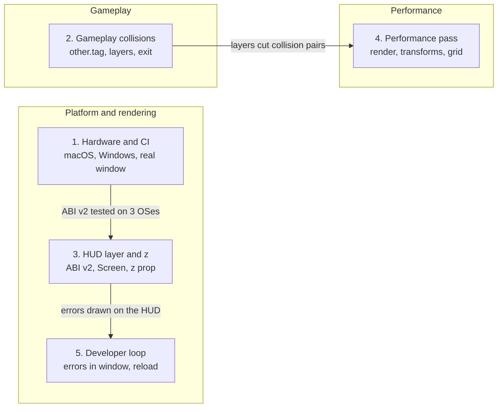

# react-game-engine: next priorities after Phase 3

As of 2026-11-09. Written after the post-N6 review; see [NATIVE_PLAN.md](NATIVE_PLAN.md), "Review after N6", for what that review measured and fixed.

## Summary

Phase 3 is done: a compiled game runs in a native window under Node and as a QuickJS-ng executable, with byte-identical output between the two. The post-N6 review fixed three performance cliffs and five bugs. What it cannot yet do is ship to someone else, or support a game whose logic depends on *what* it hit. The next five priorities, in order:

| # | Priority | Why now | Size (estimate) |
| --- | --- | --- | --- |
| 1 | Verify on real hardware; build macOS and Windows in CI | Nobody has played it in a real window; macOS and Windows have never been built | \~1 week |
| 2 | Collisions gameplay can use: readable `other`, layers, exit events | A handler cannot tell a coin from an enemy, which blocks almost any game | \~1–1.5 weeks |
| 3 | A screen-space HUD layer and a `z` prop (ABI v2) | A score drawn in the world moves with the camera; draw order is tree order only | \~1 week |
| 4 | Performance pass two: dependency-scoped `render()`, cached transforms, a collision grid | 2,000 state-driven objects with colliders still take 18 ms of a 16.7 ms frame under QuickJS | \~1.5–2 weeks |
| 5 | Developer loop: errors in the window, scenes as an entry point, hot reload | A crash today closes the window and prints to a terminal the player may not see | \~1.5 weeks |

Sizes are rough, for one engineer, in the style of the Phase 3 plan. Each priority below ends with a checklist that says when it is done.

## 1. Verify on real hardware, and build macOS and Windows in CI

Every Phase 3 milestone was built and tested only in a Linux cloud container, against a virtual display. Three things have never happened: a person playing in a real window, a sound actually playing (hidden test windows have no audio device), and a build on macOS or Windows. `host/build.rs` carries macOS and Windows link lists copied from raylib's and marked unverified, so the first person to try either platform is likely to hit a link error.

**Work**

- A person plays the demo on a desktop: window feel and resizing, arrow keys and WASD, both Shift keys (the review changed how left and right combine), a click on the button through the moving camera, and the click sound.
- CI jobs on `macos-latest` and `windows-latest`: build librge on raylib's software renderer and run the C smoke test, build the Rust host, and run the Node↔QuickJS parity test. The software renderer needs no display, so all three platforms can run the same checks.
- A compile-only desktop (OpenGL) build of librge and the host on macOS and Windows, so the window path at least links.
- Cache Cargo and the CMake build of raylib in CI: today every job rebuilds raylib from source, twice in `native-desktop`.

**Done when**

- [ ] The demo has been played on Linux, macOS and Windows desktops, with any findings filed
- [ ] Sound plays on all three
- [ ] CI runs smoke, host build and parity on Linux, macOS and Windows
- [ ] Desktop builds link on macOS and Windows in CI
- [ ] The "unverified" notes are gone from `build.rs` and `NATIVE_PLAN.md`

## 2. Collisions that gameplay can use

`onCollisionEnter(other)` fires correctly, but handler code can read nothing on `other`: the compiler's handle type for a `GameObject` is empty. So a player cannot tell a coin it should collect from an enemy that should hurt it. This is listed as "Later" in the Phase 2 plan, pending a decision on what a collider exposes. Almost every game needs it, so it moves up.

**Proposal**

- A `tag` prop on `<Collider>` (a string, `"coin"`, `"enemy"`), readable in handlers as `other.tag`. The compiler adds `tag` to the handle type and checks the comparison like any other string.
- Layers: a `layer` and a `hits` list on `<Collider>`, so a bullet can ignore other bullets. The tracker skips those pairs before testing them, which also helps the pile case.
- `onCollisionExit(other)`, for "standing on a platform" or "inside a zone". The tracker already knows when a pair stops touching; it only needs to keep last frame's colliders beside their keys.

**Done when**

- [ ] The tag design is settled in `DESIGN.md` (see the open decisions below)
- [ ] `other.tag` reads in handler code, with a compiler test and a diagnostic for an unknown member
- [ ] Layers and `hits` filter pairs, tested against every-pair testing like the existing randomised test
- [ ] `onCollisionExit` fires once when a pair separates, and when either collider leaves the world
- [ ] The demo (or a second small demo) collects one thing and is hurt by another

## 3. A screen-space HUD layer and draw order

Everything is drawn through the camera, so a score or a health bar placed in the world drifts away as the camera follows the player; the demo's "Clicks" text does exactly that. Draw order is tree order only, so a sprite that must sit behind its siblings has to be moved in the tree.

**Proposal**

- A `<Screen>` built-in. Its subtree is drawn after the world, through an identity view, in window pixels. The player emits a second `RGE_OP_VIEW` before it.
- librge today refuses a second view record ("malformed draw records"), so this is an ABI change: allow a later `RGE_OP_VIEW` to replace the current view, and bump `RGE_ABI_VERSION` to 2. Both hosts already check the version at load.
- A `<Pointer>` inside `<Screen>` is hit-tested in window coordinates, so HUD buttons work while the camera moves.
- A `z` prop: a sort key applied in TypeScript to the draw list before it is sent, stable within equal keys. It stays inside the current record format.

**Done when**

- [ ] `rge.h`, `protocol.ts` and the header-parity test agree on ABI v2; `smoke.c` checks a second view
- [ ] `<Screen>` children stay fixed while the camera moves (a recording test and a pixel test)
- [ ] A HUD pointer receives presses through a moving, zoomed camera
- [ ] `z` reorders records, and equal keys keep tree order
- [ ] The demo's click counter moves into a `<Screen>`

## 4. Performance pass two

After the review, 2,000 objects moving the way compiled components do cost about 7 ms of script a frame under QuickJS; with a collider each, about 18 ms, which is over a 60 fps frame before any drawing. Each of the three known fixes targets one column below.

Script time per frame under the Rust host (QuickJS-ng), by phase; objects move the way compiled components do. Measured with the bench in `packages/player/bench` during the post-N6 review on a 4-core 2.1 GHz cloud VM, noisy to about ±15%.

| Scene | Tick: hooks, state, renders | Tree walk and draw list | Collisions | Total |
| --- | --- | --- | --- | --- |
| 2,000 by state | 3.1 ms | 4.3 ms | — | 7.4 ms |
| 5,000 by state | 8.1 ms | 11.1 ms | — | 19.2 ms |
| 2,000 by state + colliders | 3.9 ms | 6.0 ms | 8.5 ms | 18.4 ms |

The tree walk costs most; collisions add as much again. A 60 fps frame is 16.7 ms.

**Work, one per column**

- **Tree walk: cache world transforms for still subtrees.** Most objects do not move in a given frame, but every frame recomposes every transform from the root. This needs a change signal: `Transform`'s fields are plain public fields, so either setters that bump a version, or a comparison against last frame's values.
- **Tick: dependency-scoped `render()`.** Today a moving object re-runs its whole `render()` every frame. Every dynamic prop already records which state it reads, so the compiler can re-evaluate only the props whose state changed. Setters called with an updater (`setX(x => x + 1)`) also allocate a closure per call, which the compiler could avoid.
- **Collisions: a uniform grid.** The sweep over x degrades when colliders line up in columns, as platforms and the bench's own grid do. A grid sized to a typical collider keeps it near linear. Layers from priority 2 also cut pairs before they are tested.
- **A guard in CI.** The host job prints these numbers but fails on nothing, which is how a quadratic mount went unnoticed. Fail it on a generous threshold, or on the QuickJS/Node ratio, which is steadier on shared runners.

**Done when**

- [ ] 2,000 state-driven objects with colliders take under 10 ms of script a frame under QuickJS (a proposed target: about half of today's 18 ms)
- [ ] The parity test still passes byte for byte
- [ ] CI fails when a bench scene regresses past its threshold
- [ ] The new numbers are recorded in `NATIVE_PLAN.md`

## 5. The developer loop

When a handler throws, both hosts print the stack and exit with status 1. That is right for CI, but a player who double-clicked the packaged game sees the window vanish, and a developer loses the frame they were looking at. Iterating also means a full restart: there is no reload.

**Work**

- **Errors in the window.** Catch an exception from a step, keep the window open, and draw the message and stack in screen space (on priority 3's layer) until it is closed. Keep exit status 1 for headless runs and CI.
- **Scenes as an entry point.** `loadScene` and the Tiled importer exist, but `PlayerConfig` only takes `root: () => GameObject`. Add `scene` and `prefabs` options, which the Phase 3 plan already suggested if `root` turned out awkward.
- **Hot reload in the Node host.** Recompile a changed `.tsx`, swap its class, and keep state by element id. The IR's stable element ids and scene ids were designed for this.
- **Key names checked at compile time.** `input.pressed("Spcae")` warns once at run time today. The compiler can report it with a did-you-mean, as it already does for shape kinds.

**Done when**

- [ ] A thrown handler shows its message in the window under both hosts; headless runs still exit 1
- [ ] A game can start from a scene file and a prefab registry
- [ ] Editing a component while `npm run play:demo` runs updates it in place, keeping its state
- [ ] An unknown key name is a compile error with a suggestion

## Sequencing and open decisions

Start priorities 1 and 2 together: they touch different code (CI and build scripts; the compiler and the collision tracker). The HUD layer waits for cross-platform CI because it changes the ABI, and in-window errors wait for the HUD layer they draw on.

**Decisions needed before work starts**

1. **What `other` exposes (priority 2).** A `tag` string on the collider is the proposal. The alternative is the owning prefab's name, which needs no new prop but cannot tell two colliders on one prefab apart.
2. **How a moved transform is detected (priority 4).** Setters with a version counter are exact but change `Transform` from plain fields; comparing against last frame keeps the fields but costs a check per object.
3. **Whether ABI v2 also takes the `z` sort key (priority 3).** Sorting in TypeScript keeps the record format unchanged, which is the plan's existing choice.
4. **Who plays the demo on macOS and Windows (priority 1).** This needs a person with each machine; no CI job can replace it.

## Not now, and what would pull it in

The rest of the backlog (the player's and the compiler's) waits because nothing above depends on it, or because no game has asked for it yet. Each row names what would move it up.

| Item | Why it waits | What would pull it in |
| --- | --- | --- |
| Sprite sheets, tint, opacity, pivot on `Sprite` | The demo needs none; each is a record field plus a prop | The first game with real art (likely right after priority 3) |
| Fonts, text measuring and alignment | The default font works for a demo | A HUD (priority 3) that needs centred or right-aligned text |
| Sound volume, looping music, overlapping plays, a build-time asset check | `useSound` takes one literal path and covers one-shot effects | Any game with background music |
| Web backend (canvas) | Records map directly onto canvas calls, so it stays cheap to add later | Wanting a shareable browser build |
| Gamepads, high DPI, fixed timestep | Each slots into the ABI without rework | A controller game, a blurry Retina window, or physics |
| One-file executable, prebuilt librge, macOS signing | Packaging as a folder works | Handing a build to people outside the team |
| SDL3 platform layer, native code generation | Large, and nothing measured asks for them | Consoles, or script time dominating after priority 4 |
| Custom hooks (`function useHealth(max) { … }`) | Inlining them at compile time fits "hooks are compiler intrinsics", but no game needs them yet | Repeated hook logic across components |
| Context (`createContext` / `useContext`) | Props cover today's trees | Deep trees passing the same prop down many levels |
| Spread props, conditionals inside a list's `.map`, forwarding `{children}`, children on list items | Each is rejected today with a clear diagnostic | An author hitting one of those diagnostics in a real game |
| Tiled importer gaps (`visible`, tile flip flags, whole-number `int` checks, template properties) | The importer covers the example maps | A map that uses them |
