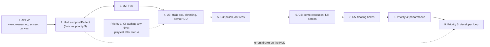

# react-game-engine: next priorities after Phase 3

As of 2026-11-09. Written after the post-N6 review; see [NATIVE_PLAN.md](NATIVE_PLAN.md), "Review after N6", for what that review measured and fixed.

## Summary

Phase 3 is done: a compiled game runs in a native window under Node and as a QuickJS-ng executable, with byte-identical output between the two. The post-N6 review fixed three performance cliffs and five bugs. Since then, collisions that gameplay can use (#34), a fixed game resolution, a layout offset and `z` draw order (#36), and a Zustand-style game state with a `<Game>` root that carries the window's settings (#37) have landed, and the UI work is planned in [UI_PLAN.md](UI_PLAN.md) (#35, #38). **The order to work in is in "Order of work" below**; the five priorities, as first ranked:

| # | Priority | Why now | Size (estimate) |
| --- | --- | --- | --- |
| 1 | Verify on real hardware; cache CI builds | Nobody has played it in a real window; every CI job rebuilds raylib from source | \~2–3 days |
| 2 | Collisions gameplay can use: readable `other`, layers, exit events (**done**, #34) | A handler could not tell a coin from an enemy, which blocked almost any game | Done |
| 3 | ABI v2 with a HUD layer, plus `z` draw order (`z` **done**, #36) | A score drawn in the world moves with the camera; layout and `pixelPerfect` need the same ABI change | \~1–1.5 weeks, `z` done |
| 4 | Performance pass two: dependency-scoped `render()`, cached transforms, a collision grid | 2,000 state-driven objects with colliders still take 18 ms of a 16.7 ms frame under QuickJS | \~1.5–2 weeks |
| 5 | Developer loop: errors in the window, hot reload, key names checked by type (**done**; scenes as an entry point dropped) | A crash today closes the window and prints to a terminal the player may not see | \~1.5 weeks |

Sizes are rough, for one engineer, in the style of the Phase 3 plan. Each priority below ends with a checklist that says when it is done.

**What comes after these** is Phase 4, decided 2026-11-10: play the engine on a real machine, build a real small game and let it drive the backlog, then make it usable outside this repository by making a third game outside it (decided 2026-11-11; [ADVENTURE_PLAN.md](ADVENTURE_PLAN.md)). See "Phase 4: driven by a real game" below.

## Phase 4: driven by a real game

Decided 2026-11-10. Once priority 5 lands, every ranked item above is done or deliberately set aside, yet the engine has only been built against the demo: about 180 lines of TSX that nobody has played in a real window. Most of "Not now" below waits on the same trigger, "the first game that needs it". So the next phase is led by games, not by engine features.

**Who it is for.** Mostly the author, making their own games; open-sourcing it is a goal for later, not now. That puts a real game first and readiness for other people second. The game is an original precision platformer; see priority 7.

**Local first.** Everything stays on the desktop: a game is written, played and packaged on one Linux machine. No web backend, hosted builds, other platforms or distribution yet (see "Not now").

| # | Priority | Why now | Size (estimate) |
| --- | --- | --- | --- |
| 6 | Play it on a real machine (the rest of priority 1) | Window feel, keys, the HUD, scaling and sound have never been tried by a person; sound has never been heard | \~1 day |
| 7 | A real game: the first level of a precision platformer, and the engine features it needs | The demo is too small to find what is missing; the "Not now" table is waiting for a game to ask | \~4–6 weeks |
| 7b | A second, small game in a different genre: a tower defense ([TOWER_DEFENSE_PLAN.md](TOWER_DEFENSE_PLAN.md)) (**built**, `packages/hearth`; four of five Tier 3 items built, see below) | Kite hit no Tier 3 item and never measured finding 9; a game of lists, menus and many sprites tests both, so priority 8 describes a shape that has worked twice | \~3–4 weeks |
| 8 | Usable outside this repository, tested by a third game made outside it: a small top-down adventure ([ADVENTURE_PLAN.md](ADVENTURE_PLAN.md)) | A game only builds as a workspace in this monorepo, and the docs are design notes, not a guide; and both games so far are one screen, a few minutes long and keep nothing, so a large world, saves, maps saved by Tiled, deeper UI, enemies that path, and rebinding are all untested | \~4–6 weeks |

**Order.** 6 can start now, alongside priority 5, and is still the cheapest way to learn something before priority 8: Hearth has never been played in a window. 7 can start now too: a new game package mostly adds code, so it does not clash with the developer-loop work in the player, host and compiler, and the game is the first real user of hot reload and in-window errors. 8 waits until 5 settles, because it packages that loop, and until 7 and 7b have shown what a game's project layout looks like.

### 6. Play it on a real machine

This finishes priority 1. Most useful now that the HUD, `<Flex>`, the fixed resolution and full screen are in.

**Work**

- Run `npm run play:demo` on a Linux desktop: the window and resizing, the 3× default and `fit="expand"`, full screen, arrow keys and WASD, both Shift keys, a press on the HUD button while the camera moves, and the click sound.
- Run the packaged build (`npm run package`) the same way, under both the default V8 build and `--engine quickjs`.

**Done when**

- [ ] The demo has been played on a Linux desktop, under Node and as a packaged build, with any findings filed or fixed
- [x] Sound plays (the author, playing Kite on a Linux desktop, 2026-11-11)
- [ ] Whether `native-desktop` in CI builds raylib once is checked (the open item from priority 1)

### 7. A real game: the first level of a precision platformer

Decided 2026-11-10: the game is an original precision platformer, in the spirit of tight-control mountain-climbing platformers: run, jump, a mid-air dash, wall slide and wall jump, short single-screen rooms, instant respawn, and a camera that moves room to room. The first milestone is **one complete level**: a title screen, 5–8 rooms that teach and then combine the mechanics, and an end screen, with music, sound and gamepad support. The character, art, rooms, music and name are all original; the genre is the reference for feel, not a source to copy.

It lives in its own package beside `packages/demo`, and is written only through the public authoring API (`@rge/runtime/jsx`), as an outside author would. Unlike the "pull it in when needed" rule elsewhere in this document, the engine features below are planned up front: any game with a level, a character and music needs them, and this level is what tests each one.

**Goals, in order:** it feels good to control; it is a complete, playable level; the engine gains the features below, each designed, tested and documented; and the gaps it still finds are written down.

**Not in this level:** a save system, settings or key rebinding, dialogue, cutscenes, a level editor, a web build or other platforms.

**Movement and collision stay in game code.** `<Collider>` reports overlaps but stops nothing, so the player moves one axis at a time against the tilemap's solid grid, with whole-pixel positions and a sub-pixel remainder. Colliders handle hazards, room exits and pickups. Run, variable jump, coyote time, the jump buffer, an 8-direction dash, wall slide and wall jump come from one module of constants, first set from the genre's usual ranges and checked by tests, then tuned by a person playing (priority 6). **The game's rules are kept apart from drawing:** movement, rooms, deaths and pickups are plain functions or hooks that take inputs and return state, so a test can run them without rendering anything. If that code is worth sharing, it becomes the first custom hook.

**Headless tooling, built first.** A person is not always there to play, and the level is written and checked mostly by agents, so the game must be buildable and verifiable without a window. The engine already has the parts: `RecordingBackend` (scripted input, decoded draw records), the software-rendered hidden window with `readPixels()`, and the parity script. Four things are missing, and they come before the game, in their own commits:

- **A screenshot script** that renders a frame, or chosen frames of a scripted run, to PNG through the headless build, plus a contact sheet of a run, so an agent can look at a room, an animation or a camera slide.
- **A headless harness** that takes a game and an input script and returns the game's state for each fixed step (the player's position and velocity, the room, deaths, pickups), so tests assert on behaviour such as jump height or reaching an exit, not on draw records.
- **An input-script helper**, turning a short script such as `right*30, jump, right*20+dash` into input frames. The same format is the replay format for "every room can be finished" tests. (Added in priority 7b: `click@120,64` moves the mouse to a point of the game's canvas and taps `MouseLeft`; `mouse@120,64` only moves it; see `ScriptOptions.screen`.)
- **One check command per game** (for example `npm run check:<game>`) that compiles it, type-checks, runs its tests and the parity run, and prints a short pass or fail summary.

The harness steps exactly one tick at a time, so once the fixed timestep lands, a run is repeatable and a replay is a trustworthy test. None of this tells an agent how the game *feels*; that is still priority 6.

**Engine additions, Tier 1: needed for the level to work**

- **Fixed timestep.** `useUpdate` runs at a fixed rate (60 Hz) from an accumulator; drawing stays once per frame. A `<Game>` prop turns it on, and no input pressed between steps is lost.
- **Sound that loops, with volume, and overlapping plays.** `useSound` gains a volume and can play over itself. Looping music (a `useMusic` hook or `<Music>` built-in) streams, loops, stops and fades, and keeps playing across room changes. A build-time check finds missing sound and image paths.
- **Sprite sheets and sprite options.** A sprite draws one frame of a sheet; `<AnimatedSprite>` plays named animations from a sheet, with a frame rate and a loop setting. `Sprite` gains `flipX` / `flipY`, an origin (pivot), tint and opacity.
- **A tilemap.** A `<Tilemap>` built-in draws a grid from a tile sheet without a game object per tile, can be queried as a solid grid by movement code, and loads from Tiled layers, filling the importer's gaps (`visible`, tile flip flags) on the way.
- **Rooms and the camera.** Camera bounds that clamp to the current room, a short slide between rooms done by the camera, and switching from title to level to end screen. The switching is agreed with priority 5's "scenes as an entry point", not built twice.

**Engine additions, Tier 2: what makes it feel like a game**

- **Gamepad input.** Buttons and the left stick through `useInput`, with names in the style of key names (`"PadA"`, `"PadLeft"`) and a deadzone; a new ABI call over raylib's gamepad functions.
- **Freeze frames and screen shake.** Pause the world's update for N steps (the dash, a death), and a camera shake with a strength and duration.
- **Particles.** A `<Particles>` emitter (rate, lifetime, speed, gravity, color, shrink or fade) for dust, the dash trail and death, with no game object per particle.
- **Screen fades** to and from a color on the HUD layer, for death and room or scene changes.
- **A pixel font** for the title, the end screen and the HUD.
- **Custom hooks** (`function usePlatformerBody(...) { ... }`), inlined at compile time to match "hooks are compiler intrinsics".

**Tier 3: only if the level asks for them.** Context, spread props, conditionals inside a list's `.map`, and forwarding `{children}`. A diagnostic is lifted only when the level hits it, and each case is recorded as a finding.

Each addition gets a design section in the matching doc (`DESIGN.md`, `NATIVE_PLAN.md` or `UI_PLAN.md`), compiler and runtime tests, and a recording or pixel test where it draws, and keeps the parity test byte-identical. Native changes are batched so `RGE_ABI_VERSION` moves once per batch. Engine and game changes go in separate commits.

**Order of work**

0. Headless tooling: the screenshot script, the harness, the input-script helper and the check command, with tests of their own, using the demo as the first game.
1. Greybox: the player and tiles as `<Shape>`s, rooms as in-code tile strings, a variable step; movement roughly right, with headless tests for its rules.
2. Fixed timestep, then retune movement under it.
3. Tilemap, rooms and camera; the rooms move into Tiled.
4. Sprite sheets and sprite options: the character's animations, facing left and right.
5. Sound: effects with volume and overlap, then looping music.
6. Gamepad.
7. Feel: freeze frames, screen shake, particles, fades.
8. Title and end screens with the pixel font; play it start to finish and as a packaged build.
9. Custom hooks whenever the movement code is ready to be pulled out, by step 7 at the latest.

Someone plays it on a Linux desktop after step 1 and at the end (priority 6); the agent does not wait for that. Steps 0–4 are a natural place to stop and review if a person wants to.

**Done when**

- [x] A one-page design note in the game's package covers the mechanics, the room list and what "finished" means for the level (`packages/kite/DESIGN.md`)
- [x] The level is playable from title to end with keyboard or gamepad, under Node and as a packaged build, with music and sound. *Verified headlessly only*: a scripted run plays title to end through the game under Node and the first rooms under the Rust host, and `npm run package:kite` builds both the Node/V8 and the QuickJS folders and they start. Played on a Linux desktop by the author on 2026-11-11, with sound working (priority 6)
- [x] Every Tier 1 and Tier 2 addition is in, each with its design notes and tests, and its "Not now" row is removed or updated
- [x] The movement constants are recorded in the design note, with untested guesses marked; a person tunes them by playing (priority 6)
- [x] The headless tooling works on the demo and the game: screenshots and contact sheets, the harness with input scripts, and one check command
- [x] Headless tests cover the movement rules (coyote time, the jump buffer, the dash refill, a wall jump) under the fixed timestep, and a scripted run finishes every room
- [x] The parity test passes and `npm run bench:check` stays within budget; frame time on the busiest room is recorded in `NATIVE_PLAN.md` ("What a frame of the level costs")
- [x] A "Findings from the first level" section is added here: each gap beyond the planned additions, its workaround or fix, and what it should become
- [x] `npm test` and `npm run typecheck` pass

**Built 2026-11-10** in `packages/kite` (a game, "Kite: The Foothills"; `npm run check:kite`, `npm run play:kite`, `npm run package:kite`). Order of work as planned, one commit per step. Scene switching (title, level, end) is a `screen` leaf in the game state and three conditions in the root, so priority 5's scenes-as-an-entry-point was not needed and nothing was built twice; whoever does priority 5 should read it as the first real use of switching.

### Findings from the first level

What writing a real game found, beyond the planned additions. Each says what the workaround was and what it should become.

1. **A compiled component can hold almost no logic.** Handlers have no loops, `let`, or calls beyond an allowlist, and the game state holds only numbers, strings and booleans (no arrays). *Workaround:* every rule is a plain function in `src/rules/`, the game state keeps the run as leaves and its actions call the rules, and a component passes the buttons as one packed number (`step(buttons, dt)`). This worked well, and is what made the rules testable without the engine. *Should become:* say it as the intended shape in the guide (priority 8); consider arrays in the game state, and an `input.any("ArrowLeft", "A", "PadLeft")` helper or an action map, since the button reading is a long `||` chain.
2. **Custom hooks cannot return refs, setters or functions, and take no callbacks.** They are inlined text, so only values come out, and a parameter that is a function has nowhere to go. A literal argument is substituted, which is how `useSoundOnCount("jump.wav", …)` gets a path. *Workaround:* three hooks (`usePlatformerBody`, `useSoundOnCount`, `useBurst`) that take values and return a value or nothing. *Should become:* positions in diagnostics point into the expanded text, not the source (a source map), and a hook may want a shorthand for "play this sound when a counter changes".
3. **Events are counters.** There is no way to call a sound from a store action or to react to a state *change*, so the rules count what happened (`jumps`, `lands`, `deathCount`) and the component compares with a ref (`useSoundOnCount`, `useBurst`). It works and is one step late. *Should become:* an event or change-subscription hook, or `useGame` selectors that fire a handler on change.
4. **Freeze frames and deterministic replays interact.** `freeze()` skips `onUpdate` for some steps, so a replay's frames and the rules' steps no longer line up; the solver and the rule-level test needed `playback.ts` to model what the engine does (skip, keep presses). The engine side keeps key edges for the first step after a freeze. *Should become:* the fixed-step driver (accumulator, freeze, edge carry) as a function a test can use without a player, so nobody models it twice. **Done:** `FixedDriver` (`packages/player/src/fixed.ts`) is that function; `createPlayer` and Kite's `playFrame` both run through it. Writing it found that the engine did *not* keep a press made in a freeze for `onUpdate` (only `onInput` saw it, in the frozen step), so the replay modelled something the game lacked. It does now: `World.tick`'s `beforeUpdate` hands `onUpdate` the kept edges.
5. **Colliders report one frame late, and are the wrong tool for tiles.** Hazards, exits and the start are tiles the rules read in the same step; only the gem is a `<Collider>`. *Should become:* a `<Tilemap>` option that makes colliders from tile properties, if a game wants callbacks for them.
6. **Wall jumping a single wall is a ladder.** Room 3 (the dash) can be crossed by wall jumping out of its pit. Not a bug in the rules, but it says wall jump needs a limit or a cost if "needs the dash" is to hold. *Should become:* a design call after someone plays it (priority 6).
7. **Room seams are not continuous.** The character is placed standing on the next room's floor a little inside it, under the camera's slide; a continuous world would need the neighbouring room's tiles and hazards to be live during the slide. *Should become:* decide when levels get bigger than one screen (the camera's `bounds` and `slide` already allow it).
8. **The importer was never run on a map saved by Tiled.** The maps are written by `tools/make-rooms.ts` in Tiled's JSON format, and the tests use hand-written maps; real files from Tiled (other layer formats, external tilesets, more than one tileset, tile objects) may differ. *Should become:* open a room in Tiled and fix what breaks (priority 6 or 8).
9. **Styled sprites leave the fast path.** A sprite with a frame, a flip or a tint is written by the general walk and is not moved as a block; fine for a handful, measurable for hundreds. `<Tilemap>` has no culling (the level draws the room and its neighbours only, by conditions). *Should become:* measure with a scene of many animated sprites before optimising.
10. **Frame time spikes when a room changes** (about 25 ms for one step on the cloud VM): a `<Tilemap>` is made and the bounds change. Not noticeable during a 0.4 s slide that the world waits through, but it is the first thing to look at if a person sees a hitch. *Should become:* build the next room's tilemap one step early.
11. ~~**Sound has never been heard**~~ It has: the author played Kite on a Linux desktop (2026-11-11), and its sound and music worked.
12. **Room 4 was unplayable** (found by playing, not by the tests): the search found a contrived route, and the natural dash-up never worked. Fixed by redesigning the room and by testing a window of dash timings for the two dash rooms. *Should become:* a margin check for every room's key move, not only those two, and the search preferring routes a person would take.
13. **Particles in an emitter that is removed are removed with it.** The first version mounted a burst emitter for 0.1 s and unmounted it, which cut the particles off, and kept them in the character's space, so they stuck to it. Emitters now stay mounted, switch on, and use `space="world"`. *Should become:* the guide should say this, and `<Particles>` may deserve a one-shot `burst` trigger that is not a prop toggled twice.
14. **A router** was asked for, and built: `<Router route transition>` with `<Route name>` screens, transitions as plain functions (finding 1's escape hatch, now real: plain `.ts` functions are callable from components and passable as props). `useUpdate` takes the input, and an action can take it, so Kite's controls are read in plain TypeScript. Sharp scaling (ABI v6) fixes uneven pixels at fractional scales. See NATIVE_PLAN.md and DESIGN.md.
15. **Smaller things.** The title's "press Z" prompt blinks from a counter in `useInput` (fine, but `useUpdate` would be more honest); `Particles` `emitting` and `burst` together mean "burst when it turns on, including when mounted", which reads oddly until you know it; the bitmap font has one case; TypeScript 7's strip-only mode in Node rejects parameter properties and enums, so the asset tool uses plain classes; `tools/screenshot.ts` needs the headless build and is slow on a cold cache; `npm run check:<game>` runs the Rust host comparison only if `host/target/release/rge-host` exists. The Tier 3 items (context, spread props, conditionals in `.map`, forwarding `{children}`) were **not hit**: the level has no lists and no deep trees, so their diagnostics stay and their rows in "Not now" stay too.

16. **Code that did not read like React** (reviewed after the level was done, 2026-11-11), and what replaced it:
    - *Counters as events* (`jumps`, `lands`, `deathCount` in the state, compared with refs every frame by `useSoundOnCount`, `useBurst`, `shake={deathCount}`). Now the rules push `GameEvent`s and the game state answers them through **effect stores** (`createParticles` + `<ParticleLayer>`, `createSounds`, `createShake`), called from anywhere like a toast library. No `useEffect` was added: watching state to fire events is the pattern React advises against. This also closes finding 13.
    - *Eighteen leaf selectors and a `RUN_KEYS` copy loop.* The game state now holds objects, arrays and computed values (`run: newRun()`), and a selector may name an object (`useGame((s) => s.run.player)`), re-rendering when anything under it changes.
    - *Eight hand-written rooms in `Level.tsx`.* Constants import from `.ts` files: `ROOM_LIST.filter(…).map(…)`; the gem is placed from the room data.
    - *Key lists in three places.* `createControls` and `<Game controls>`: `input.pressed("confirm")` anywhere.
    - *Smaller.* A fragment may be a condition's branch (`{!taken && <>…</>}`); the gem owns its collision; screens write with a `<Label>`; animations are a table; the title blinks from time in `useUpdate`; the game loop (`step`) is called by the `Play` screen, not a hook in the character.
    *Still open:* asset names in a `.ts` file (`createSounds`) are not checked at build time; a selected object is trusted not to be changed in place.

### 7b. A second game: a small tower defense

Planned 2026-11-11; the plan is [TOWER_DEFENSE_PLAN.md](TOWER_DEFENSE_PLAN.md). One map, three towers, three enemies and ten
waves, written the React way, so its lists, menus and panels hit the Tier 3 items (spread props, conditionals inside
`.map`, children on list items, forwarding `{children}`, context) for real reasons, and its last waves measure finding 9
(many animated sprites). Each Tier 3 item is built when the game hits it, or recorded as not needed. It comes before
priority 8.

**Built 2026-11-11** in `packages/hearth` ("Hearth"; `npm run check:hearth`, `npm run play:hearth`, `npm run package:hearth`; its design note is
`packages/hearth/DESIGN.md`). In the order of the plan: input scripts can click (`click@x,y`, `mouse@x,y`); the design note and the rules, with
headless tests; the game written the React way with marked workarounds; the Tier 3 items the game hit, one commit each (spread props,
conditionals in a list's `.map`, forwarding `{children}`, children on list items), each removing its workaround; art, sound, the balance tool and the wave
replays; the two bench scenes and wave 10's frame time. **Not done:** context (below, recorded as not needed), a real-window and Node-engine package (`package:hearth -- --engine quickjs --headless` builds and starts;
the window builds need GL dev packages this VM lacks), and nobody has played it in a window. `check:hearth` agrees between Node and the Rust host.

### Findings from the second game

What building Hearth found, and which of Kite's findings held a second time.

**Tier 3, as planned:**

1. **Spread props** were hit at once (`<Enemy key={e.id} {...e} />`) and are **built** for component elements: a `SpreadProp` in the IR, a real spread in the
   generated constructor call and `updateProps`, tests that only the item whose object was replaced re-renders and that a named prop after a spread
   wins. A spread onto a built-in is still a diagnostic (the game never wanted it). See DESIGN.md, "Spread props".
2. **Conditionals inside a list's `.map`** were hit twice (a pad that is an `EmptyPad` or a `Tower`, and a shot that is `live`) and are **built**, both the `&&`
   (an implicit filter) and the `? :` form (an item that switches class keeps its position; both branches need the same key). A limitation the game
   found: the `&&` form is a filter, so TypeScript cannot narrow inside it (`p.tower && <Tower {...p.tower}/>` would not type-check); the `? :` form
   narrows because the generated branches test the condition itself.
3. **Forwarding `{children}`** was hit by the modal (`<Panel title={title}>{children}</Panel>`) and is **built**, with option A decided in the plan (the
   forwarded `{children}` is the only child passed on). The game never wanted anything beside it. See DESIGN.md, "Forwarding".
4. **Children on list items** were hit by the build menu (`TOWER_LIST.map((d) => <MenuButton …><Icon/><Label/></MenuButton>)`, `RGE1209`), worked around for a while with one
   component per item, and are **built** for the first cut: an item (a component or a built-in) may have plain child elements that read the item. Each item's children are made
   with it, kept in the list's per-key record (`kids`) and given the item's current value on every render, attached with `attachPassedChild` (or `addChild` on a built-in), and go
   with the item. Still rejected: a condition, a list, `{children}` or nested children inside an item's children, and children on a `? :` item that switches between two
   elements. See DESIGN.md, "Children on list items".
5. **Context was not needed, and is not built.** Each tower's `Barrel`, `RangeRing`, `LevelPips` and `MuzzleFlash` take two or three props from `Tower`, one level
   of nesting; the only per-tower thing read deeper is the cursor, a store selector. The plan's reason to build it (one value per list item that a single
   global store cannot hold without ids) did not arise at this size. Its row in "Not now" stays, with a sharper pull: a component tree three or more levels
   deep passing the same props through.
6. **Finding 9 (many animated sprites) measured, not a problem:** 200 animated, styled sprites re-rendered every step take 2.2 ms under QuickJS (0.2 ms under V8); wave
   10 of Hearth (109 enemies) takes a mean of 6.7 ms and a 99th percentile of 15 ms per step under QuickJS. The "moved as a block" fast path for styled sprites was not
   built. The cost that does show is one `render()` per enemy per step. See NATIVE_PLAN.md.

**Compiler subset, found by writing a game the React way** (each is a clear diagnostic; the workaround and what it should become):

7. **No constants or tables at the top of a component file** (`RGE1001`), **no index reads in render expressions** (`KIND_INDEX[kind]`, `pads[cursor]`) and **selectors must
   be plain paths** (`s.battle.pads[s.cursor]`, `s.cursor === id` were `RGE1103`). **Built** after review: top-level `const`s and helper functions in a component file,
   index reads and `!`, `Math.PI`, and computed selectors (each path read is its own subscription; the expression is a derived value). Hearth's `rules/view.ts` lost
   `towerFrame`, `iconOf` and `PIPS` to the components that use them, and the store lost its `focus` copy: `useGame((s) => focusOf(s.battle, s.cursor))`.
   See DESIGN.md, "Computed selectors" and "Constants, helpers and index reads beside components". Found on the way: `useGame((s) => s.enemies.length)`
   subscribed to a path the store never reports (fixed: `.length` reads the array).
8. **A component cannot be the root of another** (`RGE1003`): `BuildMenu` rendering `<Panel>` directly was rejected, so it wrapped it in a `<Flex>`. **Built**:
   a component, a condition (`on ? <X/> : null`) or `null` may be the root; the component is a see-through container (`layoutContents`, CSS's
   `display: contents` for `<Flex>` layout), so the panel still grows to the column. See DESIGN.md, "Component, condition and null roots".
9. **A game-state action cannot be passed as a value** (`onPress={startWave}`), and **a callback prop could be forwarded whole only to a component**. **Built**:
   both are accepted (`onPress={resume}`, `<Flex onPress={onPress}>`). Note: destructuring several values from the store
   (`const { gold, lives } = useGame((s) => s.battle)`) already worked when Hearth was written; `SidePanel` now uses it.
10. **A compiler bug found and fixed:** a keyed list over an imported constant (`TOWER_LIST.map(…)`) whose item has a callback that reads the item crashed the generator
    (`Unexpected list source`), because the item's type was only known for state and prop sources. It now reads `(typeof TOWER_LIST)[number]`.
11. **`<Pointer>` had no hover**, so the plan's "range ring while the mouse is over a tower" was the selected tower's ring instead. **Built** after review:
    `onPointerEnter` / `onPointerLeave` on `<Pointer>` and `<Flex>`; a tower shows its range while selected or hovered. Two smaller gaps the review named
    are built with it: `<Game font>` (the bitmap font of every `<Text>` without its own, which `Label` existed mostly to repeat) and `useTime()` (seconds
    since mount, which `Title` wrote out with `useState` and `useUpdate`).
12. **`<Flex>` has no `z`**; the pause modal draws above the panel because it comes later in the `<Hud>`. Fine, and what the draw order says.

**Tooling:**

13. **Input scripts can click** (`click@120,64`, `mouse@120,64`: points in the game's canvas, mapped through the screen's fit; an item may combine them with keys). Names
    in a script must start with a letter, so `1` cannot be written: the game binds `one`, `two`, `three`. The screenshot tool passes the game's `screen` export so
    its clicks land. A long replay (35,000 frames) kept every drawn frame and ran out of memory: `RecordingBackend` takes `keepFrames`.
14. **"Press already handled" flag: not needed.** The field and the panel do not overlap, and no `useUpdate` reads `MouseLeft`: every click goes through a
    `<Pointer>` or a `<Flex onPress>`, which take the topmost one under the mouse. Nothing was built.
15. **The bitmap font having one case** reads fine for menus in upper case; nobody asked for lower case.

**A second review of Hearth's code** (2026-11-11) found keyboard input taking a path of its own (an `Intent` read from the keys, applied
by rules apart from the buttons' actions) and asked for what a DOM button has. **Built:** `pressKey` (a button's own shortcut), focus
(`focusable`, `autoFocus`, `onFocus`/`onBlur`, arrow-key movement, confirm presses the focused), `<Pointer originX originY>`, a bitmap
`<Text>`'s default size, `controls.label`, self-registering tilemaps and type imports from `.ts` files. Hearth's `rules/ui.ts`,
`readIntent` and `act(intent)` are gone: every key and click calls an action, and `step(dt)` only steps the battle. See DESIGN.md, "Keys
that press things" and "Focus".

**Which of Kite's findings held a second time:** *Rules apart from drawing* (finding 1/16): yes, completely. `stepBattle` is plain TypeScript, 27 headless tests, the balance table and
the parity run all use it with no engine, and the replays then check that the components and the rules agree. *Effect stores* (finding 16): yes: `playEvents` answers the rules'
events with sounds and bursts and nothing in a component watches state. *The router* (finding 14): yes, for four screens (title, play, won, lost); no transitions were wanted.
*The game state holding objects and arrays*: yes, and it made the battle one object. *Constants from `.ts` files*: yes, with finding 7's limits. What did not hold: Kite's
character was one big component that stepped itself; Hearth steps from `Play` through one action (`act`), which is the shape Kite's finding 16 recommended and worked better.

**Balance, a note for whoever tunes it:** with the plan's first numbers eighteen bolt towers lost no lives at all. The table now has HP growing 20 % a wave and half the gold; see
`packages/hearth/DESIGN.md`. No person has played it, so these are a first pass set by a tool.

### 8. Usable outside this repository, and a third game made outside it

Today a game is a workspace in this monorepo, compiled by a path into `packages/compiler/src/cli.ts`, and the docs explain the design rather than how to use it. This is the groundwork for open-sourcing, kept local: nothing is published to a registry yet.

**Decided 2026-11-11: done together with a third game.** Kite and Hearth have shown what a game's project layout looks like, which is what this priority was waiting for. The work is tested by making a game from the template, outside the workspaces, through the guide, and the game is chosen for what neither earlier game touched: a world larger than the screen, saving and loading, maps saved by Tiled itself, dialogue and an inventory, enemies that path to the player, and settings with rebinding. The plan is [ADVENTURE_PLAN.md](ADVENTURE_PLAN.md) (working title Bramble). Performance work waits for a measured problem: under the default V8 build both games use about 1 ms a step; only Hearth's wave 10 under QuickJS (p99 15 ms) is near the line, and QuickJS is the fallback.

**Work** (the game's own engine work is in the plan)

- One command line for a game wherever it lives: compile, play (with hot reload), and package.
- A game template (or a `create` command) that makes a new game folder outside the repo and works with packed local packages (`npm pack` or a path dependency).
- A getting-started guide (from an empty folder to a packaged game) and a reference for the built-ins, hooks, props and diagnostics, separate from `DESIGN.md`.
- Choose a license, and check the repo for anything that should not be public before it ever is.

**Done when**

- [ ] A new game made from the template, in a folder outside this repository, compiles, plays and packages with the one command line
- [ ] The guide takes a new reader from nothing to a packaged game, checked by following it from scratch
- [ ] Every built-in and hook has a reference entry with an example
- [ ] A license is chosen
- [ ] Everything in [ADVENTURE_PLAN.md](ADVENTURE_PLAN.md)'s "Done when"

## 1. Verify on real hardware, and cache CI builds

Every Phase 3 milestone was built and tested only in a Linux cloud container, against a virtual display. Two things have never happened: a person playing in a real window, and a sound actually playing (hidden test windows have no audio device).

**Decided 2026-11-09: no macOS or Windows CI.** Extra platform jobs are a lot of CI for a game nobody has asked to ship there yet. Linux is the one supported platform. `host/build.rs` still carries macOS and Windows link lists copied from raylib's, and they stay unverified; the first person to try either platform is likely to hit a link error, and that is when they get fixed. See "Not now".

**Work**

- A person plays the demo on a Linux desktop: window feel and resizing, arrow keys and WASD, both Shift keys (the review changed how left and right combine), a click on the button through the moving camera, and the click sound.
- Cache Cargo and the CMake build of raylib in CI: today every job rebuilds raylib from source, twice in `native-desktop`.

**Done when**

- [ ] The demo has been played on a Linux desktop, with any findings filed
- [x] Sound plays (the author, playing Kite on a Linux desktop, 2026-11-11)
- [x] Cargo and the raylib CMake build are cached in CI (#32); whether `native-desktop` builds raylib once is unchecked

## 2. Collisions that gameplay can use

**Done 2026-11-09.** `other` is a `Contact` with `tag` and `owner` (both were chosen, see "What `other` exposes" in `DESIGN.md`), `<Collider>` takes `layer` and `hits`, and `onCollisionExit` exists. The demo has a coin (picked up, counted) and spikes (the player turns red while on them), and the parity run exercises both under QuickJS. The collision bench is unchanged: 2,000 colliders about 21 ms, a pile of 300 about 29 ms under QuickJS, before and after. The text below is the proposal as written.

`onCollisionEnter(other)` fires correctly, but handler code can read nothing on `other`: the compiler's handle type for a `GameObject` is empty. So a player cannot tell a coin it should collect from an enemy that should hurt it. This is listed as "Later" in the Phase 2 plan, pending a decision on what a collider exposes. Almost every game needs it, so it moves up.

**Proposal**

- A `tag` prop on `<Collider>` (a string, `"coin"`, `"enemy"`), readable in handlers as `other.tag`. The compiler adds `tag` to the handle type and checks the comparison like any other string.
- Layers: a `layer` and a `hits` list on `<Collider>`, so a bullet can ignore other bullets. The tracker skips those pairs before testing them, which also helps the pile case.
- `onCollisionExit(other)`, for "standing on a platform" or "inside a zone". The tracker already knows when a pair stops touching; it only needs to keep last frame's colliders beside their keys.

**Done when**

- [x] The tag design is settled in `DESIGN.md` (see the open decisions below)
- [x] `other.tag` reads in handler code, with a compiler test and a diagnostic for an unknown member
- [x] Layers and `hits` filter pairs, tested against every-pair testing like the existing randomised test
- [x] `onCollisionExit` fires once when a pair separates, and when either collider leaves the world
- [x] The demo (or a second small demo) collects one thing and is hurt by another

## 3. A screen-space HUD layer and draw order

Everything is drawn through the camera, so a score or a health bar placed in the world drifts away as the camera follows the player; the demo's "Clicks" text does exactly that. Draw order used to be tree order only, so a sprite that had to sit behind its siblings had to be moved in the tree; `z` fixed that.

**Proposal**

- A `<Hud>` built-in. Its subtree is drawn after the world through a view that ignores the camera: in canvas pixels under a `<Screen>`, in window pixels without one. The player emits a second `RGE_OP_VIEW` before it. The demo's own `Hud` component, and the `Hud` test components in the compiler's tests, are renamed, since a component cannot share a built-in's name.
- librge today refuses a second view record ("malformed draw records"), so this is an ABI change: allow a later `RGE_OP_VIEW` to replace the current view, and bump `RGE_ABI_VERSION` to 2. Both hosts already check the version at load.
- A `<Pointer>` inside `<Hud>` is hit-tested in the HUD's coordinates, so HUD buttons work while the camera moves.
- A `z` draw order: **done 2026-11-09**, as a `transform` field (`transform={{ z: 2 }}`) rather than a prop, because `z` is a common prop name that an attribute would reserve on every component. It is relative to the parent like `x` and `y`, sorted in TypeScript (stable, tree order among equals) so the record format is unchanged, and pointers follow it. See "What is drawn" in `DESIGN.md`. Cost: about 10% of the tree walk in the bench scenes under QuickJS, which priority 4's `Transform` setters would remove for games that never use it.
- UI layout (`<Flex alignItems="center" gap={8}>`, sized with Clay's algorithm) builds on this layer, and a `<Screen width={320} height={180}>` inside the `<Game>` root gives the game a fixed resolution scaled to the window; see [UI_PLAN.md](UI_PLAN.md). ABI v2 therefore carries four things, landing together so the version moves once: the second view record (`<Hud>`); `rge_measure_text` (width and line height) and `rge_texture_size` (UI_PLAN's U0); a scissor record for clipping (U0); and `RGE_OP_CANVAS`, the render texture that makes `<Screen pixelPerfect>` real (UI_PLAN's C2).

**Done when**

- [x] `rge.h`, `protocol.ts` and the header-parity test agree on ABI v2; `smoke.c` checks a second view
- [x] ABI v2 also has the measuring functions, the scissor record and `RGE_OP_CANVAS`, each with the checks in UI_PLAN's U0 and C2 (done 2026-11-10; the player does not write them yet, that is step 2)
- [x] `<Hud>` children stay fixed while the camera moves (a recording test and a pixel test)
- [x] A HUD pointer receives presses through a moving, zoomed camera
- [x] `z` reorders records, and equal keys keep tree order
- [x] The demo's click counter moves into a `<Hud>`

## 4. Performance pass two

**Decided 2026-11-10: V8 is the main engine, QuickJS-ng the fallback.** `npm run package` now ships the Node/V8 build by default; `--engine quickjs` is the small, JIT-free build for platforms that ban a JIT. The QuickJS numbers below are therefore a regression guard and a floor, not the target: the remaining open items (the 10 ms QuickJS target, dependency-scoped `render()`) are no longer priorities, and the developer loop (priority 5) comes next.

After the review, 2,000 objects moving the way compiled components do cost about 7 ms of script a frame under QuickJS; with a collider each, about 18 ms, which is over a 60 fps frame before any drawing. Each of the three known fixes targets one column below.

Script time per frame under the Rust host (QuickJS-ng), by phase; objects move the way compiled components do. Measured with the bench in `packages/player/bench` during the post-N6 review on a 4-core 2.1 GHz cloud VM, noisy to about ±15%.

| Scene | Tick: hooks, state, renders | Tree walk and draw list | Collisions | Total |
| --- | --- | --- | --- | --- |
| 2,000 by state | 3.1 ms | 4.3 ms | — | 7.4 ms |
| 5,000 by state | 8.1 ms | 11.1 ms | — | 19.2 ms |
| 2,000 by state + colliders | 3.9 ms | 6.0 ms | 8.5 ms | 18.4 ms |

The tree walk costs most; collisions add as much again. A 60 fps frame is 16.7 ms.

**Work, one per column**

- **Tree walk: reuse the draw records of still subtrees.** *(Done 2026-11-10, see NATIVE_PLAN.md, "reusing draw records": a still scene's walk goes from about 10 ms to under 2.)* Most objects do not move in a given frame. The change signal is the render / structure / animation stamp the world already has, not setters on `Transform`.
- **Tick: dependency-scoped `render()`.** Today a moving object re-runs its whole `render()` every frame. Every dynamic prop already records which state it reads, so the compiler can re-evaluate only the props whose state changed. Setters called with an updater (`setX(x => x + 1)`) also allocate a closure per call, which the compiler could avoid.
- **Collisions: an incremental check.** *(Done 2026-11-10, see NATIVE_PLAN.md: only colliders whose entries are new are tested again, about 10 ms to 0.1–1.2 ms when most stand still; the all-moving case is the full sweep, unchanged.)* The uniform grid below was tried first and did not pay. *(The grid, as first written:)* The sweep over x degrades when colliders line up in columns, as platforms and the bench's own grid do. A grid sized to a typical collider keeps it near linear. Layers from priority 2 also cut pairs before they are tested.
- **The frame where everything moves.** *(Done 2026-11-10, see NATIVE_PLAN.md, "pass three": 2,000 state-driven objects with colliders that all move go from 23.5 to 15.0 ms. The sweep runs in horizontal bands when it tests many pairs for each box, the walk writes plain leaves in place, and the tick keeps a list of renders instead of a `Set`. What is left, by size: the walk for a component that only moved, the broad phase in `librge`, and updater arrows written out by the compiler.)*
- **Updaters written in place.** *(Done 2026-11-10, see NATIVE_PLAN.md: an updater of one expression in a hook is generated as an assignment to the pending value, with no closure and no call; the tick for 2,000 moving objects goes from 4.5 to 3.0 ms.)*
- **The broad phase in `librge`.** *(Done 2026-11-10, see NATIVE_PLAN.md: ABI v4 adds `rge_overlaps`, which finds the boxes that overlap; collisions for 2,000 moving colliders go from 4.3 to 2.2 ms. The rules, the contacts and the reports stay in script, and a backend without it sweeps in script as before.)*
- **A component that only moved.** *(Done 2026-11-10, see NATIVE_PLAN.md: a generated `render()` reports what it changed, and the player moves a component's records as a block when only its transform changed; 2,000 moving objects with colliders go from about 11.9 to 10.0 ms.)*
- **A guard in CI.** *(Done 2026-11-10, see NATIVE_PLAN.md: `npm run bench:check` fails a scene over its budget in `packages/player/bench/budget.json`, or one that grows faster than its size; the host job runs it.)* The host job prints these numbers but fails on nothing, which is how a quadratic mount went unnoticed. Fail it on a generous threshold, or on the QuickJS/Node ratio, which is steadier on shared runners.

**Done when**

- [ ] 2,000 state-driven objects with colliders take under 10 ms of script a frame under QuickJS (a proposed target: about half of today's 18 ms)
- [ ] The parity test still passes byte for byte
- [x] CI fails when a bench scene regresses past its threshold
- [ ] The new numbers are recorded in `NATIVE_PLAN.md`

## 5. The developer loop

When a handler throws, both hosts print the stack and exit with status 1. That is right for CI, but a player who double-clicked the packaged game sees the window vanish, and a developer loses the frame they were looking at. Iterating also means a full restart: there is no reload.

**Work**

- **Errors in the window.** Catch an exception from a step, keep the window open, and draw the message and stack in screen space (on priority 3's layer) until it is closed. Keep exit status 1 for headless runs and CI.
- **Hot reload in the Node host.** Recompile a changed `.tsx`, swap its class, and keep state by element id. The IR's stable element ids and scene ids were designed for this.
- **Key names checked by type.** Since `createControls`, a game writes its key names in one place, the bindings table, and everything else asks about actions (`input.pressed("confirm")`). A typo there (`jump: ["Spcae"]`) is only a warning at run time, on the first press. Type each binding as a union of the key names the player knows (`KeyName`, kept equal to `protocol.ts`'s `KEYS` by a test), so the editor and `tsc` report it.

**Done when**

- [x] A thrown handler shows its message in the window under both hosts; headless runs still exit 1 (2026-11-11: drawn by the TypeScript player, so the Rust host needed no change; see DESIGN.md, "Errors in the window")
- [x] Editing a component while `npm run play:demo` runs updates it in place, keeping its state (2026-11-11: `play.ts` hot reloads by default, keeping each component's `useState` and refs by tree path and carrying the game state over; compile errors show in the window; see DESIGN.md, "Hot reload", and NATIVE_PLAN.md, `packages/player-node`)
- [x] A misspelt key name in `createControls` is a type error (2026-11-11: `KeyName` from the runtime's `KEY_NAMES`, which the player's `KEYS` now is; tsc suggests the nearest name)

**Done 2026-11-11.**

**Started 2026-11-11** with errors in the window and hot reload, the two that matter most for working on a game.

**Dropped 2026-11-11:**
- *Scenes as an entry point* (`scene` and `prefabs` options on `PlayerConfig`). It was planned before `<Router>`: Kite switches its title, level and end screens in code, and nothing has asked to start a game from a scene file. `loadScene` and the Tiled importer stay as they are. Pull it back in if a game wants its levels to be data a tool writes.
- *A compiler diagnostic, with a did-you-mean, for every `input.pressed("…")`.* Most of those now name actions, so the compiler would have to follow a game's action names through the hooks and into its plain `.ts` rules, for a typo the run time already reports once. The type on the bindings above catches the case that matters.

## Order of work

Decided 2026-11-09. This merges the priorities above with the milestones in [UI_PLAN.md](UI_PLAN.md) (U0–U5 for layout, C1–C3 for the fixed resolution). Done so far: priority 2 (#34), C1, U1 and `z` (#36), the game state and the `<Game>` root (#37), ABI v2 (step 1), `<Hud>` with `pixelPerfect` (step 2, which finishes priority 3), `<Flex>` (step 3), U3 (step 4), U4 (step 5), C3 (step 6), and U5 (step 7).

1. ~~**ABI v2, as one change**~~ **Done 2026-11-10** (priority 3, U0, and C2's native half): the second view record, the measuring functions, the scissor record and `RGE_OP_CANVAS`, in `rge.h`, librge, both hosts and the recording backend.
2. ~~**The player's side of ABI v2:**~~ **Done 2026-11-10.** the `<Hud>` built-in (with the renames), and `pixelPerfect` (the rest of C2). The demo's click counter moves into a `<Hud>`. This finishes priority 3.
3. ~~**U2, `<Flex>`:** the sizing modes, Clay's passes, alignment, `background`.~~ **Done 2026-11-10** (see UI_PLAN's U2 for what moved to U3 and U4).
4. ~~**U3:** the HUD's box, shrinking to minimum sizes, and the demo's HUD rebuilt with `<Flex>`.~~ **Done 2026-11-10.**
5. ~~**U4:** whole-pixel rounding, text alignment, `<Flex onPress>`.~~ **Done 2026-11-10.**
6. ~~**C3:** the demo at a fixed resolution, `fit="expand"`, full screen, and the 3× window default.~~ **Done 2026-11-10** (full screen is `rge_set_fullscreen`, ABI v3; see UI_PLAN's C3).
7. ~~**U5:** floating boxes.~~ **Done 2026-11-10.**
8. **Priority 4, the performance pass**, starting with its open decision (how a moved transform is detected), which also decides whether a game that never sets `z` can skip its cost.
9. **Priority 5, the developer loop:** errors are drawn on the `<Hud>`, so it comes after step 2 at the earliest.

**Priority 1 fits anywhere**, because it is small and touches nothing above: CI caching can go in at any time, and the Linux playtest is most useful after step 4, so it covers the new HUD and layout.

Why this order: everything visual (the HUD, layout, `pixelPerfect`) needs the same ABI change, so it comes first and lands once; `<Flex>` needs the HUD's box and real text sizes, so it follows; the demo's resolution change (C3) waits until its HUD is laid out, so it is done once; performance and the developer loop are independent of the UI, and the developer loop's in-window errors need the HUD.

## Open decisions

1. ~~**What `other` exposes (priority 2).**~~ Decided 2026-11-09: both `other.tag` and `other.owner` (the owning entity's name).
2. ~~**How a moved transform is detected (priority 4).**~~ Decided and built 2026-11-10: not at all. Setters with a version counter were built, measured and reverted (about 4 ms slower on 2,000 moving objects). Instead a render, a structural change and an animation frame stamp the object and its ancestors, and code that writes a transform by hand calls `markChanged()` (see DESIGN.md, "Reusing draw records").
3. ~~**Whether ABI v2 also takes the `z` sort key (priority 3).**~~ Decided and done 2026-11-09: no, it is sorted in TypeScript, and the record format is unchanged.

## Not now, and what would pull it in

The rest of the backlog (the player's and the compiler's) waits because nothing above depends on it, or because no game has asked for it yet. Each row names what would move it up. Sprite sheets and sprite options, fonts, sound volume and looping music, gamepads, a fixed timestep and custom hooks used to be listed here; priority 7 built them (2026-11-10).

| Item | Why it waits | What would pull it in |
| --- | --- | --- |
| Web backend (canvas) | Phase 4 is local first (decided 2026-11-10); records map directly onto canvas calls, so it stays cheap to add later | Wanting a shareable browser build, after priority 8 |
| High DPI | Slots into the ABI without rework; gamepads and a fixed timestep were built in priority 7 | A blurry Retina window |
| macOS and Windows builds and CI | Linux is the only supported platform; extra CI jobs are a lot of upkeep for no player yet | Someone wanting to play on either, at which point the unverified link lists in `host/build.rs` get tried and fixed |
| One-file executable, prebuilt librge, macOS signing, publishing packages to npm | Packaging as a folder works, and Phase 4 is local first | Handing a build to someone else, or open-sourcing after priority 8 |
| SDL3 platform layer, native code generation | Large, and nothing measured asks for them | Consoles, or script time dominating after priority 4 |
| Context (`createContext` / `useContext`) | Props covered Hearth's trees (one level of nesting under each tower), so priority 7b did not need it (second-game finding 5) | A tree three or more levels deep passing the same props through; the third game's settings screen may be it (priority 8) |
| Children on list items that are conditional, lists, or nested | Built flat only (second-game finding 4): `RGE1209` for the rest | An author needing `{ok && <Icon/>}` inside a list item's children; the third game's inventory slots are expected to (priority 8) |
| Forwarding `{children}` beside other passed children, spread onto a built-in | Built: only a forwarded `{children}` that is the whole of what is passed (option A), and spread onto components only | A game writing `<Panel><Title/>{children}<Footer/></Panel>` (then a wrapper `<Flex>` first, order ranges second) or `<Shape {...p}/>` |
| Tiled importer gaps (whole-number `int` checks, template properties, external and multiple tilesets, base64 layers) | `visible` and tile flip flags are done (priority 7); the rest each say so when met | A map that uses them, or the first map saved by Tiled itself (finding 8); the third game's overworld is planned to be that map (priority 8) |
