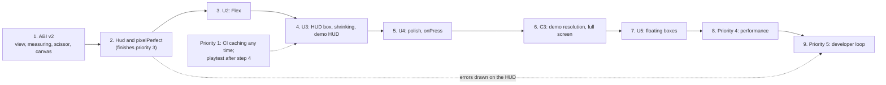

# react-game-engine: next priorities after Phase 3

As of 2026-11-09. Written after the post-N6 review; see [NATIVE_PLAN.md](NATIVE_PLAN.md), "Review after N6", for what that review measured and fixed.

## Summary

Phase 3 is done: a compiled game runs in a native window under Node and as a QuickJS-ng executable, with byte-identical output between the two. The post-N6 review fixed three performance cliffs and five bugs. Since then, collisions that gameplay can use (#34), a fixed game resolution, a layout offset and `z` draw order (#36), and a Zustand-style game state with a `<Game>` root that carries the window's settings (#37) have landed, and the UI work is planned in [UI_PLAN.md](UI_PLAN.md) (#35, #38). **The order to work in is in "Order of work" below**; the five priorities, as first ranked:

| # | Priority | Why now | Size (estimate) |
| --- | --- | --- | --- |
| 1 | Verify on real hardware; cache CI builds | Nobody has played it in a real window; every CI job rebuilds raylib from source | \~2–3 days |
| 2 | Collisions gameplay can use: readable `other`, layers, exit events (**done**, #34) | A handler could not tell a coin from an enemy, which blocked almost any game | Done |
| 3 | ABI v2 with a HUD layer, plus `z` draw order (`z` **done**, #36) | A score drawn in the world moves with the camera; layout and `pixelPerfect` need the same ABI change | \~1–1.5 weeks, `z` done |
| 4 | Performance pass two: dependency-scoped `render()`, cached transforms, a collision grid | 2,000 state-driven objects with colliders still take 18 ms of a 16.7 ms frame under QuickJS | \~1.5–2 weeks |
| 5 | Developer loop: errors in the window, scenes as an entry point, hot reload | A crash today closes the window and prints to a terminal the player may not see | \~1.5 weeks |

Sizes are rough, for one engineer, in the style of the Phase 3 plan. Each priority below ends with a checklist that says when it is done.

## 1. Verify on real hardware, and cache CI builds

Every Phase 3 milestone was built and tested only in a Linux cloud container, against a virtual display. Two things have never happened: a person playing in a real window, and a sound actually playing (hidden test windows have no audio device).

**Decided 2026-11-09: no macOS or Windows CI.** Extra platform jobs are a lot of CI for a game nobody has asked to ship there yet. Linux is the one supported platform. `host/build.rs` still carries macOS and Windows link lists copied from raylib's, and they stay unverified; the first person to try either platform is likely to hit a link error, and that is when they get fixed. See "Not now".

**Work**

- A person plays the demo on a Linux desktop: window feel and resizing, arrow keys and WASD, both Shift keys (the review changed how left and right combine), a click on the button through the moving camera, and the click sound.
- Cache Cargo and the CMake build of raylib in CI: today every job rebuilds raylib from source, twice in `native-desktop`.

**Done when**

- [ ] The demo has been played on a Linux desktop, with any findings filed
- [ ] Sound plays
- [ ] Cargo and the raylib CMake build are cached in CI, and the `native-desktop` job builds raylib once

## 2. Collisions that gameplay can use

**Done 2026-11-09.** `other` is a `Contact` with `tag` and `owner` (both were chosen, see "What `other` exposes" in `DESIGN.md`), `<Collider>` takes `layer` and `hits`, and `onCollisionExit` exists. The demo has a coin (picked up, counted) and spikes (the player turns red while on them), and the parity run exercises both under QuickJS. The collision bench is unchanged: 2,000 colliders about 21 ms, a pile of 300 about 29 ms under QuickJS, before and after. The text below is the proposal as written.

`onCollisionEnter(other)` fires correctly, but handler code can read nothing on `other`: the compiler's handle type for a `GameObject` is empty. So a player cannot tell a coin it should collect from an enemy that should hurt it. This is listed as "Later" in the Phase 2 plan, pending a decision on what a collider exposes. Almost every game needs it, so it moves up.

**Proposal**

- A `tag` prop on `<Collider>` (a string, `"coin"`, `"enemy"`), readable in handlers as `other.tag`. The compiler adds `tag` to the handle type and checks the comparison like any other string.
- Layers: a `layer` and a `hits` list on `<Collider>`, so a bullet can ignore other bullets. The tracker skips those pairs before testing them, which also helps the pile case.
- `onCollisionExit(other)`, for "standing on a platform" or "inside a zone". The tracker already knows when a pair stops touching; it only needs to keep last frame's colliders beside their keys.

**Done when**

- [x] The tag design is settled in `DESIGN.md` (see the open decisions below)
- [x] `other.tag` reads in handler code, with a compiler test and a diagnostic for an unknown member
- [x] Layers and `hits` filter pairs, tested against every-pair testing like the existing randomised test
- [x] `onCollisionExit` fires once when a pair separates, and when either collider leaves the world
- [x] The demo (or a second small demo) collects one thing and is hurt by another

## 3. A screen-space HUD layer and draw order

Everything is drawn through the camera, so a score or a health bar placed in the world drifts away as the camera follows the player; the demo's "Clicks" text does exactly that. Draw order used to be tree order only, so a sprite that had to sit behind its siblings had to be moved in the tree; `z` fixed that.

**Proposal**

- A `<Hud>` built-in. Its subtree is drawn after the world through a view that ignores the camera: in canvas pixels under a `<Screen>`, in window pixels without one. The player emits a second `RGE_OP_VIEW` before it. The demo's own `Hud` component, and the `Hud` test components in the compiler's tests, are renamed, since a component cannot share a built-in's name.
- librge today refuses a second view record ("malformed draw records"), so this is an ABI change: allow a later `RGE_OP_VIEW` to replace the current view, and bump `RGE_ABI_VERSION` to 2. Both hosts already check the version at load.
- A `<Pointer>` inside `<Hud>` is hit-tested in the HUD's coordinates, so HUD buttons work while the camera moves.
- A `z` draw order: **done 2026-11-09**, as a `transform` field (`transform={{ z: 2 }}`) rather than a prop, because `z` is a common prop name that an attribute would reserve on every component. It is relative to the parent like `x` and `y`, sorted in TypeScript (stable, tree order among equals) so the record format is unchanged, and pointers follow it. See "What is drawn" in `DESIGN.md`. Cost: about 10% of the tree walk in the bench scenes under QuickJS, which priority 4's `Transform` setters would remove for games that never use it.
- UI layout (`<Flex alignItems="center" gap={8}>`, sized with Clay's algorithm) builds on this layer, and a `<Screen width={320} height={180}>` inside the `<Game>` root gives the game a fixed resolution scaled to the window; see [UI_PLAN.md](UI_PLAN.md). ABI v2 therefore carries four things, landing together so the version moves once: the second view record (`<Hud>`); `rge_measure_text` (width and line height) and `rge_texture_size` (UI_PLAN's U0); a scissor record for clipping (U0); and `RGE_OP_CANVAS`, the render texture that makes `<Screen pixelPerfect>` real (UI_PLAN's C2).

**Done when**

- [x] `rge.h`, `protocol.ts` and the header-parity test agree on ABI v2; `smoke.c` checks a second view
- [x] ABI v2 also has the measuring functions, the scissor record and `RGE_OP_CANVAS`, each with the checks in UI_PLAN's U0 and C2 (done 2026-11-10; the player does not write them yet, that is step 2)
- [x] `<Hud>` children stay fixed while the camera moves (a recording test and a pixel test)
- [x] A HUD pointer receives presses through a moving, zoomed camera
- [x] `z` reorders records, and equal keys keep tree order
- [x] The demo's click counter moves into a `<Hud>`

## 4. Performance pass two

After the review, 2,000 objects moving the way compiled components do cost about 7 ms of script a frame under QuickJS; with a collider each, about 18 ms, which is over a 60 fps frame before any drawing. Each of the three known fixes targets one column below.

Script time per frame under the Rust host (QuickJS-ng), by phase; objects move the way compiled components do. Measured with the bench in `packages/player/bench` during the post-N6 review on a 4-core 2.1 GHz cloud VM, noisy to about ±15%.

| Scene | Tick: hooks, state, renders | Tree walk and draw list | Collisions | Total |
| --- | --- | --- | --- | --- |
| 2,000 by state | 3.1 ms | 4.3 ms | — | 7.4 ms |
| 5,000 by state | 8.1 ms | 11.1 ms | — | 19.2 ms |
| 2,000 by state + colliders | 3.9 ms | 6.0 ms | 8.5 ms | 18.4 ms |

The tree walk costs most; collisions add as much again. A 60 fps frame is 16.7 ms.

**Work, one per column**

- **Tree walk: reuse the draw records of still subtrees.** *(Done 2026-11-10, see NATIVE_PLAN.md, "reusing draw records": a still scene's walk goes from about 10 ms to under 2.)* Most objects do not move in a given frame. The change signal is the render / structure / animation stamp the world already has, not setters on `Transform`.
- **Tick: dependency-scoped `render()`.** Today a moving object re-runs its whole `render()` every frame. Every dynamic prop already records which state it reads, so the compiler can re-evaluate only the props whose state changed. Setters called with an updater (`setX(x => x + 1)`) also allocate a closure per call, which the compiler could avoid.
- **Collisions: an incremental check.** *(Done 2026-11-10, see NATIVE_PLAN.md: only colliders whose entries are new are tested again, about 10 ms to 0.1–1.2 ms when most stand still; the all-moving case is the full sweep, unchanged.)* The uniform grid below was tried first and did not pay. *(The grid, as first written:)* The sweep over x degrades when colliders line up in columns, as platforms and the bench's own grid do. A grid sized to a typical collider keeps it near linear. Layers from priority 2 also cut pairs before they are tested.
- **The frame where everything moves.** *(Done 2026-11-10, see NATIVE_PLAN.md, "pass three": 2,000 state-driven objects with colliders that all move go from 23.5 to 15.0 ms. The sweep runs in horizontal bands when it tests many pairs for each box, the walk writes plain leaves in place, and the tick keeps a list of renders instead of a `Set`. What is left, by size: the walk for a component that only moved, the broad phase in `librge`, and updater arrows written out by the compiler.)*
- **Updaters written in place.** *(Done 2026-11-10, see NATIVE_PLAN.md: an updater of one expression in a hook is generated as an assignment to the pending value, with no closure and no call; the tick for 2,000 moving objects goes from 4.5 to 3.0 ms.)*
- **The broad phase in `librge`.** *(Done 2026-11-10, see NATIVE_PLAN.md: ABI v4 adds `rge_overlaps`, which finds the boxes that overlap; collisions for 2,000 moving colliders go from 4.3 to 2.2 ms. The rules, the contacts and the reports stay in script, and a backend without it sweeps in script as before.)*
- **A component that only moved.** *(Done 2026-11-10, see NATIVE_PLAN.md: a generated `render()` reports what it changed, and the player moves a component's records as a block when only its transform changed; 2,000 moving objects with colliders go from about 11.9 to 10.0 ms.)*
- **A guard in CI.** *(Done 2026-11-10, see NATIVE_PLAN.md: `npm run bench:check` fails a scene over its budget in `packages/player/bench/budget.json`, or one that grows faster than its size; the host job runs it.)* The host job prints these numbers but fails on nothing, which is how a quadratic mount went unnoticed. Fail it on a generous threshold, or on the QuickJS/Node ratio, which is steadier on shared runners.

**Done when**

- [ ] 2,000 state-driven objects with colliders take under 10 ms of script a frame under QuickJS (a proposed target: about half of today's 18 ms)
- [ ] The parity test still passes byte for byte
- [x] CI fails when a bench scene regresses past its threshold
- [ ] The new numbers are recorded in `NATIVE_PLAN.md`

## 5. The developer loop

When a handler throws, both hosts print the stack and exit with status 1. That is right for CI, but a player who double-clicked the packaged game sees the window vanish, and a developer loses the frame they were looking at. Iterating also means a full restart: there is no reload.

**Work**

- **Errors in the window.** Catch an exception from a step, keep the window open, and draw the message and stack in screen space (on priority 3's layer) until it is closed. Keep exit status 1 for headless runs and CI.
- **Scenes as an entry point.** `loadScene` and the Tiled importer exist, but `PlayerConfig` only takes `root: () => GameObject`. Add `scene` and `prefabs` options, which the Phase 3 plan already suggested if `root` turned out awkward.
- **Hot reload in the Node host.** Recompile a changed `.tsx`, swap its class, and keep state by element id. The IR's stable element ids and scene ids were designed for this.
- **Key names checked at compile time.** `input.pressed("Spcae")` warns once at run time today. The compiler can report it with a did-you-mean, as it already does for shape kinds.

**Done when**

- [ ] A thrown handler shows its message in the window under both hosts; headless runs still exit 1
- [ ] A game can start from a scene file and a prefab registry
- [ ] Editing a component while `npm run play:demo` runs updates it in place, keeping its state
- [ ] An unknown key name is a compile error with a suggestion

## Order of work

Decided 2026-11-09. This merges the priorities above with the milestones in [UI_PLAN.md](UI_PLAN.md) (U0–U5 for layout, C1–C3 for the fixed resolution). Done so far: priority 2 (#34), C1, U1 and `z` (#36), the game state and the `<Game>` root (#37), ABI v2 (step 1), `<Hud>` with `pixelPerfect` (step 2, which finishes priority 3), `<Flex>` (step 3), U3 (step 4), U4 (step 5), C3 (step 6), and U5 (step 7).

1. ~~**ABI v2, as one change**~~ **Done 2026-11-10** (priority 3, U0, and C2's native half): the second view record, the measuring functions, the scissor record and `RGE_OP_CANVAS`, in `rge.h`, librge, both hosts and the recording backend.
2. ~~**The player's side of ABI v2:**~~ **Done 2026-11-10.** the `<Hud>` built-in (with the renames), and `pixelPerfect` (the rest of C2). The demo's click counter moves into a `<Hud>`. This finishes priority 3.
3. ~~**U2, `<Flex>`:** the sizing modes, Clay's passes, alignment, `background`.~~ **Done 2026-11-10** (see UI_PLAN's U2 for what moved to U3 and U4).
4. ~~**U3:** the HUD's box, shrinking to minimum sizes, and the demo's HUD rebuilt with `<Flex>`.~~ **Done 2026-11-10.**
5. ~~**U4:** whole-pixel rounding, text alignment, `<Flex onPress>`.~~ **Done 2026-11-10.**
6. ~~**C3:** the demo at a fixed resolution, `fit="expand"`, full screen, and the 3× window default.~~ **Done 2026-11-10** (full screen is `rge_set_fullscreen`, ABI v3; see UI_PLAN's C3).
7. ~~**U5:** floating boxes.~~ **Done 2026-11-10.**
8. **Priority 4, the performance pass**, starting with its open decision (how a moved transform is detected), which also decides whether a game that never sets `z` can skip its cost.
9. **Priority 5, the developer loop:** errors are drawn on the `<Hud>`, so it comes after step 2 at the earliest.

**Priority 1 fits anywhere**, because it is small and touches nothing above: CI caching can go in at any time, and the Linux playtest is most useful after step 4, so it covers the new HUD and layout.

Why this order: everything visual (the HUD, layout, `pixelPerfect`) needs the same ABI change, so it comes first and lands once; `<Flex>` needs the HUD's box and real text sizes, so it follows; the demo's resolution change (C3) waits until its HUD is laid out, so it is done once; performance and the developer loop are independent of the UI, and the developer loop's in-window errors need the HUD.

## Open decisions

1. ~~**What `other` exposes (priority 2).**~~ Decided 2026-11-09: both `other.tag` and `other.owner` (the owning entity's name).
2. ~~**How a moved transform is detected (priority 4).**~~ Decided and built 2026-11-10: not at all. Setters with a version counter were built, measured and reverted (about 4 ms slower on 2,000 moving objects). Instead a render, a structural change and an animation frame stamp the object and its ancestors, and code that writes a transform by hand calls `markChanged()` (see DESIGN.md, "Reusing draw records").
3. ~~**Whether ABI v2 also takes the `z` sort key (priority 3).**~~ Decided and done 2026-11-09: no, it is sorted in TypeScript, and the record format is unchanged.

## Not now, and what would pull it in

The rest of the backlog (the player's and the compiler's) waits because nothing above depends on it, or because no game has asked for it yet. Each row names what would move it up.

| Item | Why it waits | What would pull it in |
| --- | --- | --- |
| Sprite sheets, tint, opacity, pivot on `Sprite` | The demo needs none; each is a record field plus a prop | The first game with real art (likely right after priority 3) |
| Fonts | The default font works for a demo; text measuring (U0) and alignment (U4) are now in [UI_PLAN.md](UI_PLAN.md) | A game whose look needs its own typeface |
| Sound volume, looping music, overlapping plays, a build-time asset check | `useSound` takes one literal path and covers one-shot effects | Any game with background music |
| Web backend (canvas) | Records map directly onto canvas calls, so it stays cheap to add later | Wanting a shareable browser build |
| Gamepads, high DPI, fixed timestep | Each slots into the ABI without rework | A controller game, a blurry Retina window, or physics |
| macOS and Windows builds and CI | Linux is the only supported platform; extra CI jobs are a lot of upkeep for no player yet | Someone wanting to play on either, at which point the unverified link lists in `host/build.rs` get tried and fixed |
| One-file executable, prebuilt librge, macOS signing | Packaging as a folder works | Handing a build to people outside the team |
| SDL3 platform layer, native code generation | Large, and nothing measured asks for them | Consoles, or script time dominating after priority 4 |
| Custom hooks (`function useHealth(max) { … }`) | Inlining them at compile time fits "hooks are compiler intrinsics", but no game needs them yet | Repeated hook logic across components |
| Context (`createContext` / `useContext`) | Props cover today's trees | Deep trees passing the same prop down many levels |
| Spread props, conditionals inside a list's `.map`, forwarding `{children}`, children on list items | Each is rejected today with a clear diagnostic | An author hitting one of those diagnostics in a real game |
| Tiled importer gaps (`visible`, tile flip flags, whole-number `int` checks, template properties) | The importer covers the example maps | A map that uses them |
