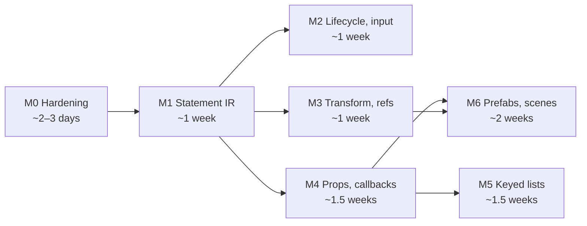

# Phase 2 implementation plan

Snapshot of the plan as of 2026-11-07. Phase 2 adds the features the first slice was designed for: lifecycle hooks, input, transforms, refs, props and callbacks, keyed lists, prefabs and scenes. It is split into seven milestones (M0–M6), each shippable on its own, each extending the existing IR rather than replacing it. Progress is tracked in [Status](#status) and the per-milestone [Handoff checklist](#handoff-checklist). Architecture of the current code: [DESIGN.md](DESIGN.md). A review of M3 and a worked-out approach for M4–M6, including proposed changes to this plan, is in [PHASE2_M3_REVIEW_M4_M6.md](PHASE2_M3_REVIEW_M4_M6.md). How close the current and planned authoring API is to React, and the open decisions that follow from it, is in [REACT_API_REVIEW.md](REACT_API_REVIEW.md).

## Status

Last updated 2026-11-08. **Update this table and the milestone's checklist in the same PR as the work**, so it cannot drift. A milestone moves Not started → In review (PR open) → Done (PR merged); the PR number goes in the third column. Whoever lands the work keeps this table and the milestone's checklist current; for work done by Claude, that is Claude's job, including flipping to Done once the merge is seen.

| Milestone | Status | Branch / PR | Notes |
| --- | --- | --- | --- |
| M0 Hardening | Done | #5 | CI passed on the PR (first run of the workflow). Imports are named `.tsx` imports only (no aliases). Cross-file static cycles are not detected yet |
| M1 Statement and function IR | Done | #4 | `Assign` deferred to M3: its only targets are transform fields. Tested through the M2 hooks rather than an internal test hook |
| M2 Lifecycle and input hooks | Done | #4 | `other` in `onCollisionEnter` is received but has no readable members yet |
| M3 Transform attribute and refs | Done | #7, #8 | #7 shipped `useTransform` and element refs; #8 replaced them with a `transform={{ x, y }}` attribute driven by state and value refs (`useRef(0)`), and also renamed the per-frame hooks to `useUpdate`/`useInput` and switched state reads to React's snapshot semantics (see Decisions) |
| M7 Authoring types | Not started | n/a | Next. Typed imports for hooks and intrinsics so source TSX type-checks in editors; see below |
| M4 Props and callbacks | Not started | n/a | Also: collision events as `<Collider onCollisionEnter>` props, fragment and non-Entity roots, arrow-function and default-export components |
| M8 Children | Not started | n/a | Needs M4 |
| M5 Keyed dynamic lists | Not started | n/a | Needs M4; split into M5a (arrays and records in handlers) and M5b (keyed list) |
| M9 Mount and unmount hooks | Not started | n/a | `useMount` / `useUnmount`; no `useEffect` |
| M6 Prefabs and scenes | Not started | n/a | Needs M3 and M4 |

Rows are in the order the work is planned (M7–M9 were added on 2026-11-08 after the [React API review](REACT_API_REVIEW.md)).

## Decisions (settled)

| Decision | Choice | Affects |
| --- | --- | --- |
| Prop and list types: copy source type text into output, or query the TS 7.1 checker through the API | Copy source text; revisit if prefab schemas need resolved types (unions, aliases across files) | M4, M5, M6 |
| Input model | Per-frame `useInput` hook with polled `InputState`; JSX event props can be added later as a `PropIR` variant | M2 |
| Scene format | Support both: JSON scenes validated against the generated schema, and TSX scenes that compose prefabs | M6 |
| Hook names | Hooks start with `use`, as in React: `useUpdate`, `useInput` (were `onUpdate`, `onInput`; the old names report `RGE1102`). Collision handling becomes a prop on `<Collider onCollisionEnter={…}>` in M4, replacing the `onCollisionEnter` hook (decided 2026-11-08) | M2, M4 |
| State reads in handlers | React's snapshot semantics: reads see the value from the last render; setters queue, updaters chain on the pending value, and `commitState()` applies them just before the render. Every handler in a frame sees the same state (decided 2026-11-08) | M1, M2 |
| Refs | Refs hold values only (`const timer = useRef(0)`; plain fields, never render, `.current` readable only in handlers). No `ref={…}` on elements or components: what is on screen is driven by state and props (decided 2026-11-08) | M3 |
| Component forms | Arrow-function components and default exports/imports are allowed. A component may return a fragment (an implicit container) or a non-Entity root; a root may have JSX children only if its element type accepts children (decided 2026-11-08) | M4 |
| Lifecycle | `useMount(() => …)` and `useUnmount(() => …)`; no `useEffect` (decided 2026-11-08) | M9 |
| Authoring | Source files import hooks and intrinsics from a typed entry point and type-check in editors (decided 2026-11-08) | M7 |
| Transforms: a non-reactive `useTransform` handle written imperatively in handlers, or position as state written through a JSX attribute | Position is state, set with `transform={{ x, y }}` on any built-in element (decided 2026-11-08; every runtime object has a transform, and the manifest's `transformIntrinsics` lists which built-ins take the attribute). Transforms nest: relative to the parent by default, `global: true` opts out. Authoring should feel as close to ideal React as possible; a per-frame move costs one render per tick, and dependency-scoped rendering is the optimisation if that ever matters | M3, M4, M6 |

## Ground rules

Every milestone keeps the slice's architecture intact; a change that breaks one of these rules needs a design note first.

- **IR first.** Each feature starts as new variants in `packages/compiler/src/ir/types.ts`. Code is generated only from IR, never from the AST.
- **Exhaustive unions.** Add the variant, then let `assertNever` failures show every place that must handle it. Never add a `default:` that silently passes.
- **No React, no virtual DOM, no signals, no ECS, no generic reconciler.** Updates stay direct: field assignments and queued add/remove on persistent instances.
- **Hooks are compiler intrinsics.** New hooks follow the `useState` rule: top-level statement in the component body, rejected anywhere else.
- **TypeScript 7.1 only through the two adapters.** Only `parser/parser.ts` and `typecheck/typecheck.ts` import `typescript/sync`. Verify any new API against the installed `.d.ts` before use.
- **Unsupported means a diagnostic.** Never silently drop syntax. Diagnostic codes in `diagnostics.ts` are append-only.
- **Generated code must type-check.** Every feature adds a test that runs generated output through `typeCheckFiles` and one that imports and runs it against the runtime.
- **Runtime stays a mock.** No rendering, physics or input backend; the runtime gets only the hooks the compiler's output calls.

## Sequencing

Critical path with two engineers: M0 → M1 → M4 → M6, about 5 weeks. M2, M3 and M5 run alongside. M1 is the only milestone everything waits on, so it deserves the most review. Durations are rough estimates for one engineer per milestone.



## M0 — Hardening (prerequisite, ~2–3 days)

Clears four gaps in the first slice. No new authoring syntax.

| Work item | Where | Done when |
| --- | --- | --- |
| Nested conditionals commit without a World. Today a conditional inside a conditional stays queued until the object joins a `World`. Make `commitStructure()` also commit pending ops of children it just attached. | `runtime/src/GameObject.ts` | A freshly constructed object whose nested conditions are true has its full subtree attached, with no `World`. |
| Runtime manifest. Move the intrinsic tag list and the reserved member names out of `transform.ts` into one exported object in the runtime package; the compiler takes it as config. | `runtime/src/manifest.ts`, `compiler/src/index.ts`, `transform.ts` | Adding an intrinsic needs no compiler edit; a test fails if a `GameObject` member is missing from the reserved list. |
| Components across files. Add `ComponentRef` variant `Imported { module, name }`; the analyzer accepts `import { X } from "./X.tsx"` for components and rewrites the specifier to `.ts` in output. | `analyzer.ts`, `ir/types.ts`, `transform.ts`, `generator.ts`, `cli.ts` | The example splits `WarningIcon` into its own file and the CLI's type-check passes across both outputs. |
| Generated-output check in CI. Add a GitHub Actions workflow running `npm test`, `npm run typecheck`, and `npm run example` followed by `git diff --exit-code packages/example/generated`. | `.github/workflows/ci.yml` | A PR that changes codegen without regenerating the example fails CI. |

Out of scope: field naming. Generated names like `entity`/`sprite2` stay until refs (M3) give authors control.

## M1 — Statement and function IR (~1 week)

Lets the IR hold small function bodies, which `onUpdate`, `onInput`, collision handlers and callback props all need. Ships no user-facing hook by itself; tests drive it through an internal test hook.

**IR additions** (`ir/types.ts`):

- `FunctionIR { params: ParamIR[]; body: StatementIR[] }`, with `ParamIR { id: LocalId; name; type: TypeIR }`.
- `StatementIR` union: `ExpressionStatement`, `LocalConst`, `If`, `Return`, `SetState { state; value: ExprIR } | { state; updater: FunctionIR }`, `Assign { target: AssignTargetIR; operator: "=" | "+=" | "-=" | "*=" | "/="; value }`.
- `ExprIR` additions: `LocalRead`, `ParamRead`, `PropertyRead { object; name }` (only on typed handles such as a transform or a ref, checked in transform), `Call` to a fixed allowlist (`Math.*`, `clamp`), `TemplateLiteral`.
- `TypeIR`: start with `number | string | boolean | void`, plus named runtime types (`GameObject`, `InputState`). The existing `ValueType` becomes a subset of it.

**Lowering** (new `transform/statements.ts`):

1. Scope chain: component scope (state, setters; later props, refs, transforms) → function scope (params, locals). Shadowing a component binding is a diagnostic.
2. `setX(v)` and `setX(prev => …)` inside a function become `SetState`. Setters stay illegal in render expressions (existing RGE1301).
3. Everything else is a diagnostic: loops, `try`, closures that escape, `this`, `await`, calls outside the allowlist.

**Generation**: a `generator/statements.ts` emitter that reuses the parenthesising expression emitter; `SetState` emits `this.setX(…)`, so dirty marking stays in one place.

**Acceptance tests**: lowering snapshots for each statement kind; a diagnostic test per rejected construct; generated bodies type-check; a handler that calls a setter twice in one frame causes exactly one render.

Decision: no general-purpose JS subset. The allowlist grows only when a milestone needs it.

## M2 — Lifecycle and input hooks (~1 week, needs M1)

Three top-level hooks that compile to overridden methods, plus a fixed frame order in `World`. (Shipped as `onUpdate`/`onInput`; renamed to `useUpdate`/`useInput` in #8. The `onCollisionEnter` hook becomes a `<Collider>` prop in M4.)

```tsx
function Player() {
  const [health, setHealth] = useState(100);
  useUpdate((dt) => { if (health < 100) setHealth((h) => h + dt); });
  useInput((input) => { if (input.pressed("Space")) setHealth(100); });
  onCollisionEnter((other) => setHealth((h) => h - 10));
  return <Entity>…</Entity>;
}
```

**IR**: `HookIR` gains `OnUpdate { handler: FunctionIR }`, `OnInput { handler }`, `OnCollisionEnter { handler }`. Several calls of the same hook are allowed and run in source order.

**Generated code**: one method per hook kind: `override onUpdate(dt: number): void`, `override onInput(input: InputState): void`, `override onCollisionEnter(other: GameObject): void`, each holding the handler bodies in order. Handlers read state through `this.*`, so they never see a stale closure; since #8 they read the snapshot from the last render, as in React (see Decisions).

**Runtime**:

1. `GameObject` gets no-op base methods for the three hooks.
2. `World.tick(dt, input)` runs one frame in this order: `onInput` → `onUpdate` → render dirty objects → commit structure. Objects attached during a frame start receiving hooks next frame.
3. Only objects that override a hook are visited: `attachToWorld` registers them by comparing against the base prototype method.
4. `InputState` is a plain interface (`pressed`, `down`, `released`, pointer position); the mock builds it from test-supplied data.
5. Collisions: the mock exposes `world.reportCollision(a, b)`, which calls `onCollisionEnter` on the nearest compiled component that owns each `Collider`. Real detection is out of scope.

**Acceptance tests**: frame order; setter calls in `onUpdate` render once per tick; a handler added by a conditional child starts the next frame and stops after removal; collision dispatch reaches the owning component; hooks inside conditions or callbacks are rejected.

Decision: `useInput` is a per-frame hook with a polled `InputState`, not JSX event props such as `onKeyDown`. Event props come later as `PropIR` `EventHandlerProp` if needed.

## M3 — Transform attribute and refs (~1 week, needs M1)

Position as ordinary state, written through a `transform` attribute, plus refs that hold values which never cause a render. (The first version shipped a non-reactive `useTransform` hook and refs to elements; both were replaced so that components read like React. See Decisions.)

```tsx
function Player() {
  const [x, setX] = useState(0);
  const travelled = useRef(0);
  useUpdate((dt) => {
    setX((x) => x + 60 * dt);
    travelled.current += 60 * dt; // bookkeeping: no render
  });
  return <Entity transform={{ x, y: 0 }}><Sprite image="idle.png" /></Entity>;
}
```

**Transform attribute**

- Runtime: every `GameObject` owns `transform: Transform` (`x, y, rotation, scaleX, scaleY`; pixels, y down, radians). Transforms are relative to the parent; `global: true` (default `false`) makes one world-space. `GameObject.worldTransform()` resolves the hierarchy for renderers.
- IR: `ElementIR.transform` / `HostElementIR.transform: TransformPropIR[]`, static or dynamic props restricted to the transform fields. `transform` is never a `PropIR`.
- Codegen: static fields are set once after construction; dynamic fields are re-applied in `render()` like any dynamic prop.
- Any built-in element in the manifest's `transformIntrinsics` takes it (today all of them), root or child. On a component element it is placement by the parent and waits for M4.

**useRef**

- Syntax: `const r = useRef(0)` or `useRef<number>(0)` (types as for `useState`). `r.current` is the only allowed use, read and assigned in handlers.
- IR: `RefIR { id; name; type; initialValue }` in `ComponentIR.refs`. `ExprIR` `RefRead { ref }`; `Assign` target `RefCurrent { ref }`.
- Codegen: a plain field (`travelled: number = 0`); no dirty marking, no render.
- Reading `.current` in JSX, a state initialiser or a derived `const` is `RGE1304` (it would go stale). `ref={…}` on any element is `RGE1106`.

**Acceptance tests**: transform fields from state render once per tick and update in place; static fields set once; ref writes never render and persist across frames; misuse diagnostics.

## M4 — Props and callbacks between components (~1.5 weeks, needs M1)

A parent passes values and callbacks to a local or imported component; a changed value updates the existing child instance in place.

```tsx
interface EnemyProps { speed: number; onDefeated?: () => void }
function Enemy({ speed, onDefeated }: EnemyProps) { … }

function Level() {
  const [score, setScore] = useState(0);
  return <Entity><Enemy speed={score > 10 ? 2 : 1} onDefeated={() => setScore((s) => s + 1)} /></Entity>;
}
```

**Prop declarations**

- Accept one destructured parameter with a type annotation that names an `interface` or `type` declared in the same file (or imported, after M0). Defaults in the destructuring are allowed.
- IR: `ComponentIR.props: PropDeclIR[]` with `{ name; type: TypeIR; optional; defaultValue: ExprIR | null; kind: "value" | "callback" }`. `ExprIR` gains `PropRead`.
- Types: copy the prop type's source text into the generated module as `TypeIR { kind: "SourceType"; text }` and let the type-check validate it. This is a deliberate exception to "no strings in IR" (see Decisions).

**Generated child**

- Constructor becomes `constructor(props: EnemyProps)`; props live in `this.props` (a private copy). Prop reads compile to `this.props.speed`.
- `updateProps(next: Partial<EnemyProps>): void` shallow-compares each key with `===` and calls `markDirty()` once if anything changed.

**Generated parent**

- Static props go into `new Enemy({ … })`. Dynamic props become `this.enemy.updateProps({ speed: … })` in `render()`; the instance is never recreated.
- Callback props lower to `FunctionIR` and are emitted as arrow functions created once in the constructor. They read state through `this`, so they never go stale and never need updating. A callback is therefore always a static prop.
- The child calls a callback from a handler: `onDefeated?.()` lowers to an optional `Call` on a `PropRead`.

Remove diagnostic RGE1204 (props on local components). `children` as a prop stays unsupported.

**Acceptance tests**: parent state change updates the child's prop and renders the child once; the child keeps its identity; callback invoked from the child's `onCollisionEnter` updates parent state; missing required prop fails the type-check; defaults apply.

**Also in M4** (from the [React API review](REACT_API_REVIEW.md)):

- **Collision events as props**: `<Collider width={16} onCollisionEnter={(other) => …} />` replaces the `onCollisionEnter` hook. The runtime calls the collider's own callback, so a component with several colliders knows which one was hit. The hook reports `RGE1102` with the new form.
- **Fragment and non-Entity roots**: `return <>…</>` lowers to an implicit container (the host `Entity`, no props). `return <Sprite image="coin.png" />` makes the generated class extend `Sprite` itself, with no container. JSX children under the root are allowed only if that element type accepts children (a manifest list). Every intrinsic already has a transform (#8), so such a component can be placed like any other.
- **Component forms**: `const Enemy = (props: EnemyProps) => …` and `export default function Enemy`, plus default imports (`import Enemy from "./Enemy.tsx"`).

## M5 — Keyed dynamic lists (~1.5 weeks, needs M4)

One component per item of an array state, keyed so each item keeps its instance across updates.

```tsx
interface EnemyData { id: string; speed: number }
function Level() {
  const [enemies, setEnemies] = useState<EnemyData[]>([]);
  return <Entity>{enemies.map((e) => <Enemy key={e.id} speed={e.speed} />)}</Entity>;
}
```

**Restrictions for v1** (each a diagnostic): the item must be a single component element (local, imported or intrinsic) with a `key`; no conditionals or nested children inside the map callback; the source must be a state array or a prop. These keep per-item storage to one instance and avoid per-item field trees.

**IR**

- `ChildIR` gains `KeyedListChild { source: ExprIR; item: ParamIR; index: ParamIR | null; key: ExprIR; element: ElementIR; dependencies }`.
- State types extend to arrays of a named record type (`TypeIR` `Array` of `SourceType`), reusing M4's type approach.

**Generated code**

- One field per list: `enemyItems: Map<string | number, Enemy> = new Map()`.
- `render()` walks the source once: an existing key calls `updateProps`; a new key constructs and queues an insert; keys no longer present queue a removal. Duplicate keys throw in development builds.
- Order matters for draw order. Children already carry a source *slot* (`addChild(child, slot)`), so a conditional mounts between its siblings. Lists extend this to `(slot, order)` with a `queueReorder` emitted only when the key order actually changed (proposed in [PHASE2_M3_REVIEW_M4_M6.md](PHASE2_M3_REVIEW_M4_M6.md) in place of `queueInsertChild` / `queueMoveChild`).
- Change detection relies on immutable updates (`setEnemies([...enemies, e])`): the setter's `===` check means mutating the array in place does nothing. Document this; do not deep-compare.

**Acceptance tests**: add, remove, reorder and update by key; an unchanged item keeps its identity and is not re-rendered; static siblings before and after the list keep their positions; duplicate key error; each restriction has a diagnostic.

## M6 — Prefabs and scene/map integration (~2 weeks, needs M3 + M4)

Lets data files, not only TSX, place components in a world: a prefab is a compiled component plus a machine-readable description of its props.

**Prefab registry** (compiler output)

- For each module, also emit `export const prefabs = { Enemy: { create: (props: EnemyProps) => new Enemy(props), props: […] } }`. The `props` array is generated from `PropDeclIR` (name, type, default, optional), so editors and loaders can validate data without running TypeScript.
- The CLI writes a project-wide `prefabs.ts` index and a `prefabs.json` schema alongside `*.ir.json`.

**Scene format**

- A scene is JSON: `{ version, entities: [{ id, prefab, props, transform, children? }] }`. `id` is author-assigned and stable, for diffing and hot reload.
- A build step (`rge-compile --scenes`) validates every scene against `prefabs.json` and reports problems as compiler diagnostics with file and JSON path.
- Runtime: `loadScene(world, scene, prefabs)` constructs each prefab, applies `transform` to the instance's `Entity.transform` (M3), and mounts it. Callback props cannot come from data; a scene may only set value props.

**Maps**

- First target: Tiled `.tmj` object layers. An importer maps each object's `type` to a prefab and its custom properties to props, producing the scene JSON above. Tile layers are a renderer concern and are out of scope.

**Code-first scenes** stay possible: a scene can also be a TSX component that composes prefabs directly. Both paths produce the same objects.

**Acceptance tests**: registry generated for every exported component; schema matches `PropDeclIR`; a scene with an unknown prefab, missing required prop or wrong type fails validation; a loaded scene matches the object tree built from equivalent TSX; Tiled fixture imports to the expected scene.

Not in M6: hot reload and editor tooling. Stable `ElementId`s and scene `id`s are what they will key on.

## M7 — Authoring types (~3–4 days, next)

Source files import what they use, as in React, and type-check in an editor:

```tsx
import { useState, useUpdate, Entity, Sprite } from "@rge/runtime/jsx";
```

- A typed entry point declares the hooks (`useState`, `useRef`, `useUpdate`, `useInput`, later `useMount`/`useUnmount`), the intrinsics with their props (including `transform`), and a `JSX` namespace (`jsxImportSource`), so editors give autocomplete and prop errors on the TSX itself.
- The compiler already ignores non-relative imports; it should check that hooks and intrinsics come from this entry point (or are unimported, for now) and report a clear diagnostic otherwise.
- Examples switch to explicit imports, and CI type-checks `packages/example/src` with the declarations.

## M8 — Children (~1 week, needs M4)

`<Panel><Button /></Panel>`: the parent constructs the child elements (it owns their props and state) and passes them as `children`; the child mounts them where `{children}` appears in its JSX. IR: a slot child (`ChildrenSlotIR`) in the receiving component and a `children` prop on the element that passes them. Conditional children inside the passed block stay owned by the parent.

## M9 — Mount and unmount hooks (~3–4 days)

`useMount(() => …)` runs once, after the component is first attached to a `World` and its first render has committed. `useUnmount(() => …)` runs when it is removed from the `World` (a conditional turning off, a list item removed, a scene unloaded). Both are top-level hooks lowered to `FunctionIR` like `useUpdate`. Setters in `useUnmount` are a diagnostic (the component is gone); refs may be read and written. There is no `useEffect`: reacting to a state change is done where the state changes.

## Other risks

| Risk | Affects | Mitigation |
| --- | --- | --- |
| TypeScript 7.1 is beta (`7.1.0-beta`); the API may change before stable | All | Keep the exact pin; all TS calls stay in `parser.ts` and `typecheck.ts`; re-verify `.d.ts` on each upgrade |
| Handler language creep: users expect arbitrary JS in handlers | M1–M4 | Allowlist grows only per milestone; every rejection has a clear diagnostic |
| Draw order for lists needs ordered inserts in the runtime | M5 | Source slots landed for conditionals; extend to `(slot, order)` with `queueReorder`, emitted only on key-order change |
| Mutating state arrays in place silently does nothing | M5 | Document immutable updates; consider a dev-mode freeze of array state |
| Per-frame cost of visiting every object | M2 | Register only objects that override a hook |

## Handoff checklist

A milestone is done when every box under it is ticked. Tick boxes in the same PR as the work; add a note beside any box that is ticked with a caveat.

### M0 Hardening

- [x] New IR variants added in `ir/types.ts`, with every `assertNever` site handled (`ImportedComponentRef`)
- [x] Analyzer recognises the new syntax; every unsupported form has a diagnostic and a test (default / namespace / alias / type-only imports, name clashes)
- [x] `docs/DESIGN.md` updated: authoring rules, IR table, generated-code example (runtime manifest and cross-file sections)
- [x] At least one example in `packages/example/src` uses the feature; `npm run example` regenerated and committed (`WarningIcon.tsx` split out of `Player.tsx`)
- [x] Tests cover the IR shape, the generated code shape, the type-check, and runtime behaviour (`m0.test.ts`, `runtime/test/manifest.test.ts`)
- [x] `npm test` and `npm run typecheck` pass on Node 22.18+

### M1 Statement and function IR

- [x] New IR variants added in `ir/types.ts`, with every `assertNever` site handled (`Assign` deferred to M3)
- [x] Analyzer recognises the new syntax; every unsupported form has a diagnostic and a test
- [x] `docs/DESIGN.md` updated: authoring rules, IR table, generated-code example
- [x] At least one example in `packages/example/src` uses the feature; `npm run example` regenerated and committed (`Hero.tsx`)
- [x] Tests cover the IR shape, the generated code shape, the type-check, and runtime behaviour (identity preserved, one render per change)
- [x] `npm test` and `npm run typecheck` pass on Node 22.18+

### M2 Lifecycle and input hooks

- [x] New IR variants added in `ir/types.ts`, with every `assertNever` site handled
- [x] Analyzer recognises the new syntax; every unsupported form has a diagnostic and a test
- [x] `docs/DESIGN.md` updated: authoring rules, IR table, generated-code example
- [x] At least one example in `packages/example/src` uses the feature; `npm run example` regenerated and committed (`Hero.tsx`)
- [x] Tests cover the IR shape, the generated code shape, the type-check, and runtime behaviour (identity preserved, one render per change)
- [x] `npm test` and `npm run typecheck` pass on Node 22.18+

### M3 Transform attribute and refs

- [x] New IR variants added in `ir/types.ts`, with every `assertNever` site handled
- [x] Analyzer recognises the new syntax; every unsupported form has a diagnostic and a test
- [x] `docs/DESIGN.md` updated: authoring rules, IR table, generated-code example
- [x] At least one example in `packages/example/src` uses the feature; `npm run example` regenerated and committed
- [x] Tests cover the IR shape, the generated code shape, the type-check, and runtime behaviour (identity preserved, one render per change)
- [x] `npm test` and `npm run typecheck` pass on Node 22.18+ (`m3.test.ts`; example `Mover.tsx`)

### M4 Props and callbacks

- [ ] New IR variants added in `ir/types.ts`, with every `assertNever` site handled
- [ ] Analyzer recognises the new syntax; every unsupported form has a diagnostic and a test
- [ ] `docs/DESIGN.md` updated: authoring rules, IR table, generated-code example
- [ ] At least one example in `packages/example/src` uses the feature; `npm run example` regenerated and committed
- [ ] Tests cover the IR shape, the generated code shape, the type-check, and runtime behaviour (identity preserved, one render per change)
- [ ] `npm test` and `npm run typecheck` pass on Node 22.18+

### M5 Keyed dynamic lists

- [ ] New IR variants added in `ir/types.ts`, with every `assertNever` site handled
- [ ] Analyzer recognises the new syntax; every unsupported form has a diagnostic and a test
- [ ] `docs/DESIGN.md` updated: authoring rules, IR table, generated-code example
- [ ] At least one example in `packages/example/src` uses the feature; `npm run example` regenerated and committed
- [ ] Tests cover the IR shape, the generated code shape, the type-check, and runtime behaviour (identity preserved, one render per change)
- [ ] `npm test` and `npm run typecheck` pass on Node 22.18+

### M6 Prefabs and scenes

- [ ] New IR variants added in `ir/types.ts`, with every `assertNever` site handled
- [ ] Analyzer recognises the new syntax; every unsupported form has a diagnostic and a test
- [ ] `docs/DESIGN.md` updated: authoring rules, IR table, generated-code example
- [ ] At least one example in `packages/example/src` uses the feature; `npm run example` regenerated and committed
- [ ] Tests cover the IR shape, the generated code shape, the type-check, and runtime behaviour (identity preserved, one render per change)
- [ ] `npm test` and `npm run typecheck` pass on Node 22.18+

Orientation for the implementer: start with `docs/DESIGN.md`, then `packages/compiler/test/behavior.test.ts` (how generated classes behave), then `transform/transform.ts` (where most milestones land). Each milestone fits one PR; M1 and M4 may split into IR-plus-lowering and codegen-plus-runtime PRs.
