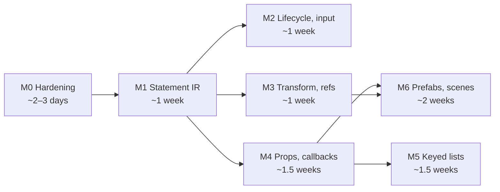

# Phase 2 implementation plan

Snapshot of the plan as of 2026-11-08. Phase 2 adds the features the first slice was designed for: lifecycle hooks, input, transforms, refs, props and callbacks, keyed lists, prefabs and scenes, plus the authoring types and built-in elements that grew out of the design. It is split into milestones, each shippable on its own, each extending the existing IR rather than replacing it. Progress is tracked in [Status](#status) and the per-milestone [Handoff checklist](#handoff-checklist). Architecture of the current code: [DESIGN.md](DESIGN.md). Build-level design for M4–M6: [M4_M6_DESIGN.md](M4_M6_DESIGN.md).

## Status

Last updated 2026-11-08. **Update this table and the milestone's checklist in the same PR as the work**, so it cannot drift. A milestone moves Not started → In review (PR open) → Done (PR merged); the PR number goes in the third column. Whoever lands the work keeps this table and the milestone's checklist current; for work done by Claude, that is Claude's job, including flipping to Done once the merge is seen.

| Milestone | Status | Branch / PR | Notes |
| --- | --- | --- | --- |
| M0 Hardening | Done | #5 | CI passed on the PR (first run of the workflow). Imports are named `.tsx` imports only (no aliases). Cross-file static cycles are not detected yet |
| M1 Statement and function IR | Done | #4 | `Assign` deferred to M3: its only targets are transform fields. Tested through the M2 hooks rather than an internal test hook |
| M2 Lifecycle and input hooks | Done | #4 | Collision handling began as a component hook; M4b moved it to a `<Collider onCollisionEnter>` prop. `other` has no readable members yet |
| M3 Transform attribute and refs | Done | #7, #8 | #7 shipped `useTransform` and element refs; #8 replaced them with a `transform={{ x, y }}` attribute driven by state and value refs (`useRef(0)`), and also renamed the per-frame hooks to `useUpdate`/`useInput` and switched state reads to React's snapshot semantics (see Decisions) |
| M7 Authoring types | Done | #9 | Component source imports from `@rge/runtime/jsx` (mandatory: `RGE1005` otherwise); the TSX itself is type-checked (editor, `npm run typecheck`, and the CLI) |
| M4a Props and callbacks | Done | #10 | Destructured props with a declared type, defaults, callbacks, `updateProps`, prop dependencies, `transform` on a component as `placement`, `useState(prop)` type inference. Imported children work: the parent needs nothing about their props |
| M4b Roots and component forms | Done | #11 | `<Collider onCollisionEnter>` replaces the hook (a per-collider callback), fragment and non-Entity roots, arrow-function and default-export components, the `props` object form, `useState` type inference over expressions. Completes M4 |
| M8 Children | Done | #14 | `children: Child` and `{children}` in the receiver, elements between the tags in the parent (static, conditional, or a sole list). The parent owns and updates what it passes; the receiver only says where it mounts. Forwarding `{children}` and children on list items are not supported yet |
| M5a Arrays and records in handlers | Done | #12 | Array and record state (`useState<EnemyData[]>([])`), array and object literals with spreads, member reads, the non-mutating array methods with inline arrow callbacks. Object spread is in (the design deferred it) |
| M5b Keyed lists | In review | #13 | `KeyedListChild` over a state or prop array (optionally filtered), `(slot, order)` child ordering and `queueReorder`. Duplicate keys throw before anything changes; item callbacks read the current item by key; an index-only key is a warning |
| M9 Mount and unmount hooks | Done | #15 | `useMount` (may set state; renders in the same flush) and `useUnmount` (no setters; refs and callback props). Mount is children first, unmount parent first. Also fixes list-item callbacks that read the item during an unmount |
| M6 Prefabs and scenes | Done | #16 | Per-module `prefabs` registry, project `prefabs.ts` / `prefabs.json`, `rge-compile --scenes` (validation with line, column and JSON path; `RGE15xx`), `loadScene`, a Tiled `.tmj` importer. Also closes M0's gap: cross-file static cycles are now detected |
| M10 `<Text>` | In progress | `claude/pensive-faraday-lnmtga` | `<Text size color>Score: {score}</Text>` or `text={…}`: both are one `text` prop (a template when text and expressions mix), updated in place. Needs the new manifest entry `textContent`, which says which built-ins take JSX text |
| M11 `<Shape>` | Not started | n/a | Needs M7. Rectangles and circles for debugging and prototypes; `transformIntrinsics` |
| M12 `<Camera>` | Not started | n/a | Needs M4 (to follow a target through a prop). The view transform is its own `transform`; `transformIntrinsics` |
| M13 `<AnimatedSprite>` | Not started | n/a | Needs M5a (frame lists). Sprite-sheet playback; `transformIntrinsics` |
| M14 `<Pointer>` | Not started | n/a | Needs M4 (callback props). Clickable hit area; `transformIntrinsics` |
| M15 `useSound` | Not started | n/a | Needs M1 and the hook machinery from M3. A handle called in handlers; no transform, because sounds are not placed |

Rows are in the order the work is planned. M7–M9 were added on 2026-11-08 after a review of the authoring API against React; M10–M15 were added the same day for the built-in elements and the sound hook.

## Decisions (settled)

| Decision | Choice | Affects |
| --- | --- | --- |
| Prop and list types: copy source type text into output, or query the TS 7.1 checker through the API | Copy source text; revisit if prefab schemas need resolved types (unions, aliases across files) | M4, M5, M6 |
| Input model | Per-frame `useInput` hook with polled `InputState`; JSX event props can be added later as a `PropIR` variant | M2 |
| Scene format | Support both: JSON scenes validated against the generated schema, and TSX scenes that compose prefabs | M6 |
| Hook names | Hooks start with `use`, as in React: `useUpdate`, `useInput` (were `onUpdate`, `onInput`; the old names report `RGE1102`). Collision handling is a prop on `<Collider onCollisionEnter={…}>`, replacing the `onCollisionEnter` hook (decided 2026-11-08, done in M4b) | M2, M4 |
| State reads in handlers | React's snapshot semantics: reads see the value from the last render; setters queue, updaters chain on the pending value, and `commitState()` applies them just before the render. Every handler in a frame sees the same state (decided 2026-11-08) | M1, M2 |
| Refs | Refs hold values only (`const timer = useRef(0)`; plain fields, never render, `.current` readable only in handlers). No `ref={…}` on elements or components: what is on screen is driven by state and props (decided 2026-11-08) | M3 |
| Component forms | Arrow-function components and default exports/imports are allowed. A component may return a fragment (an implicit container) or a non-Entity root; a root may have JSX children only if its element type accepts children (decided 2026-11-08) | M4 |
| Lifecycle | `useMount(() => …)` and `useUnmount(() => …)`; no `useEffect` (decided 2026-11-08) | M9 |
| Built-in elements | Planned set: `<Text>`, `<Shape>`, `<Camera>`, `<AnimatedSprite>`, `<Pointer>`, on top of `<Entity>`, `<Sprite>`, `<Collider>`. Each placed element is listed in the manifest's `transformIntrinsics` (decided 2026-11-08) | M10–M14 |
| Sound | A hook, not an element: `const playSound = useSound("hit.wav")`, then `playSound()` in handlers. Sounds have no position, so they do not take `transform`. Playing is an effect, not state, so it happens immediately rather than at the next render (decided 2026-11-08) | M15 |
| Authoring | Source files import hooks and intrinsics from a typed entry point and type-check in editors (decided 2026-11-08) | M7 |
| Transforms: a non-reactive `useTransform` handle written imperatively in handlers, or position as state written through a JSX attribute | Position is state, set with `transform={{ x, y }}` on any built-in element (decided 2026-11-08; every runtime object has a transform, and the manifest's `transformIntrinsics` lists which built-ins take the attribute). Transforms nest: relative to the parent by default, `global: true` opts out. Authoring should feel as close to ideal React as possible; a per-frame move costs one render per tick, and dependency-scoped rendering is the optimisation if that ever matters | M3, M4, M6 |

## Ground rules

Every milestone keeps the slice's architecture intact; a change that breaks one of these rules needs a design note first.

- **Feel like ideal React.** A component is a function of state and props, hooks follow React's conventions, and imports, `key`, and callbacks-as-props look like React's. "Ideal" means React's model, not its accidents (stale closures, dependency arrays). A feature that makes authors learn an engine-specific API where a React one exists needs a design note first.

- **IR first.** Each feature starts as new variants in `packages/compiler/src/ir/types.ts`. Code is generated only from IR, never from the AST.
- **Exhaustive unions.** Add the variant, then let `assertNever` failures show every place that must handle it. Never add a `default:` that silently passes.
- **No React, no virtual DOM, no signals, no ECS, no generic reconciler.** Updates stay direct: field assignments and queued add/remove on persistent instances.
- **Hooks are compiler intrinsics.** New hooks follow the `useState` rule: top-level statement in the component body, rejected anywhere else.
- **TypeScript 7.1 only through the two adapters.** Only `parser/parser.ts` and `typecheck/typecheck.ts` import `typescript/sync`. Verify any new API against the installed `.d.ts` before use.
- **Unsupported means a diagnostic.** Never silently drop syntax. Diagnostic codes in `diagnostics.ts` are append-only.
- **Generated code must type-check.** Every feature adds a test that runs generated output through `typeCheckFiles` and one that imports and runs it against the runtime.
- **Runtime stays a mock.** No rendering, physics or input backend; the runtime gets only the hooks the compiler's output calls.

## Sequencing

Critical path with two engineers: M0 → M1 → M4 → M6, about 5 weeks. M2, M3 and M5 run alongside. M1 is the only milestone everything waits on, so it deserves the most review. Durations are rough estimates for one engineer per milestone.



## M0 — Hardening (prerequisite, ~2–3 days)

Clears four gaps in the first slice. No new authoring syntax.

| Work item | Where | Done when |
| --- | --- | --- |
| Nested conditionals commit without a World. Today a conditional inside a conditional stays queued until the object joins a `World`. Make `commitStructure()` also commit pending ops of children it just attached. | `runtime/src/GameObject.ts` | A freshly constructed object whose nested conditions are true has its full subtree attached, with no `World`. |
| Runtime manifest. Move the intrinsic tag list and the reserved member names out of `transform.ts` into one exported object in the runtime package; the compiler takes it as config. | `runtime/src/manifest.ts`, `compiler/src/index.ts`, `transform.ts` | Adding an intrinsic needs no compiler edit; a test fails if a `GameObject` member is missing from the reserved list. |
| Components across files. Add `ComponentRef` variant `Imported { module, name }`; the analyzer accepts `import { X } from "./X.tsx"` for components and rewrites the specifier to `.ts` in output. | `analyzer.ts`, `ir/types.ts`, `transform.ts`, `generator.ts`, `cli.ts` | The example splits `WarningIcon` into its own file and the CLI's type-check passes across both outputs. |
| Generated-output check in CI. Add a GitHub Actions workflow running `npm test`, `npm run typecheck`, and `npm run example` followed by `git diff --exit-code packages/example/generated`. | `.github/workflows/ci.yml` | A PR that changes codegen without regenerating the example fails CI. |

Out of scope: field naming. Generated names like `entity`/`sprite2` stay until refs (M3) give authors control.

## M1 — Statement and function IR (~1 week)

Lets the IR hold small function bodies, which `onUpdate`, `onInput`, collision handlers and callback props all need. Ships no user-facing hook by itself; tests drive it through an internal test hook.

**IR additions** (`ir/types.ts`):

- `FunctionIR { params: ParamIR[]; body: StatementIR[] }`, with `ParamIR { id: LocalId; name; type: TypeIR }`.
- `StatementIR` union: `ExpressionStatement`, `LocalConst`, `If`, `Return`, `SetState { state; value: ExprIR } | { state; updater: FunctionIR }`, `Assign { target: AssignTargetIR; operator: "=" | "+=" | "-=" | "*=" | "/="; value }`.
- `ExprIR` additions: `LocalRead`, `ParamRead`, `PropertyRead { object; name }` (only on typed handles such as a transform or a ref, checked in transform), `Call` to a fixed allowlist (`Math.*`, `clamp`), `TemplateLiteral`.
- `TypeIR`: start with `number | string | boolean | void`, plus named runtime types (`GameObject`, `InputState`). The existing `ValueType` becomes a subset of it.

**Lowering** (new `transform/statements.ts`):

1. Scope chain: component scope (state, setters; later props, refs, transforms) → function scope (params, locals). Shadowing a component binding is a diagnostic.
2. `setX(v)` and `setX(prev => …)` inside a function become `SetState`. Setters stay illegal in render expressions (existing RGE1301).
3. Everything else is a diagnostic: loops, `try`, closures that escape, `this`, `await`, calls outside the allowlist.

**Generation**: a `generator/statements.ts` emitter that reuses the parenthesising expression emitter; `SetState` emits `this.setX(…)`, so dirty marking stays in one place.

**Acceptance tests**: lowering snapshots for each statement kind; a diagnostic test per rejected construct; generated bodies type-check; a handler that calls a setter twice in one frame causes exactly one render.

Decision: no general-purpose JS subset. The allowlist grows only when a milestone needs it.

## M2 — Lifecycle and input hooks (~1 week, needs M1)

Three top-level hooks that compile to overridden methods, plus a fixed frame order in `World`. (Shipped as `onUpdate`/`onInput`; renamed to `useUpdate`/`useInput` in #8. The `onCollisionEnter` hook was replaced by a `<Collider>` prop in M4b, and the third hook below no longer exists.)

```tsx
function Player() {
  const [health, setHealth] = useState(100);
  useUpdate((dt) => { if (health < 100) setHealth((h) => h + dt); });
  useInput((input) => { if (input.pressed("Space")) setHealth(100); });
  return <Entity>…</Entity>;
}
```

**IR**: `HookIR` gains `OnUpdate { handler: FunctionIR }`, `OnInput { handler }`, `OnCollisionEnter { handler }`. Several calls of the same hook are allowed and run in source order.

**Generated code**: one method per hook kind: `override onUpdate(dt: number): void`, `override onInput(input: InputState): void`, each holding the handler bodies in order. Handlers read state through `this.*`, so they never see a stale closure; since #8 they read the snapshot from the last render, as in React (see Decisions).

**Runtime**:

1. `GameObject` gets no-op base methods for the three hooks.
2. `World.tick(dt, input)` runs one frame in this order: `onInput` → `onUpdate` → render dirty objects → commit structure. Objects attached during a frame start receiving hooks next frame.
3. Only objects that override a hook are visited: `attachToWorld` registers them by comparing against the base prototype method.
4. `InputState` is a plain interface (`pressed`, `down`, `released`, pointer position); the mock builds it from test-supplied data.
5. Collisions: the mock exposes `world.reportCollision(a, b)`, which calls each mounted `Collider`'s own `onCollisionEnter` callback with the other collider. Real detection is out of scope.

**Acceptance tests**: frame order; setter calls in `onUpdate` render once per tick; a handler added by a conditional child starts the next frame and stops after removal; collision dispatch reaches the owning component; hooks inside conditions or callbacks are rejected.

Decision: `useInput` is a per-frame hook with a polled `InputState`, not JSX event props such as `onKeyDown`. Event props come later as `PropIR` `EventHandlerProp` if needed.

## M3 — Transform attribute and refs (~1 week, needs M1)

Position as ordinary state, written through a `transform` attribute, plus refs that hold values which never cause a render. (The first version shipped a non-reactive `useTransform` hook and refs to elements; both were replaced so that components read like React. See Decisions.)

```tsx
function Player() {
  const [x, setX] = useState(0);
  const travelled = useRef(0);
  useUpdate((dt) => {
    setX((x) => x + 60 * dt);
    travelled.current += 60 * dt; // bookkeeping: no render
  });
  return <Entity transform={{ x, y: 0 }}><Sprite image="idle.png" /></Entity>;
}
```

**Transform attribute**

- Runtime: every `GameObject` owns `transform: Transform` (`x, y, rotation, scaleX, scaleY`; pixels, y down, radians). Transforms are relative to the parent; `global: true` (default `false`) makes one world-space. `GameObject.worldTransform()` resolves the hierarchy for renderers.
- IR: `ElementIR.transform` / `HostElementIR.transform: TransformPropIR[]`, static or dynamic props restricted to the transform fields. `transform` is never a `PropIR`.
- Codegen: static fields are set once after construction; dynamic fields are re-applied in `render()` like any dynamic prop.
- Any built-in element in the manifest's `transformIntrinsics` takes it (today all of them), root or child. On a component element it is placement by the parent and waits for M4.

**useRef**

- Syntax: `const r = useRef(0)` or `useRef<number>(0)` (types as for `useState`). `r.current` is the only allowed use, read and assigned in handlers.
- IR: `RefIR { id; name; type; initialValue }` in `ComponentIR.refs`. `ExprIR` `RefRead { ref }`; `Assign` target `RefCurrent { ref }`.
- Codegen: a plain field (`travelled: number = 0`); no dirty marking, no render.
- Reading `.current` in JSX, a state initialiser or a derived `const` is `RGE1304` (it would go stale). `ref={…}` on any element is `RGE1106`.

**Acceptance tests**: transform fields from state render once per tick and update in place; static fields set once; ref writes never render and persist across frames; misuse diagnostics.

## M4 — Props and callbacks between components (~1.5 weeks, needs M1)

Detailed design, which supersedes the details below where they differ: [M4_M6_DESIGN.md](M4_M6_DESIGN.md#m4-props-and-callbacks).

**Split.** M4a (props, callbacks, placement, #10) is described in [DESIGN.md](DESIGN.md#props-and-callbacks); M4b (the "Also in M4" list further down, #11) in [DESIGN.md](DESIGN.md#roots-and-component-forms). With both, M4 is done.

A parent passes values and callbacks to a local or imported component; a changed value updates the existing child instance in place.

```tsx
interface EnemyProps { speed: number; onDefeated?: () => void }
function Enemy({ speed, onDefeated }: EnemyProps) { … }

function Level() {
  const [score, setScore] = useState(0);
  return <Entity><Enemy speed={score > 10 ? 2 : 1} onDefeated={() => setScore((s) => s + 1)} /></Entity>;
}
```

**Prop declarations**

- Accept one destructured parameter with a type annotation that names an `interface` or `type` declared in the same file (or imported, after M0). Defaults in the destructuring are allowed.
- IR: `ComponentIR.props: PropDeclIR[]` with `{ name; type: TypeIR; optional; defaultValue: ExprIR | null; kind: "value" | "callback" }`. `ExprIR` gains `PropRead`.
- Types: copy the prop type's source text into the generated module as `TypeIR { kind: "SourceType"; text }` and let the type-check validate it. This is a deliberate exception to "no strings in IR" (see Decisions).

**Generated child**

- Constructor becomes `constructor(props: EnemyProps)`; props live in `this.props` (a private copy). Prop reads compile to `this.props.speed`.
- `updateProps(next: Partial<EnemyProps>): void` shallow-compares each key with `===` and calls `markDirty()` once if anything changed.

**Generated parent**

- Static props go into `new Enemy({ … })`. Dynamic props become `this.enemy.updateProps({ speed: … })` in `render()`; the instance is never recreated.
- Callback props lower to `FunctionIR` and are emitted as arrow functions created once in the constructor. They read state through `this`, so they never go stale and never need updating. A callback is therefore always a static prop.
- The child calls a callback from a handler: `onDefeated?.()` lowers to an optional `Call` on a `PropRead`.

Remove diagnostic RGE1204 (props on local components). `children` as a prop stays unsupported.

**Acceptance tests**: parent state change updates the child's prop and renders the child once; the child keeps its identity; callback invoked from the child's `useUpdate` updates parent state; missing required prop fails the type-check; defaults apply.

**Also in M4:**

- **Collision events as props** (done): `<Collider width={16} onCollisionEnter={(other) => …} />` replaces the `onCollisionEnter` hook. The runtime calls the collider's own callback, so a component with several colliders knows which one was hit. The hook reports `RGE1102` with the new form.
- **Fragment and non-Entity roots** (done): `return <>…</>` lowers to an implicit container (the host `Entity`, no props). `return <Sprite image="coin.png" />` makes the generated class extend `Sprite` itself, with no container. JSX children under the root are allowed only if that element type accepts children (a manifest list). Every intrinsic already has a transform (#8), so such a component can be placed like any other.
- **Component forms** (done, with the non-destructured `props` form): `const Enemy = (props: EnemyProps) => …` and `export default function Enemy`, plus default imports (`import Enemy from "./Enemy.tsx"`).

## M5 — Keyed dynamic lists (~1.5 weeks, needs M4)

Detailed design, which supersedes the details below where they differ: [M4_M6_DESIGN.md](M4_M6_DESIGN.md#m5-keyed-dynamic-lists).

One component per item of an array state, keyed so each item keeps its instance across updates.

```tsx
interface EnemyData { id: string; speed: number }
function Level() {
  const [enemies, setEnemies] = useState<EnemyData[]>([]);
  return <Entity>{enemies.map((e) => <Enemy key={e.id} speed={e.speed} />)}</Entity>;
}
```

**Restrictions for v1** (each a diagnostic): the item must be a single component element (local, imported or intrinsic) with a `key`; no conditionals or nested children inside the map callback; the source must be a state array or a prop. These keep per-item storage to one instance and avoid per-item field trees.

**IR**

- `ChildIR` gains `KeyedListChild { source: ExprIR; item: ParamIR; index: ParamIR | null; key: ExprIR; element: ElementIR; dependencies }`.
- State types extend to arrays of a named record type (`TypeIR` `Array` of `SourceType`), reusing M4's type approach.

**Generated code**

- One field per list: `enemyItems: Map<string | number, Enemy> = new Map()`.
- `render()` walks the source once: an existing key calls `updateProps`; a new key constructs and queues an insert; keys no longer present queue a removal. Duplicate keys throw in development builds.
- Order matters for draw order. Children already carry a source *slot* (`addChild(child, slot)`), so a conditional mounts between its siblings. Lists extend this to `(slot, order)` with a `queueReorder` emitted only when the key order actually changed (designed in [M4_M6_DESIGN.md](M4_M6_DESIGN.md#m5-keyed-dynamic-lists) in place of `queueInsertChild` / `queueMoveChild`).
- Change detection relies on immutable updates (`setEnemies([...enemies, e])`): the setter's `===` check means mutating the array in place does nothing. Document this; do not deep-compare.

**Acceptance tests**: add, remove, reorder and update by key; an unchanged item keeps its identity and is not re-rendered; static siblings before and after the list keep their positions; duplicate key error; each restriction has a diagnostic.

## M6 — Prefabs and scene/map integration (~2 weeks, needs M3 + M4)

Detailed design, which supersedes the details below where they differ: [M4_M6_DESIGN.md](M4_M6_DESIGN.md#m6-prefabs-and-scenes).

Lets data files, not only TSX, place components in a world: a prefab is a compiled component plus a machine-readable description of its props.

**Prefab registry** (compiler output)

- For each module, also emit `export const prefabs = { Enemy: { create: (props: EnemyProps) => new Enemy(props), props: […] } }`. The `props` array is generated from `PropDeclIR` (name, type, default, optional), so editors and loaders can validate data without running TypeScript.
- The CLI writes a project-wide `prefabs.ts` index and a `prefabs.json` schema alongside `*.ir.json`.

**Scene format**

- A scene is JSON: `{ version, entities: [{ id, prefab, props, transform, children? }] }`. `id` is author-assigned and stable, for diffing and hot reload.
- A build step (`rge-compile --scenes`) validates every scene against `prefabs.json` and reports problems as compiler diagnostics with file and JSON path.
- Runtime: `loadScene(world, scene, prefabs)` constructs each prefab, applies `transform` to the instance's `Entity.transform` (M3), and mounts it. Callback props cannot come from data; a scene may only set value props.

**Maps**

- First target: Tiled `.tmj` object layers. An importer maps each object's `type` to a prefab and its custom properties to props, producing the scene JSON above. Tile layers are a renderer concern and are out of scope.

**Code-first scenes** stay possible: a scene can also be a TSX component that composes prefabs directly. Both paths produce the same objects.

**Acceptance tests**: registry generated for every exported component; schema matches `PropDeclIR`; a scene with an unknown prefab, missing required prop or wrong type fails validation; a loaded scene matches the object tree built from equivalent TSX; Tiled fixture imports to the expected scene.

Not in M6: hot reload and editor tooling. Stable `ElementId`s and scene `id`s are what they will key on.

## M7 — Authoring types (done in #9)

Source files import what they use, as in React, and type-check in an editor:

```tsx
import { useState, useUpdate, Entity, Sprite } from "@rge/runtime/jsx";
```

What shipped:

- **Entry point** `@rge/runtime/jsx` declares the hooks (`useState`, `useRef`, `useUpdate`, `useInput`), the built-in elements with their props (including `transform`), and `clamp`. `@rge/runtime/jsx-runtime` holds the `JSX` namespace, so a project sets `"jsx": "react-jsx"` and `"jsxImportSource": "@rge/runtime"`. Everything is a declaration (calling one throws); the compiler never executes source.
- **No drift.** Element props are the runtime's own prop interfaces and `TransformProps` is `Partial<Transform>`, so they follow the runtime. A test checks the module exports exactly the names the compiler accepts (intrinsics, hooks, manifest functions).
- **Imports are validated.** Component source may import from `./X.tsx` and from the manifest's `authoringModule`; any other import (`react`, a CSS file, a `.ts` helper, a default, namespace, aliased or `type` import) is `RGE1001` instead of being silently dropped. A name the entry point does not export is `RGE1004`.
- **Source type-checking.** `Compiler.typeCheckSources` runs the TypeScript checker over the authored TSX (`RGE9002`), so a wrong prop, a bad hook argument or an undefined name is reported with TypeScript's own message (`Did you mean 'image'?`). `rge-compile` runs it before compiling; `--no-check` skips it. `packages/example/tsconfig.json` type-checks the examples from `npm run typecheck`, which CI runs.
- **Imports are mandatory.** A hook, built-in element or runtime function used without being imported from the authoring module is `RGE1005`, reported once per name per file with the import line to add (`Math` is a global and needs none). The test helpers add the import line to short snippets (see `withAuthoringImports`); `m7.test.ts` tests the rule by calling the compiler directly.
- **One divergence to know.** TypeScript accepts `ref.current` in JSX, but the compiler rejects it (`RGE1304`), because it would go stale.

## M8 — Children (~1 week, needs M4)

`<Panel><Button /></Panel>`: the parent constructs the child elements (it owns their props and state) and passes them as `children`; the child mounts them where `{children}` appears in its JSX. IR: a slot child (`ChildrenSlotIR`) in the receiving component and a `children` prop on the element that passes them. Conditional children inside the passed block stay owned by the parent.

Implemented as described in [DESIGN.md](DESIGN.md#children), with one difference from the sketch above: the passed children are the element's ordinary `children` (`ElementIR.children` on a component element) rather than a separate `children` prop, since the parent lowers, constructs and updates them like any of its own children. They mount through `(slot, order)` (M5b), so the receiver's other children and a conditional passed child keep their places.

## M9 — Mount and unmount hooks (~3–4 days)

`useMount(() => …)` runs once, after the component is first attached to a `World` and its first render has committed. `useUnmount(() => …)` runs when it is removed from the `World` (a conditional turning off, a list item removed, a scene unloaded). Both are top-level hooks lowered to `FunctionIR` like `useUpdate`. Setters in `useUnmount` are a diagnostic (the component is gone); refs may be read and written. There is no `useEffect`: reacting to a state change is done where the state changes.

Implemented as described in [DESIGN.md](DESIGN.md#mount-and-unmount). Ordering, which the sketch left open: a subtree mounts children first and unmounts parent first. The sketch also said `useMount` runs "after its first render has committed": the constructor already runs the first render, so mounting at attach satisfies it.

## M10 — `<Text>` (~3–4 days, needs M7)

A text element for HUDs, labels and menus. It is the first built-in whose content is a string prop, so it exercises dynamic string props in a built-in.

```tsx
<Text transform={{ x: 8, y: 8 }} size={16} color="white">{`Score: ${score}`}</Text>
```

- **Runtime:** `Text extends GameObject` with `text`, `size`, `color` as fields. The mock records what it would draw; there is no font rendering.
- **Compiler:** text children are not supported elsewhere, so the content is a `text` prop, not JSX text. A template or string expression is a `DynamicProp` like any other.
- **Manifest:** added to `intrinsics` and `transformIntrinsics`, plus a new `textContent` entry (`{ Text: "text" }`) naming the prop an intrinsic's JSX text becomes.
- **Authoring:** the example above and `text={…}` are the same thing; the content is the text between the tags or the `text` prop, not both. Implemented as described in [DESIGN.md](DESIGN.md#text).
- **Tests:** the text updates in place when state changes; the element keeps its identity; `text` type-checks as `string`.

## M11 — `<Shape>` (~2–3 days, needs M7)

A primitive shape (`kind: "rect" | "circle"`, `width`, `height`, `color`). It is mainly for debugging colliders and for prototyping before art exists.

- **Runtime:** `Shape extends GameObject`; the mock stores the fields.
- **Compiler:** `kind` must be a string literal from the allowed set (`rect`, `circle`), checked in the transform against the manifest. A misspelt kind is a new diagnostic (appended to `diagnostics.ts`), not a generated-code type error.
- **Manifest:** `intrinsics` and `transformIntrinsics`.
- **Tests:** a shape placed inside a parent follows it; an unknown kind is rejected.

## M12 — `<Camera>` (~1 week, needs M4)

The viewport. A camera's `transform` is the view: a renderer draws the world through its inverse, so moving the camera pans the view. `zoom` scales it.

```tsx
function Level() {
  return (
    <Entity>
      <Camera zoom={2} follow={hero} />
      <Hero />
    </Entity>
  );
}
```

- **Following a target** needs a prop that takes another object, so it waits for M4's callback and prop machinery. `follow` is an object prop, not a ref (refs hold values only). The mock resolves the target's `worldTransform()` each frame. The exact way a component names one of its own children to pass it on is decided in M4.
- **Runtime:** `Camera extends GameObject` with `zoom`; `Camera.viewTransform()` returns the inverse of `worldTransform()` composed with zoom.
- **Manifest:** `intrinsics` and `transformIntrinsics`, since the camera's own position is its view.
- **Tests:** moving the camera changes the view transform without changing any object's world transform; following a target keeps the view on it after the target moves.

## M13 — `<AnimatedSprite>` (~1 week, needs M5a)

A sprite that cycles through frames. Frames are an array, so it needs M5a's array literals to be written in source; the playing state is state.

```tsx
const [running, setRunning] = useState(false);
<AnimatedSprite frames={["run1.png", "run2.png", "run3.png"]} fps={8} playing={running} />
```

- **Runtime:** `AnimatedSprite extends GameObject`; it advances its frame in `update(dt)`, which the World calls for every object that overrides it (the existing registration rule).
- **Compiler:** `frames` is a string-array prop; it is evaluated once when it is static and read per render when dynamic.
- **Manifest:** `intrinsics` and `transformIntrinsics`.
- **Tests:** the frame advances at `fps`; `playing={false}` freezes it; changing `frames` restarts at frame 0.

## M14 — `<Pointer>` (~1 week, needs M4)

A hit area for clicks and presses, positioned with `transform` like everything else. It is an element-level event like `<Collider onCollisionEnter>`, and follows the same pattern.

```tsx
<Pointer width={120} height={40} onPress={() => setOpen(true)} />
```

- **Runtime:** `Pointer extends GameObject`. The mock dispatches `world.reportPress(pointer, x, y)`, as it does collisions, and the press is tested against the pointer's `worldTransform()` and size.
- **Compiler:** `onPress` is a callback prop on an intrinsic, the same mechanism as `<Collider onCollisionEnter>`.
- **Manifest:** `intrinsics` and `transformIntrinsics`.
- **Tests:** a press inside the area calls the handler; a press outside does not; a moved or scaled pointer is hit where it is drawn.

## M15 — `useSound` (~3–4 days, needs M1)

A sound is a hook that returns a function. It is not an element and has no position, so it does not take `transform`.

```tsx
function Hero() {
  const playHit = useSound("hit.wav");
  return <Entity name="Hero"><Collider width={16} height={24} onCollisionEnter={() => playHit()} /></Entity>;
}
```

- **Semantics:** `useSound` is a top-level hook like `useRef`, with one binding per call. The returned function may only be called in handlers; calling it in JSX or a derived `const` is a new diagnostic, for the same reason as `RGE1304` (it would run on every render). A call plays immediately; it is an effect, not state, so it does not wait for the next render.
- **Arguments:** the path is a string literal, so a missing asset can be reported at build time once an asset list exists. Options (`volume`) come later.
- **Runtime:** a mock `Sound` records plays; there is no audio backend (the ground rule stays).
- **IR:** a `SoundHookIR { id, name, path }` and a `PlaySound` expression statement, lowered like `SetState` and dispatched to the sound's runtime handle.
- **Tests:** a call in a handler records one play; calling it in JSX is rejected; two `useSound` bindings of the same path are independent.

## Later (not scheduled)

Ideas that came out of reviewing the API against React. None blocks a milestone.

| Idea | Notes |
| --- | --- |
| Custom hooks (`function useHealth(max) { … }`) | Inline them at compile time. They are ordinary functions whose hooks follow the same top-level rule, so inlining fits "hooks are compiler intrinsics". |
| Context (`createContext` / `useContext`) | After M4, for sharing state down the tree without passing props. |
| Spread props (`{...rest}`) | M4 reports a clear diagnostic. Reconsider if props grow large. |
| Lists with conditionals inside the `.map` callback | M5 restricts the callback to a single keyed element; lift once the basics are in. |
| Dependency-scoped `render()` | Re-evaluate only the props whose state changed. State-driven per-frame movement re-runs the whole render each tick; every `DynamicProp` already records its dependencies, so authors would not change anything. Do it if profiling asks. |

## Other risks

| Risk | Affects | Mitigation |
| --- | --- | --- |
| TypeScript 7.1 is beta (`7.1.0-beta`); the API may change before stable | All | Keep the exact pin; all TS calls stay in `parser.ts` and `typecheck.ts`; re-verify `.d.ts` on each upgrade |
| Handler language creep: users expect arbitrary JS in handlers | M1–M4 | Allowlist grows only per milestone; every rejection has a clear diagnostic |
| Draw order for lists needs ordered inserts in the runtime | M5 | Source slots landed for conditionals; extend to `(slot, order)` with `queueReorder`, emitted only on key-order change |
| Mutating state arrays in place silently does nothing | M5 | Document immutable updates; consider a dev-mode freeze of array state |
| Per-frame cost of visiting every object | M2 | Register only objects that override a hook |

## Handoff checklist

A milestone is done when every box under it is ticked. Tick boxes in the same PR as the work; add a note beside any box that is ticked with a caveat.

### M0 Hardening

- [x] New IR variants added in `ir/types.ts`, with every `assertNever` site handled (`ImportedComponentRef`)
- [x] Analyzer recognises the new syntax; every unsupported form has a diagnostic and a test (default / namespace / alias / type-only imports, name clashes)
- [x] `docs/DESIGN.md` updated: authoring rules, IR table, generated-code example (runtime manifest and cross-file sections)
- [x] At least one example in `packages/example/src` uses the feature; `npm run example` regenerated and committed (`WarningIcon.tsx` split out of `Player.tsx`)
- [x] Tests cover the IR shape, the generated code shape, the type-check, and runtime behaviour (`m0.test.ts`, `runtime/test/manifest.test.ts`)
- [x] `npm test` and `npm run typecheck` pass on Node 22.18+

### M1 Statement and function IR

- [x] New IR variants added in `ir/types.ts`, with every `assertNever` site handled (`Assign` deferred to M3)
- [x] Analyzer recognises the new syntax; every unsupported form has a diagnostic and a test
- [x] `docs/DESIGN.md` updated: authoring rules, IR table, generated-code example
- [x] At least one example in `packages/example/src` uses the feature; `npm run example` regenerated and committed (`Hero.tsx`)
- [x] Tests cover the IR shape, the generated code shape, the type-check, and runtime behaviour (identity preserved, one render per change)
- [x] `npm test` and `npm run typecheck` pass on Node 22.18+

### M2 Lifecycle and input hooks

- [x] New IR variants added in `ir/types.ts`, with every `assertNever` site handled
- [x] Analyzer recognises the new syntax; every unsupported form has a diagnostic and a test
- [x] `docs/DESIGN.md` updated: authoring rules, IR table, generated-code example
- [x] At least one example in `packages/example/src` uses the feature; `npm run example` regenerated and committed (`Hero.tsx`)
- [x] Tests cover the IR shape, the generated code shape, the type-check, and runtime behaviour (identity preserved, one render per change)
- [x] `npm test` and `npm run typecheck` pass on Node 22.18+

### M3 Transform attribute and refs

- [x] New IR variants added in `ir/types.ts`, with every `assertNever` site handled
- [x] Analyzer recognises the new syntax; every unsupported form has a diagnostic and a test
- [x] `docs/DESIGN.md` updated: authoring rules, IR table, generated-code example
- [x] At least one example in `packages/example/src` uses the feature; `npm run example` regenerated and committed
- [x] Tests cover the IR shape, the generated code shape, the type-check, and runtime behaviour (identity preserved, one render per change)
- [x] `npm test` and `npm run typecheck` pass on Node 22.18+ (`m3.test.ts`; example `Mover.tsx`)

### M4a Props and callbacks

- [x] New IR variants added in `ir/types.ts`, with every `assertNever` site handled (`PropDeclIR`, `PropTypeIR`, `PropRead`, `CallbackProp`, `DependencyIR`, `TypeDeclarationIR`)
- [x] Analyzer recognises the new syntax; every unsupported form has a diagnostic and a test (`RGE1208`, `m4.test.ts`)
- [x] `docs/DESIGN.md` updated: authoring rules, IR notes, generated-code example ("Props and callbacks")
- [x] At least one example in `packages/example/src` uses the feature; `npm run example` regenerated and committed (`Level.tsx`)
- [x] Tests cover the IR shape, the generated code shape, the type-check, and runtime behaviour (identity preserved, one render per change, defaults, callbacks, placement, cross-file)
- [x] `npm test` and `npm run typecheck` pass on Node 22.18+

### M4b Roots and component forms

- [x] `<Collider onCollisionEnter>` callback prop replaces the `onCollisionEnter` hook (IR variant removed, `RGE1102` points at the prop, manifest `intrinsicCallbacks`)
- [x] Fragment and non-Entity roots (the class extends the root element's type), with children only where the element accepts them (manifest `containerIntrinsics`, `intrinsicMembers`, `intrinsicRequired`)
- [x] Arrow-function components, default exports and default imports
- [x] The non-destructured `props` parameter form
- [x] `docs/DESIGN.md` updated ("Roots and component forms"); `Coin.tsx` and `Hero.tsx` use the features; `npm run example` regenerated and committed
- [x] Tests cover the IR shape, generated code, type-check and runtime behaviour (`m4.test.ts`)
- [x] `npm test` and `npm run typecheck` pass on Node 22.18+

### M5a Arrays and records in handlers

- [x] New IR variants added in `ir/types.ts` (`TypeIR` `Array` / `SourceType`, `ExprIR` `ArrayLiteral`, `ObjectLiteral`, `MemberRead`, `Arrow`, `CalleeIR` `ArrayMethod`), with every `assertNever` site handled
- [x] Transform recognises the new syntax; every unsupported form has a diagnostic and a test (untyped `[]`/`{}` state, record refs, mutating and unknown methods, argument counts, optional calls, block-bodied and non-inline callbacks, stray arrows, object methods and computed names)
- [x] `docs/DESIGN.md` updated ("Arrays and records", authoring rules, IR table)
- [x] `Level.tsx` keeps an array of `Defeat` records; `npm run example` regenerated and committed
- [x] Tests cover the IR shape, generated code, both type-checks and runtime behaviour (`m5.test.ts`)
- [x] `npm test` and `npm run typecheck` pass on Node 22.18+

### M5b Keyed lists

- [x] New IR variants added in `ir/types.ts` (`KeyedListChild`, `DependencyIR` `Item`), with every `assertNever` site handled; new diagnostic `RGE1209`
- [x] Transform recognises the new syntax; every unsupported form has a diagnostic and a test (missing or constant key, index-only key warning, non-element or multi-statement callback, item children, unsupported sources, `?.map`, index reads in callbacks, `$` names)
- [x] Runtime: `(slot, order)` child ordering and `queueReorder` (`order.test.ts`); `queueReorder` added to `reservedMembers`
- [x] `docs/DESIGN.md` updated ("Keyed lists", authoring rules, IR notes, runtime ordering)
- [x] `Level.tsx` renders its enemies from an array of spawns; `npm run example` regenerated and committed
- [x] Tests cover the IR shape, generated code, both type-checks and runtime behaviour: add, remove, reorder and update by key, identity kept and unchanged items not re-rendered, static siblings in place, duplicate keys, current item in callbacks, lists in conditionals (`m5.test.ts`)
- [x] `npm test` and `npm run typecheck` pass on Node 22.18+

### M6 Prefabs and scenes

- [x] IR: `ComponentIR.isExported` (no new expression or child variants, so no new `assertNever` sites); new diagnostics `RGE1501`–`RGE1509`
- [x] Registry generated for every exported component; `prefabs.ts` and `prefabs.json` written by the CLI; duplicate exported names and cross-file cycles are diagnostics
- [x] Scene validation reports unknown prefab, unknown prop, missing prop, wrong type, non-settable prop, duplicate id, bad shape and bad JSON, each with file, line, column and JSON path (a test per form)
- [x] Runtime `loadScene` (placement, children and slots, mount once, ids map); Tiled importer for object layers
- [x] `docs/DESIGN.md` updated ("Prefabs and scenes", cross-file cycles)
- [x] The example exports `Enemy` and has `scenes/arena.json` and `scenes/map.tmj`; `npm run example` validates them and the regenerated output (registry, schema, imported scene) is committed
- [x] Tests cover the registry and schema, constant defaults, project checks, validation, the importer, `loadScene`, the TSX-versus-scene equivalence and the CLI (`m6.test.ts`)
- [x] `npm test` and `npm run typecheck` pass on Node 22.18+

### M7 Authoring types

- [x] New diagnostics appended (`RGE1004` unknown import, `RGE9002` source type error)
- [x] Analyzer validates imports: components, authoring module, everything else rejected; every form has a test
- [x] `docs/DESIGN.md` updated: authoring rules, entry point, source type-checking
- [x] Every example imports from `@rge/runtime/jsx`; `npm run example` regenerated and committed
- [x] Tests cover the exports matching the compiler, source type errors, import diagnostics and the CLI (`m7.test.ts`)
- [x] `npm test` and `npm run typecheck` pass on Node 22.18+ (typecheck now includes the example sources)

### M8 Children

- [x] New IR (`ChildrenSlot` child, `ComponentIR.acceptsChildren`; `DependencyIR` unchanged), with every `assertNever` site handled
- [x] Transform recognises `children: Child` and `{children}`; every unsupported form has a diagnostic and a test (wrong type, no slot, two slots, slot in a condition, list or built-in leaf, forwarding, `children` as a value or with a default, list mixed with siblings, children on a list item)
- [x] Runtime: `attachPassedChild` and friends on `GameObject`, reserved in the manifest; `Child` exported from the runtime and the authoring module (`import { type Child }`, the only `type` import accepted)
- [x] `docs/DESIGN.md` updated ("Children", authoring rules, IR notes)
- [x] `Panel.tsx` in the example, used by `Level.tsx`; `npm run example` regenerated and committed
- [x] Tests cover the IR shape, generated code, both type-checks and runtime behaviour: mounting between the receiver's children, conditional passed children, a conditional receiver remounting, a sole list, the missing-slot error (`m5.test.ts`, `order.test.ts`)
- [x] `npm test` and `npm run typecheck` pass on Node 22.18+

### M9 Mount and unmount hooks

- [x] New IR (`OnMount`, `OnUnmount` hooks), with every `assertNever` site handled
- [x] Analyzer and transform recognise the hooks; every unsupported form has a diagnostic and a test (setters in `useUnmount`, parameters, non-arrow and missing arguments, missing import, nested or conditional use)
- [x] Runtime: `onMount` / `onUnmount` on `GameObject`, run once per stay in a world on attach and detach; reserved in the manifest
- [x] `docs/DESIGN.md` updated ("Mount and unmount", authoring rules)
- [x] `Banner.tsx` in the example, used by `Level.tsx`; `npm run example` regenerated and committed
- [x] Tests cover the IR shape, generated code, both type-checks and runtime behaviour: order, once per stay, same-flush render of mount state, conditional and list unmount, an unmount callback reading a removed list item (`m9.test.ts`, `order.test.ts`)
- [x] `npm test` and `npm run typecheck` pass on Node 22.18+

### M10 `<Text>`

- [x] New runtime class and manifest entries (`intrinsics`, `transformIntrinsics`, `intrinsicMembers`, `intrinsicRequired`, and the new `textContent`)
- [x] Transform accepts the element in both content forms; unsupported forms have diagnostics and tests (elements inside, both forms, no content, HTML entities, missing import, reserved field names)
- [x] `docs/DESIGN.md` updated ("Text", the built-in list, the manifest)
- [x] `Level.tsx` shows a score readout in its HUD panel; `npm run example` regenerated and committed
- [x] Tests cover the IR shape, React's whitespace rules, the generated code, both type-checks, and in-place update with one render (`m10.test.ts`, the manifest and transform tests)
- [x] `npm test` and `npm run typecheck` pass on Node 22.18+

### M11 `<Shape>`

- [ ] New runtime class, manifest entries, and the `kind` literal check
- [ ] Analyzer and transform accept the element; unsupported forms have diagnostics and tests
- [ ] `docs/DESIGN.md` updated
- [ ] At least one example uses it; `npm run example` regenerated and committed
- [ ] Tests cover IR, generated code, type-check, and runtime
- [ ] `npm test` and `npm run typecheck` pass

### M12 `<Camera>`

- [ ] Runtime `Camera` with `zoom` and `viewTransform()`; manifest entries
- [ ] `follow` prop lowered through M4's prop machinery
- [ ] `docs/DESIGN.md` updated
- [ ] At least one example uses it; `npm run example` regenerated and committed
- [ ] Tests cover view-only moves and following a target
- [ ] `npm test` and `npm run typecheck` pass

### M13 `<AnimatedSprite>`

- [ ] Runtime `AnimatedSprite` with frame advance in `update(dt)`; manifest entries
- [ ] `frames` string-array prop, static and dynamic
- [ ] `docs/DESIGN.md` updated
- [ ] At least one example uses it; `npm run example` regenerated and committed
- [ ] Tests cover fps, `playing`, and restart on frame change
- [ ] `npm test` and `npm run typecheck` pass

### M14 `<Pointer>`

- [ ] Runtime `Pointer` and `world.reportPress`; manifest entries
- [ ] `onPress` callback prop on an intrinsic
- [ ] `docs/DESIGN.md` updated
- [ ] At least one example uses it; `npm run example` regenerated and committed
- [ ] Tests cover inside and outside presses, and moved or scaled pointers
- [ ] `npm test` and `npm run typecheck` pass

### M15 `useSound`

- [ ] `SoundHookIR` and `PlaySound` statement in `ir/types.ts`, with every `assertNever` site handled
- [ ] Analyzer and transform reject calls outside handlers; every unsupported form has a diagnostic and a test
- [ ] Runtime mock `Sound` records plays
- [ ] `docs/DESIGN.md` updated
- [ ] At least one example uses it; `npm run example` regenerated and committed
- [ ] `npm test` and `npm run typecheck` pass

Orientation for the implementer: start with `docs/DESIGN.md`, then `packages/compiler/test/behavior.test.ts` (how generated classes behave), then `transform/transform.ts` (where most milestones land). Each milestone fits one PR; M1 and M4 may split into IR-plus-lowering and codegen-plus-runtime PRs.
